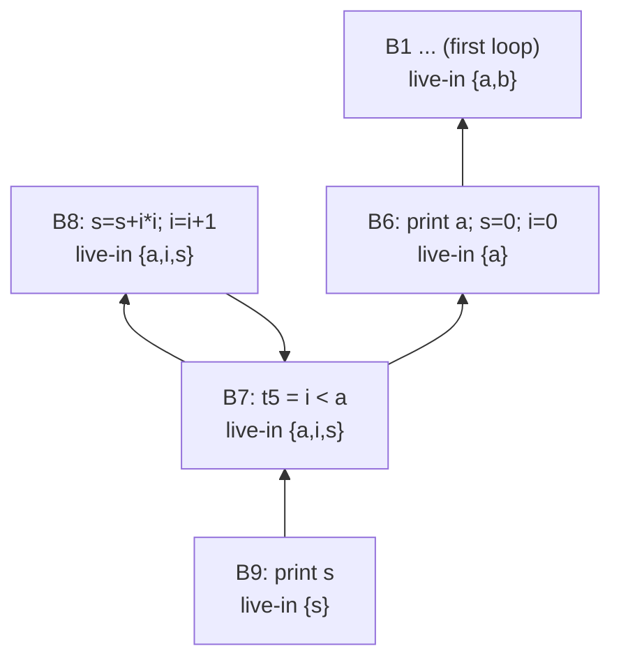

# 06 · Dataflow analysis: reaching definitions, liveness, and the monotone framework

> Level: intermediate · Time: ~3.5 h · Prereqs: lesson 03 (CFGs), lesson 01 (fixpoint iteration for FIRST/FOLLOW), sets

## 1. Why this exists

Every optimization needs a *fact* about the program that holds on **all paths**, or on **some path**, through the CFG:

* "Is `x` used again after this point?" → if not, the assignment is dead (dead-code elimination) and its register can be reused (register allocation). **Liveness.**
* "Which assignments to `a` can reach this use?" → if only `a = 5`, replace the use by `5` (constant propagation). **Reaching definitions.**
* "Has `a + b` already been computed on every path, with neither operand changed since?" → reuse it (common-subexpression elimination). **Available expressions.**
* "Can `x` be read before being written?" → GCC's `-Wmaybe-uninitialized`, Clang's `-Wsometimes-uninitialized`.

Loops make these questions circular: the fact at a loop header depends on the fact at the end of the loop body, which depends on the header. **Dataflow analysis** answers all of them with one algorithm: write local equations per block, then iterate to a fixpoint. Gary Kildall unified the approach in "A Unified Approach to Global Program Optimization" (POPL 1973); Kam and Ullman's "Monotone data flow analysis frameworks" (*Acta Informatica*, 1977) gave the general theory.

## 2. Intuition: rumours spreading through a town

Picture each basic block as a house and CFG edges as roads. A rumour ("`a` was set to 1071 in house B0") spreads along roads. Each house can **add** rumours (generate) or **debunk** them (kill: "`a` was reassigned here, forget the old rumour"). Where roads meet, the town decides how to combine stories: "a rumour arrives if it arrives on *any* road" (union — *may* analyses) or "only if on *every* road" (intersection — *must* analyses). Keep passing rumours around until no house learns anything new. Because each house's knowledge only ever grows (or only shrinks) and there are finitely many rumours, the process must stop.

## 3. Precise definitions

A dataflow analysis is defined by:

| Ingredient | Meaning |
|---|---|
| **Domain** *L* | the set of facts, organised as a **lattice** (e.g. subsets of definitions) |
| **Direction** | *forward* (facts flow along edges: entry → exit) or *backward* (exit → entry) |
| **Transfer function** f_B : L → L | how block B changes facts; often `out = gen ∪ (in − kill)` |
| **Meet** ⊓ | how facts combine at joins: ∪ for *may*, ∩ for *must* |
| **Boundary** | the value at the entry (forward) or exits (backward) |
| **Initial value** | ⊥-ish for may (∅), ⊤ for must (all facts) |

Equations, forward: `IN[B] = ⊓_{P ∈ preds(B)} OUT[P]`, `OUT[B] = f_B(IN[B])`. Backward: swap preds/succs and IN/OUT.

The three classics:

| Analysis | Direction | Meet | gen / kill | Used for |
|---|---|---|---|---|
| Reaching definitions | forward | ∪ (may) | defs in B / other defs of the same vars | constant propagation, use-def chains, uninitialised-use warnings |
| Live variables | backward | ∪ (may) | vars used before defined in B / vars defined in B | dead-code elimination, register allocation |
| Available expressions | forward | ∩ (must) | exprs computed in B / exprs whose operands B redefines | common-subexpression elimination |

**Lattice theory in one paragraph.** A *lattice* is a partial order where any two elements have a greatest lower bound (meet) and least upper bound (join). A transfer function is **monotone** if `x ⊑ y ⇒ f(x) ⊑ f(y)`. If all transfer functions are monotone and the lattice has **finite height**, iterating the equations from the initial values reaches a fixpoint in finitely many steps (each value can only move monotonically and only a finite number of times). The solution found is the **maximal fixed point (MFP)**. The ideal answer is the **meet-over-all-paths (MOP)** solution; MFP equals MOP when the transfer functions are **distributive** (`f(x ⊓ y) = f(x) ⊓ f(y)`) — true for all gen/kill problems — and is a safe approximation otherwise (e.g. constant propagation, which is monotone but not distributive).

## 4. Step by step

### 4.1 Dumbest approach: enumerate paths

"Does definition *d* reach point *p*?" — check every path from *d* to *p*. With loops there are infinitely many paths. Even without loops, paths grow exponentially with the number of branches. **Dead end.**

### 4.2 Summarise per block, iterate

Instead of paths, keep *one set per block boundary* and solve equations. Round-robin: sweep all blocks repeatedly until nothing changes. Correct, but wasteful — most blocks don't change in later sweeps.

### 4.3 Worklist

Only re-examine a block when one of its inputs changed: put all blocks on a worklist; pop one; recompute; if its OUT changed, push its successors (forward) or predecessors (backward). Visiting blocks in **reverse postorder** for forward problems (postorder for backward) makes most analyses converge in a couple of passes over acyclic regions.

### 4.4 Worked example: liveness on the GCD CFG

Backward, union. At B9, `s` is used (`print s`) → live-in(B9) = {s}. B8 uses `i`, `s` and redefines them → live-in(B8) = {s, i} ∪ whatever is live out and not defined… B7 uses `i`, `a`; and B7 is the loop header, so its live-out includes live-in(B8) — `a` is live all around the second loop because the test `i < a` uses it every iteration. Iterating to the fixpoint gives the table in §5. Read it as a register-allocation hint: in the second loop exactly three values are simultaneously live (`a`, `i`, `s`), so three registers suffice there; `b` is dead after the first loop.



(Arrows drawn bottom-to-top: liveness information flows *against* control flow.)

### 4.5 Why it terminates — and why "must" starts at ⊤

Reaching definitions starts every set at ∅ and only *adds* definitions (union never removes; transfer is monotone): each set can grow at most |all defs| times. Available expressions uses intersection, so it must start non-entry blocks at ⊤ = *all* expressions and only *remove*. Start it at ∅ instead and the loop header would intersect with ∅ from the back edge on the first visit, wrongly concluding that nothing is available — a sound but useless answer. Choosing the initial value is part of the analysis design.

## 5. Code

### 5.1 A generic solver plus three analyses (`dataflow.py`)

```python
# file: dataflow.py
# A generic iterative (worklist) dataflow solver and three classic analyses
# on the GCD CFG from lesson 03: reaching definitions, liveness, available expressions.
from collections import deque

# Block -> (instructions, successors). Instruction = (dest, op, arg1, arg2) or
# ("", "use", x) for statements that only read x (print, branch).
CFG = {
    "B0": ([("a", "const", "1071", ""), ("b", "const", "462", "")], ["B1"]),
    "B1": ([("t1", "!=", "a", "b"), ("", "use", "t1", "")],     ["B2", "B6"]),
    "B2": ([("t2", ">", "a", "b"), ("", "use", "t2", "")],      ["B3", "B4"]),
    "B3": ([("t3", "-", "a", "b"), ("a", "copy", "t3", "")],     ["B1"]),
    "B4": ([("t4", "-", "b", "a"), ("b", "copy", "t4", "")],     ["B1"]),
    "B6": ([("", "use", "a", ""), ("s", "const", "0", ""), ("i", "const", "0", "")], ["B7"]),
    "B7": ([("t5", "<", "i", "a"), ("", "use", "t5", "")],      ["B8", "B9"]),
    "B8": ([("t6", "*", "i", "i"), ("t7", "+", "s", "t6"), ("s", "copy", "t7", ""),
            ("t8", "+", "i", "1"), ("i", "copy", "t8", "")],     ["B7"]),
    "B9": ([("", "use", "s", "")],                               []),
}

def is_var(x):
    return x != "" and not x.lstrip("-").isdigit()     # a name, not a number

def uses(ins):
    dest, op, a1, a2 = ins
    if op == "const":
        return []
    return [x for x in (a1, a2) if is_var(x)]

def preds_of(cfg):
    p = {b: [] for b in cfg}
    for b, (_, succ) in cfg.items():
        for s in succ:
            p[s].append(b)
    return p

def solve(cfg, direction, meet, transfer, boundary, init):
    """Generic worklist solver.
    direction: 'forward' or 'backward'; meet: function(list of sets) -> set;
    transfer: function(block, in_set) -> out_set; boundary: value at entry (fwd) / exits (bwd);
    init: initial value for every other block."""
    preds = preds_of(cfg)
    succs = {b: cfg[b][1] for b in cfg}
    # for a backward analysis, just swap the roles of predecessors and successors
    before, after = (preds, succs) if direction == "forward" else (succs, preds)
    IN = {b: set(init) for b in cfg}       # IN = fact at the "start" in analysis direction
    OUT = {b: set(init) for b in cfg}
    work = deque(cfg)                      # deque = double-ended queue; start with every block
    iterations = 0
    while work:
        b = work.popleft()
        iterations += 1
        if before[b]:
            IN[b] = meet([OUT[p] for p in before[b]])
        else:
            IN[b] = set(boundary)          # entry block (forward) or exit block (backward)
        new_out = transfer(b, IN[b])
        if new_out != OUT[b]:              # changed: everything downstream must be revisited
            OUT[b] = new_out
            for s in after[b]:
                if s not in work:
                    work.append(s)
    return IN, OUT, iterations

union = lambda sets: set().union(*sets)                       # may-analysis meet
intersect = lambda sets: set.intersection(*map(set, sets))     # must-analysis meet

# ---------- 1. Reaching definitions (forward, may, union) ----------
# A definition is (block, index, var). gen = defs in the block that survive to its end;
# kill = all other defs of the same variables.
ALL_DEFS = [(b, i, ins[0]) for b in CFG for i, ins in enumerate(CFG[b][0]) if ins[0]]
def rd_transfer(b, in_set):
    out = set(in_set)
    for i, ins in enumerate(CFG[b][0]):
        if ins[0]:
            out = {d for d in out if d[2] != ins[0]}  # kill other defs of this variable
            out.add((b, i, ins[0]))                   # gen this def
    return out

# ---------- 2. Live variables (backward, may, union) ----------
def live_transfer(b, live_out):
    live = set(live_out)
    for ins in reversed(CFG[b][0]):                   # walk the block bottom-up
        if ins[0]:
            live.discard(ins[0])                      # a def kills liveness above it
        live |= set(uses(ins))                        # a use makes the variable live above it
    return live

# ---------- 3. Available expressions (forward, must, intersection) ----------
def expr_of(ins):
    dest, op, a1, a2 = ins
    return (op, a1, a2) if op in ("+", "-", "*", "<", ">", "!=") else None
ALL_EXPRS = {e for b in CFG for ins in CFG[b][0] if (e := expr_of(ins))}   # := assigns inside an expression
def avail_transfer(b, in_set):
    avail = set(in_set)
    for ins in CFG[b][0]:
        e = expr_of(ins)
        if e:
            avail.add(e)                              # computed here: available after
        if ins[0]:                                    # redefining x kills every expr using x
            avail = {x for x in avail if ins[0] not in (x[1], x[2])}
    return avail

if __name__ == "__main__":
    IN, OUT, n = solve(CFG, "forward", union, rd_transfer, set(), set())
    print(f"Reaching definitions ({n} block visits). Defs of 'a' reaching each block entry:")
    for b in CFG:
        print(f"  {b}: {sorted((d[0], d[1]) for d in IN[b] if d[2] == 'a')}")

    IN, OUT, n = solve(CFG, "backward", union, live_transfer, set(), set())
    # for a backward analysis, IN = facts at block END (live-out), OUT = at block START (live-in)
    print(f"Liveness ({n} block visits):")
    for b in CFG:
        print(f"  {b}: live-in {sorted(OUT[b])}  live-out {sorted(IN[b])}")

    IN, OUT, n = solve(CFG, "forward", intersect, avail_transfer, set(), ALL_EXPRS)
    print(f"Available expressions at block entry ({n} block visits):")
    for b in CFG:
        print(f"  {b}: {sorted(' '.join(e) for e in IN[b])}")
```

Python syntax notes:

* `from collections import deque` — import one name from a module; `deque` is a double-ended queue (`append`, `popleft` are O(1)).
* `before, after = (preds, succs) if direction == "forward" else (succs, preds)` — choose a pair and unpack it in one line.
* `union = lambda sets: set().union(*sets)` — `lambda` creates a small anonymous function; `*sets` *spreads* the list into separate arguments.
* `set.intersection(*map(set, sets))` — `map(set, sets)` converts each element to a set; the class method `set.intersection` intersects them all.
* `{d for d in out if d[2] != ins[0]}` — *set comprehension* (like a list comprehension, but builds a set).
* `if (e := expr_of(ins))` — the *walrus operator* `:=` assigns and tests in one expression (Python ≥ 3.8).
* `x.lstrip("-").isdigit()` — strip a leading minus sign, then check that all characters are digits.

Logic notes:

* `solve` is direction-agnostic: for backward problems it swaps predecessor/successor maps, so `IN` means "at the block's end" and `OUT` "at the block's start" — confusing names, but one solver for all analyses (real frameworks, e.g. LLVM's and GCC's, are also generic).
* Each transfer function walks instructions in the analysis direction: reaching definitions top-down (kill then gen per instruction), liveness bottom-up (def kills, then uses gen — the order handles `i = i + 1` correctly: `i` is live *before* it).
* Available expressions: initialised to `ALL_EXPRS` (⊤), meet = intersection.

```text
$ python3 dataflow.py
Reaching definitions (22 block visits). Defs of 'a' reaching each block entry:
  B0: []
  B1: [('B0', 0), ('B3', 1)]
  B2: [('B0', 0), ('B3', 1)]
  B3: [('B0', 0), ('B3', 1)]
  B4: [('B0', 0), ('B3', 1)]
  B6: [('B0', 0), ('B3', 1)]
  B7: [('B0', 0), ('B3', 1)]
  B8: [('B0', 0), ('B3', 1)]
  B9: [('B0', 0), ('B3', 1)]
Liveness (16 block visits):
  B0: live-in []  live-out ['a', 'b']
  B1: live-in ['a', 'b']  live-out ['a', 'b']
  B2: live-in ['a', 'b']  live-out ['a', 'b']
  B3: live-in ['a', 'b']  live-out ['a', 'b']
  B4: live-in ['a', 'b']  live-out ['a', 'b']
  B6: live-in ['a']  live-out ['a', 'i', 's']
  B7: live-in ['a', 'i', 's']  live-out ['a', 'i', 's']
  B8: live-in ['a', 'i', 's']  live-out ['a', 'i', 's']
  B9: live-in ['s']  live-out []
Available expressions at block entry (11 block visits):
  B0: []
  B1: []
  B2: ['!= a b']
  B3: ['!= a b', '> a b']
  B4: ['!= a b', '> a b']
  B6: ['!= a b']
  B7: ['!= a b']
  B8: ['!= a b', '< i a']
  B9: ['!= a b', '< i a']
```

Interpretation:

* Two definitions of `a` (`B0` index 0 = `a = 1071`, `B3` index 1 = `a = t3`) reach the loop and everything after it, so constant propagation **cannot** replace `a` by 1071 anywhere after B0 — correct, `a` changes in the loop.
* Live-in of B0 is empty: the program reads no variable before writing it. If it were non-empty, those variables would be **possibly uninitialised** — that is literally how the warning works.
* `a != b` is available everywhere after B1 (nothing after the first loop redefines `a` or `b`), so a later recomputation of `a != b` could reuse `t1`.

### 5.2 The same analysis inside real compilers

```c
// file: uninit.c
// Dataflow analysis you already use: "maybe uninitialized" warnings.
int pick(int flag, int v) {
    int x;                 // no initial value
    if (flag > 0)
        x = v * 2;         // x is defined on this path only
    return x;              // on the path where flag <= 0, no definition of x reaches here
}
```

```text
$ gcc -O2 -Wall -c uninit.c
uninit.c:7:12: warning: 'x' may be used uninitialized [-Wmaybe-uninitialized]
$ clang -Wall -c uninit.c
uninit.c:5:9: warning: variable 'x' is used uninitialized whenever 'if' condition is false [-Wsometimes-uninitialized]
uninit.c:4:10: note: initialize the variable 'x' to silence this warning
```

Both are "a use reached by the *absence* of a definition along some path" — reaching definitions where the function entry acts as an "undefined" definition. GCC's warning depends on optimization level: with GCC 13.3, `gcc -O0 -Wall -c uninit.c` prints **no** warning at all for this file, because `-Wmaybe-uninitialized` relies on dataflow information computed by optimization passes on GIMPLE SSA. Clang's warning runs on a CFG built from the AST during semantic analysis, so it fires at every `-O` level.

## 6. Common mistakes

* **Wrong direction.** Liveness is backward: a variable is live *before* a use. Writing it forward gives nonsense.
* **Wrong order inside a block.** For liveness, process instructions bottom-up and apply *kill before gen* per instruction so `i = i + 1` keeps `i` live above it.
* **Initialising a must-analysis to ∅.** The back edge then poisons everything to ∅. Start at ⊤ (all facts) except at the boundary.
* **Forgetting the boundary condition** (e.g. nothing is available at function entry; nothing is live at exit unless it's a return value or global).
* **Non-monotone transfer functions** → the iteration may oscillate forever. Monotonicity plus finite height is the termination proof.
* **Equating MFP with "the truth".** MFP is a *conservative* approximation; infeasible paths (e.g. `if (p) … if (!p) …`) are still counted, causing false "maybe uninitialised" warnings.

## 7. Connections

* **Math for CS track**: partial orders, lattices, monotone functions, Kleene/Tarski fixpoint theorems.
* **DSA track**: worklist algorithms, BFS-like propagation, bit vectors (real compilers store gen/kill as bitsets: union = OR, intersection = AND).
* **Security track**: taint analysis is a forward may-analysis ("can untrusted input reach this `system()` call?").
* **Testing/Verification track**: abstract interpretation (Cousot & Cousot, 1977) generalises dataflow analysis; static analyzers such as Frama-C and Clang's Static Analyzer build on these ideas.
* **Lesson 01**: FIRST/FOLLOW were a fixpoint over a finite set lattice — the same pattern.

### Where this shows up in my projects

**compiler-fuzz**'s generator must avoid reading uninitialised variables (undefined behaviour in C). The guarantee is achieved by construction — every variable is initialised at its declaration — which is exactly what makes the "reaching definitions from entry" set empty for every use. The C-Reduce paper (04-pro/04) shows why this matters: without UB checking, 29% of reduced wrong-code test cases executed undefined behaviour.

## 8. Self-check

1. Give direction, meet and gen/kill for live variables.
2. Why must available expressions be initialised to "all expressions" rather than ∅?
3. What two properties guarantee the iterative algorithm terminates?
4. What is the difference between the MOP and MFP solutions, and when are they equal?
5. How is "maybe uninitialised" a reaching-definitions question?

<details><summary>Answers</summary>

1. Backward; union; gen = variables used in the block before any definition in the block, kill = variables defined in the block.
2. It is a must-analysis using intersection; starting at ∅ makes every loop header's intersection ∅ via the back edge, and since values only shrink, nothing could ever become available — correct but useless.
3. Monotone transfer functions and a lattice of finite height (so each value can change only finitely often).
4. MOP meets the effect of every path individually; MFP solves the equations, meeting at every join. They are equal when transfer functions are distributive (all gen/kill problems); otherwise MFP is a safe approximation of MOP.
5. Treat function entry as defining every local with "undefined"; if that pseudo-definition reaches a use along some path, the variable may be used uninitialised.

</details>

## 9. Mnemonic (Tamil + English)

**"Live-u pinnadi, Reach-u munnadi"** — *liveness looks back(ward), reaching looks forward*. And for meets: **"Maybe-ku Union, Must-ku Intersection"** — "maybe" is generous like a wedding (everyone invited: union); "must" is strict like an exam hall (only those on *every* list: intersection).

## Sources

* G. A. Kildall, "A Unified Approach to Global Program Optimization", POPL 1973: https://courses.cs.washington.edu/courses/cse501/15sp/papers/kildall.pdf
* J. B. Kam, J. D. Ullman, "Monotone data flow analysis frameworks", *Acta Informatica* 7, 1977 (DOI 10.1007/BF00290339): https://unpaywall.org/10.1007%2FBF00290339
* Aho, Lam, Sethi, Ullman, *Compilers: Principles, Techniques, and Tools*, 2nd ed., §9.2–9.3 (dataflow analysis, foundations, MOP vs MFP): https://www.pearson.com/store/en-us/p/compilers-principles-techniques-and-tools/P200000003472
* Cooper & Torczon, *Engineering a Compiler*, 3rd ed., ch. 9 "Data-Flow Analysis": https://shop.elsevier.com/books/engineering-a-compiler/cooper/978-0-12-815412-0
* Cornell CS 6120, lessons "Data Flow" and "Global Analysis": https://www.cs.cornell.edu/courses/cs6120/2023fa/self-guided/
* GCC warning options (`-Wmaybe-uninitialized`): https://gcc.gnu.org/onlinedocs/gcc/Warning-Options.html
* Clang diagnostics reference (`-Wsometimes-uninitialized`): https://clang.llvm.org/docs/DiagnosticsReference.html
* J. Regehr et al., "Test-Case Reduction for C Compiler Bugs", PLDI 2012 (29% of reduced wrong-code cases executed UB without checking): https://www-old.cs.utah.edu/~regehr/papers/pldi12-preprint.pdf

## Verify yourself

```bash
# file: verify-06i.sh
# Tested with Python 3.13, GCC 13.3, Clang 18.1.3, Nov 2026.
python3 dataflow.py                                   # the three tables above
gcc -O2 -Wall -c uninit.c                             # -Wmaybe-uninitialized
gcc -O0 -Wall -c uninit.c; echo "gcc -O0 exit=$?"     # GCC 13.3: no warning at -O0
clang -Wall -c uninit.c                               # -Wsometimes-uninitialized
```

Check against sources: the equations and the MOP/MFP distributivity condition against the Dragon Book §9.3; the worklist formulation against Kildall (1973).
