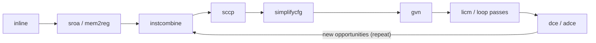

# 07 · Classic optimizations and how optimizers are organised

> Level: intermediate · Time: ~3.5 h · Prereqs: lessons 04 (SSA), 05 (LLVM IR, `opt`), 06 (dataflow)

## 1. Why this exists

Lesson 01-beginner/05's compiler needed 14 instructions to compute 7; GCC needed one. The difference is a **pipeline of optimization passes**, each a small, semantics-preserving rewrite. Knowing the classic ones lets you (a) read optimized code and understand why it looks nothing like the source, (b) write code that optimizes well, and (c) — central to this track — understand where **miscompilations** come from: every pass is a place where a subtle bug can change a program's meaning. Csmith's authors found that most GCC bugs they hit were in the middle end — "Most of the bugs we found in GCC were in the middle end" — i.e. in exactly these passes.

## 2. Intuition: editing an essay without changing its argument

A good editor (1) replaces "two plus two" with "four" (constant folding), (2) notices the same sentence said twice and keeps one (common-subexpression elimination), (3) deletes sentences nobody refers to (dead-code elimination), (4) moves a fact repeated in every paragraph of a list to before the list (loop-invariant code motion), (5) pastes a short footnote directly into the text (inlining). Each edit is individually simple. The art is in **ordering** them (deleting a sentence may make another sentence unreferenced) and in being **certain** the meaning didn't change.

## 3. Precise definitions

A transformation T is **correct (semantics-preserving)** if, for every input on which the original program has defined behaviour, the transformed program has the same observable behaviour. (When the source has undefined behaviour, T may do anything — 03-advanced/04. Formally, the target must **refine** the source; Alive2's phrase is that "a target function displays a subset of the behaviors of a source function".)

Scope:

* **Local**: within one basic block (no control flow to reason about).
* **Global / intraprocedural**: across a whole function's CFG (needs dataflow or SSA).
* **Interprocedural (IPO)**: across functions (inlining, interprocedural constant propagation, dead-argument elimination).

The classic catalogue (LLVM pass names from `opt --print-passes`; descriptions quoted from LLVM's pass documentation where shown):

| Optimization | What it does | LLVM pass(es) |
|---|---|---|
| Constant folding | evaluate operations on constants at compile time | `instcombine`, `instsimplify`, also the front end |
| Constant propagation | replace uses of a variable known to be constant | `sccp` — "Sparse conditional constant propagation" (Wegman & Zadeck, TOPLAS 13(2), 1991), `ipsccp` |
| Copy propagation | after `x = y`, use `y` for `x` | implicit in SSA + `instcombine` |
| Dead-code elimination | remove computations whose results are unused or unreachable | `dce`, `adce` ("aggressively tries to eliminate code"), `simplifycfg` |
| CSE / value numbering | reuse an already-computed identical value | `early-cse`, `gvn` ("global value numbering to eliminate fully and partially redundant instructions") |
| Loop-invariant code motion | hoist computations that don't change in a loop to the preheader | `licm` |
| Strength reduction | replace expensive ops with cheaper ones (`x*8` → `x<<3`), rewrite induction variables | `instcombine`, `loop-reduce`, `indvars` |
| Inlining | replace a call with the callee's body | `inline` — "Bottom-up inlining of functions into callees" |
| Scalar replacement of aggregates | split structs/arrays in memory into SSA scalars | `sroa`, `mem2reg` |
| Loop unrolling / rotation | duplicate loop bodies; move the test to the bottom | `loop-unroll`, `loop-rotate` |
| Tail-call elimination | turn self-recursion followed by return into a loop | `tailcallelim` |
| Peephole / algebraic simplification | `x - x → 0`, `x * 1 → x`, many thousands of patterns | `instcombine` — "Combine instructions to form fewer, simpler instructions" |

## 4. Step by step

### 4.1 Local value numbering: the dumbest effective optimizer

Walk a basic block once. Give every *value* a number; two expressions with the same operator and the same operand numbers get the **same** number, so the second is redundant. Fold when operands are known constants; apply algebraic identities; canonicalise commutative operands (`p+q` and `q+p` share a key). Afterwards, run a backward dead-code sweep. This is the classic algorithm from Cooper & Torczon (EaC ch. 8) and it's what `lvn.py` below implements.

**What's annoying:** it only sees one block. `a+b` computed before an `if` and again after it is invisible to LVN. **Wall → global methods:** dataflow-based CSE (available expressions, lesson 06), or — in SSA — **global value numbering**, where a definition dominating a use makes the redundancy obvious.

### 4.2 Constant propagation meets control flow (SCCP)

Plain constant propagation says: "`k` is defined once as 4, so every use of `k` is 4". In `prop` below, that turns `if (k > 3)` into `if (4 > 3)`. **SCCP** (sparse conditional constant propagation) goes further: it treats branch conditions as constants too and **doesn't propagate along edges it has proven never execute**, so the `else` path's definitions can't spoil the lattice values at the join. Its lattice per value is three-level: ⊤ (undetermined yet) → constant *c* → ⊥ (overdefined). `simplifycfg` then deletes the dead block.

### 4.3 Loops: where the time goes

Programs spend most time in loops, so loop optimizations pay most. LICM needs: (1) a loop (natural loops from dominators, lesson 04); (2) a **preheader** — a single block that runs just before the loop — to hoist into; (3) proof that the expression is invariant (operands defined outside the loop) and **safe to execute speculatively** (hoisting a division by a variable that might be zero, or a load from a pointer that might be null, would introduce a trap the original loop — which might run zero times — never had). This is why LLVM first runs `loop-rotate` (making a guard + preheader) and why `licm` needs alias analysis (MemorySSA) to know a load isn't changed by stores in the loop.

### 4.4 Inlining: the enabler

Inlining itself saves only call overhead, but it **enables** everything else: after inlining `sq(y)`, `y*y` is visible to CSE, constant propagation and LICM in the caller. The cost is code size, so inliners use a **cost model** with a threshold (Clang's remark below shows `cost=-15030, threshold=337`: very negative cost = very profitable, because `sq` is `static`, has a single caller, and can be deleted afterwards).

### 4.5 Phase ordering

Each pass creates opportunities for others: inlining → constant propagation → dead branches → simplifycfg → more inlining. There is no single best order (the **phase-ordering problem**; it is undecidable in general and an active ML-for-compilers research topic). Production pipelines repeat cheap cleanups (`instcombine`, `simplifycfg`) many times. LLVM 18's `default<O2>` pipeline, printed by `opt -passes='default<O2>' -print-pipeline-passes`, has about a hundred entries.



LLVM organises passes with the **new pass manager**: passes are grouped by IR unit — module, CGSCC (call-graph strongly connected component), function, loop — and a textual pipeline must nest accordingly, e.g. `opt -passes='cgscc(inline),globaldce'`. Analyses (dominator tree, loop info, alias analysis) "are computed on demand by an analysis manager and cached"; each transform declares which analyses it preserved and the rest are invalidated.

## 5. Code

### 5.1 Local value numbering + DCE (`lvn.py`)

```python
# file: lvn.py
# Local value numbering (LVN) on one basic block, with constant folding,
# copy propagation, algebraic identities, and a final dead-code sweep.
# Instruction format: (dest, op, arg1, arg2); op "copy" means dest = arg1.

BLOCK = [
    ("x", "const", "4", ""),
    ("y", "+", "x", "3"),        # 4 + 3 -> constant 7
    ("a", "+", "p", "q"),
    ("b", "+", "q", "p"),        # same as a (+ is commutative)
    ("c", "*", "a", "1"),        # identity: a * 1 = a
    ("d", "copy", "b", ""),      # copy of b -> same value as a
    ("e", "-", "d", "a"),        # a - a = 0
    ("f", "*", "y", "e"),        # 7 * 0 = 0
    ("g", "+", "c", "y"),        # a + 7  (the only real new work)
    ("ret", "use", "g", ""),     # g is the block's only live-out value
]
COMMUTATIVE = {"+", "*"}

def lvn(block):
    vn_of = {}          # variable/constant name -> value number
    table = {}          # expression key -> value number
    const_of = {}       # value number -> known constant (if any)
    home = {}           # value number -> a variable that currently holds it
    counter = [0]       # a list so the nested function can modify it
    out = []

    def number(x):      # value number of an operand (constants get their own numbers)
        if x not in vn_of:
            counter[0] += 1
            vn_of[x] = counter[0]
            if x.lstrip("-").isdigit():
                const_of[counter[0]] = int(x)
            home[counter[0]] = x
        return vn_of[x]

    def name(v):        # best operand to use for value number v
        return str(const_of[v]) if v in const_of else home[v]

    for dest, op, a1, a2 in block:
        if op == "use":
            out.append((dest, op, name(number(a1)), ""))
            continue
        if op in ("const", "copy"):
            v = number(a1)                           # dest simply gets a1's value number
        else:
            v1, v2 = number(a1), number(a2)
            c1, c2 = const_of.get(v1), const_of.get(v2)
            folded = None
            if c1 is not None and c2 is not None:    # constant folding
                folded = {"+": c1 + c2, "-": c1 - c2, "*": c1 * c2}[op]
            elif op == "*" and (c1 == 0 or c2 == 0):
                folded = 0                           # x * 0 = 0
            elif op == "-" and v1 == v2:
                folded = 0                           # x - x = 0
            if folded is not None:
                v = number(str(folded))
            elif op == "*" and c2 == 1:
                v = v1                               # x * 1 = x
            elif op == "*" and c1 == 1:
                v = v2
            elif op == "+" and c2 == 0:
                v = v1
            else:
                if op in COMMUTATIVE and v2 < v1:
                    v1, v2 = v2, v1                  # canonical order: p+q == q+p
                key = (op, v1, v2)
                if key in table:                     # seen before: redundant!
                    v = table[key]
                else:
                    counter[0] += 1
                    v = table[key] = counter[0]
                    out.append((dest, op, name(v1), name(v2)))
                    home[v] = dest
                    vn_of[dest] = v
                    continue
        vn_of[dest] = v                              # dest now names an existing value
        if v not in home or home[v] == dest:
            home[v] = dest
        out.append((dest, "copy", name(v), ""))      # cheap copy; DCE will remove if unused
    return out

def dce(block):
    """Backward sweep: keep an instruction only if its dest is used later (or it's a 'use')."""
    live, kept = set(), []
    for dest, op, a1, a2 in reversed(block):
        if op == "use" or dest in live:
            kept.append((dest, op, a1, a2))
            live.discard(dest)
            live |= {a for a in (a1, a2) if a and not a.lstrip("-").isdigit()}
    return kept[::-1]

def show(title, block):
    print(title)
    for d, op, a1, a2 in block:
        rhs = a1 if op in ("copy", "const") else f"{op} {a1}" if op == "use" else f"{a1} {op} {a2}"
        print(f"    {d} = {rhs}" if op != "use" else f"    return {a1}")

if __name__ == "__main__":
    show("before:", BLOCK)
    after = lvn(BLOCK)
    show("after LVN:", after)
    show("after LVN + DCE:", dce(after))
```

Python syntax notes:

* `counter = [0]` then `counter[0] += 1` inside a nested function — a list is used as a mutable box because assigning to a plain outer variable inside a nested function would create a new local (an alternative is the `nonlocal` keyword).
* `{"+": c1 + c2, "-": c1 - c2, "*": c1 * c2}[op]` — build a small dict and index it immediately: a compact `switch`.
* `v = table[key] = counter[0]` — chained assignment: both `v` and `table[key]` get the value.
* `const_of.get(v1)` returns `None` when `v1` isn't a known constant; `is not None` tests that.
* `live |= {a for a in (a1, a2) if a and ...}` — union the set with a set comprehension.
* `kept[::-1]` — reverse the list (we built it backwards).

Logic: one forward pass assigns value numbers; any instruction whose value number already has a "home" variable becomes a cheap copy; then `dce` sweeps backward keeping only instructions whose destination is live.

```text
$ python3 lvn.py
before:
    x = 4
    y = x + 3
    a = p + q
    b = q + p
    c = a * 1
    d = b
    e = d - a
    f = y * e
    g = c + y
    return g
after LVN:
    x = 4
    y = 7
    a = p + q
    b = a
    c = a
    d = a
    e = 0
    f = 0
    g = 7 + a
    return g
after LVN + DCE:
    a = p + q
    g = 7 + a
    return g
```

Ten instructions became three. Folding (`4+3`), commutativity (`q+p` ≡ `p+q`), identities (`a*1`, `d-a` with `d≡a`, `y*0`) and copy propagation all fell out of one idea — *name values, not variables*.

### 5.2 Each classic pass, one at a time, in LLVM

```c
// file: opts.c
// One function per classic optimization. Compile to IR, then apply single passes.
int fold(void) { return (6 * 7) + 0; }                  // constant folding

int prop(int n) {                                        // constant + conditional propagation
    int k = 4;
    if (k > 3) return n + k;                             // condition is always true
    return n - k;                                        // unreachable
}

int cse(int a, int b) { return (a + b) * (a + b); }     // common subexpression a+b

int dead(int a) { int unused = a * 100; return a + 1; } // dead code

int licm(int *p, int n, int a, int b) {                  // loop-invariant code motion
    int s = 0;
    for (int i = 0; i < n; i++) s += p[i] * (a * b);     // a*b does not change in the loop
    return s;
}

static int sq(int x) { return x * x; }                   // small static function
int inl(int y) { return sq(y) + 1; }                     // inlining candidate

unsigned strength(unsigned x) { return x * 8 + x / 4; } // strength reduction: shifts
```

Get unoptimized-but-optimizable IR: `-O1 -Xclang -disable-llvm-passes` emits IR *without* running LLVM passes and without the `optnone`/`noinline` attributes that `-O0` adds (with `-O0`, Clang marks every function `noinline`, so the inliner refuses to touch them — I hit exactly that while preparing this lesson). Then promote to SSA:

```text
$ clang -O1 -Xclang -disable-llvm-passes -fno-discard-value-names -S -emit-llvm opts.c -o opts.ll
$ opt -S -passes=mem2reg opts.ll -o base.ll
```

**Constant folding — already done by the front end.** Even in `base.ll`, `fold` is `ret i32 42`: Clang evaluates `(6*7)+0` while building the AST/IR. Folding happens in many layers.

**SCCP + simplifycfg** (`opt -S -passes='sccp,simplifycfg' base.ll`):

```llvm
; before                                   ; after
%cmp = icmp sgt i32 4, 3                   define dso_local i32 @prop(i32 noundef %n) #0 {
br i1 %cmp, label %if.then, label %if.end  entry:
...                                          %add = add nsw i32 %n, 4
%retval.0 = phi i32 [ %add, %if.then ],      ret i32 %add
                    [ %sub, %if.end ]      }
```

**CSE** (`-passes=early-cse`): `%add1 = add nsw i32 %a, %b` disappears; `%mul = mul nsw i32 %add, %add`.

**DCE** (`-passes=dce`): `%mul = mul nsw i32 %a, 100` (the `unused` variable) disappears.

**LICM** (`-passes='loop(loop-rotate),loop-mssa(licm)'` — `licm` must run inside `loop-mssa(...)` because it needs MemorySSA; plain `-passes=licm` aborts with "LICM requires MemorySSA (loop-mssa)"): `%mul = mul nsw i32 %a, %b` moves from `for.body` into the new preheader `for.body.lr.ph`.

**Inlining** (`-passes='cgscc(inline),globaldce'`):

```llvm
define dso_local i32 @inl(i32 noundef %y) #0 {
entry:
  %mul.i = mul nsw i32 %y, %y      ; sq's body, renamed with ".i"
  %add = add nsw i32 %mul.i, 1
  ret i32 %add
}
```

and `globaldce` then deletes `@sq` entirely (no remaining callers, `static` linkage).

**Strength reduction** (`-passes=instcombine`): `mul i32 %x, 8` → `shl i32 %x, 3`; `udiv i32 %x, 4` → `lshr i32 %x, 2`. Valid because `x` is **unsigned**; for signed division by 4, a plain arithmetic shift rounds toward −∞ while C division truncates toward zero, so the compiler must add a correction for negative values.

**Ask the compiler what it did** — optimization remarks:

```text
$ clang -O2 -Rpass='.*' -c opts.c -o /dev/null
opts.c:17:48: remark: hoisting mul [-Rpass=licm]
opts.c:22:25: remark: 'sq' inlined into 'inl' with (cost=-15030, threshold=337) at callsite inl:0:25; [-Rpass=inline]
opts.c:17:5: remark: vectorized loop (vectorization width: 4, interleaved count: 2) [-Rpass=loop-vectorize]
```

GCC's equivalent is `-fopt-info` ("Controls optimization dumps from various optimization passes").

## 6. Common mistakes

* **Hoisting something that can trap.** LICM must not hoist `x / y` or `*p` out of a loop that might run zero times unless it proves safety. Speculation bugs are a classic miscompilation class.
* **Strength-reducing signed division as a shift.** `-7 / 2 == -3` in C, but `-7 >> 1 == -4`.
* **Assuming CSE is valid across calls/stores.** `*p + *p` around a store through an aliasing pointer is *not* a common subexpression. Alias analysis decides.
* **Trusting `-O0` IR for pass experiments.** `optnone` + `noinline` silently block passes; use `-O1 -Xclang -disable-llvm-passes`.
* **"The optimizer broke my program."** Usually the program had undefined behaviour (03-advanced/04). Check with `-fsanitize=undefined` *before* filing a compiler bug.
* **Thinking optimizations are independent.** Order matters; a pass may undo or enable another.

## 7. Connections

* **Computer Architecture track**: why shifts beat multiplies, why loop bodies should be small and branch-free, vectorization width vs SIMD registers.
* **C track**: `static` functions enable deletion after inlining; `restrict` gives alias information to CSE/LICM.
* **Parallel/CUDA track**: the loop vectorizer's remark above is the CPU cousin of GPU SIMT; GPU compilers add convergence constraints (04-pro/05).
* **Testing/Verification track**: each pass is a refinement claim — Alive2 (04-pro/06) checks LLVM passes formally.
* **ML/LLM agents track**: learned cost models for inlining (LLVM's MLGO) and phase ordering are active ML-for-systems research.

### Where this shows up in my projects

**compiler-fuzz** tests GCC 15.2 vs Clang 21.1 at `-O0/-O2/-O3`: the `-O0` vs `-O2` comparison *within one compiler* (cross-optimization differential testing — the survey by Chen et al. calls it "the most widely used strategy in the existing compiler-testing research") is precisely a test of this lesson's passes. When `-O2` disagrees with `-O0` on a UB-free program, one of the passes listed in §3 is the prime suspect, and `opt-bisect-limit` (03-advanced/06) finds which.

## 8. Self-check

1. Why does inlining matter more for what it enables than for what it saves?
2. What extra power does SCCP have over plain constant propagation?
3. Name two conditions LICM must check before hoisting an instruction.
4. Why can `x * 8` become `x << 3` for both signed and unsigned `x`, but `x / 4` → `x >> 2` only for unsigned?
5. Why did `opt -passes=inline` refuse to inline `sq` in IR produced by `clang -O0`?

<details><summary>Answers</summary>

1. Call overhead is small; but after inlining, the callee's body is visible in the caller's context, so constant propagation, CSE, LICM and DCE can specialise it.
2. It reasons about which CFG edges are executable: a branch on a constant condition makes the other edge dead, so definitions along it don't pollute the values at the join.
3. The instruction's operands are loop-invariant (defined outside the loop), and executing it unconditionally in the preheader is safe (cannot trap or observe a different memory state; or the loop is guaranteed to execute and dominance holds).
4. Left shift equals multiplication by 8 modulo 2ⁿ for both (and signed overflow is UB anyway); signed division truncates toward zero but arithmetic right shift rounds toward −∞, so negative values differ without a correction.
5. Clang `-O0` attaches `noinline` (and `optnone`) to every function.

</details>

## 9. Mnemonic (Tamil + English)

**"Madichu, Parappi, Ozhichu, Thooki, Ottu"** — *Fold, Spread, Eliminate, Lift, Paste*: constant **fold**ing, constant **propagation** (spreading), **dead-code elimination**, **LICM** (lifting out of loops), **inlining** (pasting the callee in). Picture folding a saree, spreading it, throwing away the tag, lifting it onto the shelf, and pasting the price sticker.

## Sources

* LLVM, "LLVM's Analysis and Transform Passes": https://llvm.org/docs/Passes.html
* LLVM, "Using the New Pass Manager": https://llvm.org/docs/NewPassManager.html
* M. N. Wegman, F. K. Zadeck, "Constant Propagation with Conditional Branches", *ACM TOPLAS* 13(2):181–210, 1991: https://people.cs.umass.edu/~emery/classes/cmpsci710-spring2003/p181-wegman.pdf
* X. Yang, Y. Chen, E. Eide, J. Regehr, "Finding and Understanding Bugs in C Compilers", PLDI 2011 (middle-end bug distribution): https://www-old.cs.utah.edu/~regehr/papers/pldi11-preprint.pdf
* J. Chen et al., "A Survey of Compiler Testing", *ACM Computing Surveys* 53(1), 2020: https://tjusail.github.io/people/chenjunjie/files/CSUR20.pdf
* N. P. Lopes et al., "Alive2: Bounded Translation Validation for LLVM", PLDI 2021 (refinement): https://www-old.cs.utah.edu/~regehr/alive2-pldi21.pdf
* Clang User's Manual, optimization remarks (`-Rpass`): https://clang.llvm.org/docs/UsersManual.html
* GCC Developer Options (`-fopt-info`): https://gcc.gnu.org/onlinedocs/gcc/Developer-Options.html
* Cooper & Torczon, *Engineering a Compiler*, 3rd ed., ch. 8 "Introduction to Optimization" (local value numbering) and ch. 10 "Scalar Optimization": https://shop.elsevier.com/books/engineering-a-compiler/cooper/978-0-12-815412-0
* Aho, Lam, Sethi, Ullman, *Compilers: Principles, Techniques, and Tools*, 2nd ed., ch. 9 "Machine-Independent Optimizations": https://www.pearson.com/store/en-us/p/compilers-principles-techniques-and-tools/P200000003472

## Verify yourself

```bash
# file: verify-07i.sh
# Tested with Clang/LLVM 18.1.3 and Python 3.13, Ubuntu 24.04, Nov 2026.
python3 lvn.py                                                     # 10 instructions -> 3
clang -O1 -Xclang -disable-llvm-passes -fno-discard-value-names -S -emit-llvm opts.c -o opts.ll
opt -S -passes=mem2reg opts.ll -o base.ll
show() { sed -n "/define.*@$1(/,/^}/p"; }                          # print one function
opt -S -passes='sccp,simplifycfg' base.ll | show prop
opt -S -passes=early-cse base.ll | show cse
opt -S -passes=dce base.ll | show dead
opt -S -passes='loop(loop-rotate),loop-mssa(licm)' base.ll | show licm | grep -B1 "mul nsw i32 %a, %b"
opt -S -passes='cgscc(inline),globaldce' base.ll | grep -c "@sq"   # 0: inlined and deleted
opt -S -passes=instcombine base.ll | show strength                 # shl / lshr
opt -passes='default<O2>' -print-pipeline-passes -disable-output base.ll | tr ',' '\n' | wc -l
clang -O2 -Rpass='.*' -c opts.c -o /dev/null 2>&1 | grep remark
```

Check against sources: pass descriptions against LLVM's Passes page; the SCCP lattice against Wegman & Zadeck §3; pipeline nesting rules against the New Pass Manager page.
