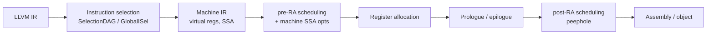

# 01 · Instruction selection, scheduling and the code-generation pipeline

> Level: advanced · Time: ~3 h · Prereqs: 02-intermediate/05 (LLVM IR), 01-beginner/05 (stack-machine codegen); basic x86-64 assembly

## 1. Why this exists

After the middle end has optimized the IR, someone has to turn `getelementptr`, `load`, `mul`, `add` into *real* instructions of a *real* CPU. That is not a one-to-one mapping. x86-64 can do "load from `base + index*8 + 32` and add it to a register" in **one** instruction; RISC-V needs four; NVIDIA PTX has yet another shape. Choosing instructions well (**instruction selection**), ordering them to keep the pipeline busy (**scheduling**), and fitting values into a handful of registers (**register allocation**, next lesson) is the back end's job. Back-end bugs are also a major bug class: in the Csmith study, LLVM's back end had about as many wrong-code/crash bugs as its middle end (74 vs 75).

## 2. Intuition: tiling a floor

The expression tree is a floor shape; the target's instructions are tiles of different shapes and prices (a big L-shaped tile = "load with scaled index and displacement"; a tiny square = "add two registers"). **Instruction selection = covering the floor with tiles, no overlaps, cheapest total price.** Greedy "always use the biggest tile that fits here" (maximal munch) usually does well; dynamic programming finds the truly cheapest tiling.

## 3. Precise definitions

* **Instruction selection (isel)**: mapping IR operations to target instructions. Modelled as **tree (or DAG) pattern matching/covering**: each target instruction is a *tile* — a small tree pattern with a cost; a *tiling* covers every IR node exactly once.
* **Maximal munch**: top-down; at each node pick the largest tile matching there; recurse on the subtrees hanging off the tile's leaves. Produces a *locally optimal* (no two adjacent tiles can merge into a cheaper one) but not necessarily globally optimal tiling.
* **Optimal tree tiling by dynamic programming**: bottom-up, compute the cheapest cost for every node and every tile — Aho, Ganapathi & Tjiang, "Code generation using tree matching and dynamic programming" (TOPLAS 1989, the `twig` tool); generalised as BURS (bottom-up rewrite systems). On DAGs (shared subexpressions) optimal tiling is NP-complete, so production compilers use heuristics.
* **Legalization**: rewriting operations or types the target doesn't support (e.g. `i128` multiply on a 64-bit machine, or `i1` values) into supported ones.
* **Instruction scheduling**: reordering independent instructions to hide latencies and exploit pipelines; **list scheduling** greedily picks the highest-priority *ready* instruction each cycle. Pre-RA scheduling increases parallelism (and register pressure); post-RA scheduling must respect physical registers.
* **Calling convention / ABI**: where arguments and return values live, which registers a callee must preserve (callee-saved) vs may clobber (caller-saved), stack alignment. On x86-64 Linux (System V AMD64 ABI) integer arguments go in `rdi, rsi, rdx, rcx, r8, r9`, the result in `rax`.
* **Prologue/epilogue**: code inserted at function entry/exit to set up the stack frame and save/restore callee-saved registers — done *after* register allocation, because only then is the frame size known.

LLVM's code generator, in the order its documentation lists the phases: **Instruction Selection** ("determines an efficient way to express the input LLVM code in the target instruction set"), **Scheduling and Formation**, **SSA-based Machine Code Optimizations**, **Register Allocation** (from "an infinite virtual register file in SSA form" to physical registers, with spill code), **Prolog/Epilog Code Insertion**, **Late Machine Code Optimizations**, **Code Emission**.

LLVM has three instruction selectors:

| Selector | Granularity | Used when (LLVM 18, observed in this sandbox) |
|---|---|---|
| **SelectionDAG** | one basic block at a time, builds a DAG ("a Directed-Acyclic-Graph whose nodes are instances of the SDNode class") | x86-64 at `-O0` and `-O2` (`X86 DAG->DAG Instruction Selection`) |
| **FastISel** | quick, per instruction, falls back to SelectionDAG | fast `-O0` paths on some targets |
| **GlobalISel** | whole function, works directly on Machine IR; passes IRTranslator → Legalizer → RegBankSelect → InstructionSelect | AArch64 at `-O0` (`IRTranslator`, `InstructionSelect` appear in `llc -debug-pass=Structure`) |

GlobalISel's stated motivation: SelectionDAG "introduces a dedicated intermediate representation, which has a compile-time cost", works per basic block, and SelectionDAG and FastISel "are radically different and share very little code".

GCC's equivalent: GIMPLE is expanded to **RTL**, whose instructions are "described, pretty much one by one, in an algebraic form", and matched against patterns in each target's **machine description** (`.md`) files.

## 4. Step by step

### 4.1 The dumbest selector: one instruction per IR node

Every node gets its own instruction and a fresh register: `a[i+4] + j*5` becomes 14 instructions (see `munch.py` output below). It is correct, and it is what 01-beginner/05 did. **What's annoying:** x86's addressing modes `disp(base,index,scale)` can absorb an add, a multiply-by-8, another add *and* the load into one instruction; `lea` can compute `j + j*4` in one instruction. One-node-one-instruction throws that away.

### 4.2 Bigger tiles: maximal munch

Describe instructions as tree patterns, try the biggest first. The same tree now needs 4 instructions. **Wall:** greedy top-down choices can be globally suboptimal when tiles overlap in complicated ways, and real IR is a DAG (a value used twice), not a tree.

### 4.3 Optimal tiling and DAGs

Dynamic programming over trees (twig/BURS, and LLVM's TableGen-generated matchers are in this tradition) gives optimal tree tilings in linear time. For DAGs, LLVM's SelectionDAG matcher works on the DAG with heuristics (e.g. it won't fold a load into an instruction if the loaded value has other uses).

### 4.4 What real compilers emit

`isel.c`:

```c
// file: isel.c
// A function whose best x86-64 code uses a complex addressing mode and lea.
long pick(long *a, long i, long j) {
    return a[i + 4] + j * 5;   // load from a + 8*i + 32 ; j*5 = j + j*4
}
```

Clang 18 `-O2`, four targets (assembler directives removed):

```text
== x86-64                        == AArch64
leaq  (%rdx,%rdx,4), %rax        add  x8, x0, x1, lsl #3     ; a + i<<3
addq  32(%rdi,%rsi,8), %rax      add  x9, x2, x2, lsl #2     ; j + j<<2
retq                             ldr  x8, [x8, #32]
                                 add  x0, x8, x9
                                 ret
== RISC-V (rv64)                 == NVPTX (PTX virtual ISA)
slli a1, a1, 3                   ld.param.u64 %rd1, [pick_param_0];
add  a0, a0, a1                  ld.param.u64 %rd2, [pick_param_1];
ld   a0, 32(a0)                  shl.b64 %rd3, %rd2, 3;
slli a1, a2, 2                   add.s64 %rd4, %rd1, %rd3;
add  a1, a1, a2                  ld.param.u64 %rd5, [pick_param_2];
add  a0, a0, a1                  ld.u64 %rd6, [%rd4+32];
ret                              mul.lo.s64 %rd7, %rd5, 5;
                                 add.s64 %rd8, %rd6, %rd7;
                                 st.param.b64 [func_retval0+0], %rd8;
                                 ret;
```

The *same IR* became 3, 5, 7 and 10 instructions: x86 folded the whole address computation **and** the load into the `addq` (a CISC "add from memory" tile); AArch64 has shifted-register operands (`lsl #3`) but loads only from `[reg, #imm]`; RISC-V has neither, so everything is spelled out; PTX passes parameters through a `.param` space and has an unlimited virtual register file (`%rd<9>`), leaving real register allocation to NVIDIA's `ptxas` assembler.

### 4.5 Look inside: Machine IR right after isel

```text
$ llc -O2 -stop-after=finalize-isel isel.ll -o -     (body only)
  bb.0 (%ir-block.3):
    liveins: $rdi, $rsi, $rdx
    %2:gr64_nosp = COPY $rdx
    %1:gr64_nosp = COPY $rsi
    %0:gr64 = COPY $rdi
    %3:gr64 = LEA64r %2, 4, %2, 0, $noreg
    %4:gr64 = nsw ADD64rm %3, %0, 8, %1, 32, $noreg, implicit-def dead $eflags :: (load (s64) from %ir.5, !tbaa !5)
    $rax = COPY %4
    RET 0, $rax
```

Reading MIR: `%N` are **virtual registers** (still SSA, still unlimited) with **register classes** (`gr64`, `gr64_nosp` = "64-bit GPR but not `rsp`", because `rsp` cannot be an index register); `$rdi` etc. are **physical registers** fixed by the ABI; `ADD64rm` = "add 64-bit, register ← memory" with the five-part x86 address `base=%0, scale=8, index=%1, disp=32, segment=$noreg`; `implicit-def dead $eflags` records that `add` clobbers the flags (nobody reads them). Register allocation (next lesson) will map `%0…%4` to physical registers.

### 4.6 Scheduling in one picture

```text
   load r1 ← [a]     (latency 4)        naive order:      list-scheduled:
   add  r2 ← r1, 1   (needs r1)         c0 load r1         c0 load r1
   mul  r3 ← x, y    (independent)      c4 add  r2         c1 mul  r3   ← fills the load shadow
                                        c5 mul  r3         c4 add  r2
```

List scheduling builds a dependence DAG, then each cycle issues the ready instruction on the longest remaining critical path. Out-of-order CPUs reduce (but don't remove) the benefit; in-order cores and GPUs depend on it heavily. `llvm-mca` (Machine Code Analyzer) simulates how a CPU model would execute a block.



## 5. Code: maximal munch vs naive tiling (`munch.py`)

```python
# file: munch.py
# Instruction selection by tree tiling: "maximal munch" (top-down, biggest tile first)
# versus naive one-instruction-per-node, for an x86-64-like target.
# Tree nodes are tuples: ("ADD", l, r), ("MUL", l, r), ("LOAD", addr), ("REG", "a"), ("CONST", 32)
import itertools

regs = itertools.count(1)                 # an endless counter: 1, 2, 3, ...
def new_reg():
    return f"%v{next(regs)}"              # fresh virtual register (register allocation comes later)

def is_const(n, ok=None):
    return n[0] == "CONST" and (ok is None or n[1] in ok)

def munch(n, code):
    """Emit instructions for tree n into list code; return the register holding its value."""
    op = n[0]
    if op == "REG":
        return n[1]
    if op == "CONST":
        r = new_reg(); code.append(f"mov  ${n[1]}, {r}"); return r
    if op == "LOAD":
        a = n[1]
        # biggest tile: LOAD(ADD(ADD(base, MUL(idx, scale)), disp)) -> disp(base,idx,scale)
        if (a[0] == "ADD" and is_const(a[2]) and a[1][0] == "ADD"
                and a[1][2][0] == "MUL" and is_const(a[1][2][2], {1, 2, 4, 8})):
            base = munch(a[1][1], code); idx = munch(a[1][2][1], code)
            r = new_reg(); code.append(f"mov  {a[2][1]}({base},{idx},{a[1][2][2][1]}), {r}"); return r
        if a[0] == "ADD" and is_const(a[2]):                    # LOAD(ADD(base, disp))
            base = munch(a[1], code)
            r = new_reg(); code.append(f"mov  {a[2][1]}({base}), {r}"); return r
        base = munch(a, code)                                   # plain LOAD(x)
        r = new_reg(); code.append(f"mov  ({base}), {r}"); return r
    if op == "MUL":
        l, rgt = n[1], n[2]
        if is_const(rgt, {3, 5, 9}):                            # x*5 = x + x*4 -> one lea
            x = munch(l, code); r = new_reg()
            code.append(f"lea  ({x},{x},{rgt[1] - 1}), {r}"); return r
        if is_const(rgt, {2, 4, 8, 16}):                        # power of two -> shift
            x = munch(l, code); r = new_reg()
            code.append(f"mov  {x}, {r}"); code.append(f"shl  ${rgt[1].bit_length() - 1}, {r}"); return r
    if op in ("ADD", "MUL"):                                    # generic two-operand form
        x = munch(n[1], code); y = munch(n[2], code); r = new_reg()
        code.append(f"mov  {x}, {r}"); code.append(f"{'add ' if op == 'ADD' else 'imul'} {y}, {r}")
        return r
    raise ValueError(n)

def naive(n, code):
    """One small tile per node: what you get without pattern matching."""
    op = n[0]
    if op == "REG":
        return n[1]
    r = new_reg()
    if op == "CONST":
        code.append(f"mov  ${n[1]}, {r}")
    elif op == "LOAD":
        a = naive(n[1], code); code.append(f"mov  ({a}), {r}")
    else:
        x = naive(n[1], code); y = naive(n[2], code)
        code.append(f"mov  {x}, {r}"); code.append(f"{'add ' if op == 'ADD' else 'imul'} {y}, {r}")
    return r

# a[i + 4] + j * 5   with 8-byte elements  ==  LOAD(a + i*8 + 32) + j*5
TREE = ("ADD",
        ("LOAD", ("ADD", ("ADD", ("REG", "a"), ("MUL", ("REG", "i"), ("CONST", 8))), ("CONST", 32))),
        ("MUL", ("REG", "j"), ("CONST", 5)))

if __name__ == "__main__":
    for name, fn in (("naive", naive), ("maximal munch", munch)):
        code = []
        result = fn(TREE, code)
        print(f"{name}: {len(code)} instructions, result in {result}")
        for line in code:
            print("    " + line)
```

Python syntax notes:

* `itertools.count(1)` is an endless iterator 1, 2, 3, …; `next(regs)` takes the next number.
* `def is_const(n, ok=None):` — a default parameter value; `n[1] in ok` tests membership in a set like `{1, 2, 4, 8}`.
* Nested tuples such as `a[1][2][2][1]` index into the tree: `a` is the `ADD` node, `a[1]` its left child, and so on.
* `rgt[1].bit_length() - 1` — for a power of two, the shift amount (8 → 3).
* `f"{'add ' if op == 'ADD' else 'imul'} {y}, {r}"` — a conditional expression inside an f-string.
* `for name, fn in (("naive", naive), ("maximal munch", munch)):` — functions are values; we loop over (label, function) pairs.

Logic: `munch` tests the biggest pattern first at each node (the 5-node "scaled-index load"), then smaller ones, then the generic fallback; `naive` always uses one-node tiles.

```text
$ python3 munch.py
naive: 14 instructions, result in %v1
    mov  $8, %v6
    mov  i, %v5
    imul %v6, %v5
    mov  a, %v4
    add  %v5, %v4
    mov  $32, %v7
    mov  %v4, %v3
    add  %v7, %v3
    mov  (%v3), %v2
    mov  $5, %v9
    mov  j, %v8
    imul %v9, %v8
    mov  %v2, %v1
    add  %v8, %v1
maximal munch: 4 instructions, result in %v12
    mov  32(a,i,8), %v10
    lea  (j,j,4), %v11
    mov  %v10, %v12
    add  %v11, %v12
```

LLVM did one better (3 instructions) because its tile set includes "add *from memory*" (`ADD64rm`), which our toy lacks — tile *coverage* matters as much as the matching algorithm. (`mov %v10, %v12` is also an artifact of two-address x86 form; a register allocator's **coalescing** would remove it.)

## 6. Common mistakes

* **Assuming `-march`/`--target` is cosmetic.** IR generated by Clang for x86 carries `target-cpu`/`target-features` attributes; feeding it to `llc -march=riscv64` produced "'x86-64' is not a recognized processor for this target" warnings and then "LLVM ERROR: RV64 target requires an RV64 CPU" in this sandbox. Generate IR per target (`clang --target=riscv64-linux-gnu`) or strip the attributes.
* **Folding a load into an instruction when the loaded value has other uses** → the load is duplicated (two memory reads; wrong if `volatile` or racing with another thread).
* **Forgetting that instructions have side effects on flags** (`implicit-def $eflags`): moving an `add` between a `cmp` and its `jcc` breaks the branch.
* **Treating PTX as machine code.** PTX is a virtual ISA; `ptxas` (or the driver JIT) does the real selection/allocation/scheduling for the GPU (04-pro/05).
* **Scheduling across a call or memory barrier** without modelling it — a classic back-end miscompilation.

## 7. Connections

* **Computer Architecture track**: addressing modes, CISC vs RISC, pipelines and latencies, out-of-order execution, ISA design (x86-64, AArch64, RISC-V).
* **DSA track**: tree pattern matching, dynamic programming (optimal tiling), DAGs, topological order (list scheduling).
* **Parallel/CUDA track**: PTX vs SASS; GPU scheduling hides latency with many warps rather than reordering one thread's instructions.
* **Lesson 03-advanced/02**: register allocation consumes the virtual registers produced here.

## 8. Self-check

1. Why does x86-64 need fewer instructions than RISC-V for `a[i+4] + j*5`?
2. What does maximal munch guarantee and what doesn't it?
3. Why is optimal instruction selection on DAGs harder than on trees?
4. In the MIR dump, why is the register class `gr64_nosp` used for `%1`?
5. Why must prologue/epilogue insertion run after register allocation?

<details><summary>Answers</summary>

1. x86-64 has complex addressing modes (`disp(base,index,scale)`) that absorb shift/add/displacement, memory operands on arithmetic instructions, and `lea` for `x + x*4`; RISC-V is a load/store ISA with only `reg + imm12` addressing.
2. A tiling where no two adjacent tiles could be combined into a single bigger tile (local optimality); it does not guarantee the minimum total cost.
3. Shared nodes can be covered by tiles from several parents (or must be computed once into a register); deciding optimally is NP-complete, whereas trees admit linear-time dynamic programming.
4. `%1` (i) is used as the *index* register in `ADD64rm`, and `rsp` cannot be encoded as an index register in x86 addressing.
5. Only after allocation is it known which callee-saved registers are used (must be saved/restored) and how many spill slots are needed (the frame size).

</details>

## 9. Mnemonic (Tamil + English)

**"Periya tile mudhalla"** — *the big tile first* (maximal munch). Like a mason laying a kolam-pattern floor: put the big granite slab first, fill the gaps with small tiles. And the codegen order: **"Select, Schedule, Seat, Setup, Send"** — selection, scheduling, seating values in registers (RA), setting up the frame (prologue/epilogue), sending out (emission).

## Sources

* LLVM, "The LLVM Target-Independent Code Generator" (phases, SelectionDAG): https://llvm.org/docs/CodeGenerator.html
* LLVM, "Global Instruction Selection": https://llvm.org/docs/GlobalISel/index.html
* LLVM, "Machine IR (MIR) Format Reference Manual": https://llvm.org/docs/MIRLangRef.html
* LLVM, `llvm-mca` command guide: https://llvm.org/docs/CommandGuide/llvm-mca.html
* A. V. Aho, M. Ganapathi, S. W. K. Tjiang, "Code generation using tree matching and dynamic programming", *ACM TOPLAS* 11(4), 1989: https://www.academia.edu/19405262/Code_generation_using_tree_matching_and_dynamic_programming
* GCC Internals, "RTL Representation" and "Machine Descriptions": https://gcc.gnu.org/onlinedocs/gccint/RTL.html
* System V AMD64 psABI: https://gitlab.com/x86-psABIs/x86-64-ABI
* X. Yang et al., "Finding and Understanding Bugs in C Compilers", PLDI 2011 (Table 4: bug locations): https://www-old.cs.utah.edu/~regehr/papers/pldi11-preprint.pdf
* Cooper & Torczon, *Engineering a Compiler*, 3rd ed., ch. 11 "Instruction Selection" and ch. 12 "Instruction Scheduling": https://shop.elsevier.com/books/engineering-a-compiler/cooper/978-0-12-815412-0

## Verify yourself

```bash
# file: verify-01a.sh
# Tested with Clang/LLVM 18.1.3 and Python 3.13, Ubuntu 24.04, Nov 2026.
python3 munch.py                                             # 14 vs 4 instructions
clang -O2 -S -emit-llvm isel.c -o isel.ll
llc -O2 isel.ll -o - | grep -E "leaq|addq"                    # 2 instructions + retq
for t in aarch64-linux-gnu riscv64-linux-gnu nvptx64-nvidia-cuda; do
  echo "== $t"; clang -O2 --target=$t -S isel.c -o - | grep -cE "^\s+[a-z]"   # rough instruction+directive count
done
llc -O2 -stop-after=finalize-isel isel.ll -o - | grep -E "LEA64r|ADD64rm"
clang -O0 --target=aarch64-linux-gnu -S -emit-llvm isel.c -o a64.ll
llc -O0 a64.ll -debug-pass=Structure -o /dev/null 2>&1 | grep -E "IRTranslator|InstructionSelect"   # GlobalISel
llc -O2 isel.ll -debug-pass=Structure -o /dev/null 2>&1 | grep -E "DAG->DAG|Greedy" | sort -u      # SelectionDAG + greedy RA
```

Check against sources: the phase list and SelectionDAG definition against "The LLVM Target-Independent Code Generator"; GlobalISel's motivation against the GlobalISel page.
