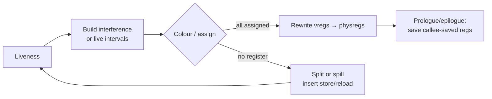

# 02 · Register allocation: graph colouring, linear scan and LLVM's greedy allocator

> Level: advanced · Time: ~3 h · Prereqs: 02-intermediate/06 (liveness), 03-advanced/01 (virtual registers in MIR); graph colouring basics

## 1. Why this exists

Instruction selection left us with an unlimited supply of virtual registers (`%0 … %4`). An x86-64 CPU has 16 general-purpose registers (a few reserved), AArch64 31, RISC-V 31; an NVIDIA GPU thread has up to 255 but using more lowers **occupancy** (how many threads fit on a multiprocessor). Registers are ~100× faster than memory, so **which values live in registers and which get "spilled" to the stack** is one of the highest-impact decisions a compiler makes. Getting it *wrong* (two live values in one register) is a silent miscompilation; getting it *poor* is a large slowdown — as the measurements in §5.2 show, even production allocators can lose 2× on an adversarial loop.

## 2. Intuition: seating guests at a wedding with few tables

Each value is a guest who is present for a time interval (its live range). Two guests present at the same time cannot share a chair (register). Guests who never overlap can reuse the same chair. If there are more simultaneous guests than chairs, someone has to wait outside (spill to memory) and be fetched back each time they're needed (reload). Good seating minimises the fetching, especially during the main event (inside loops).

## 3. Precise definitions

* **Live range / live interval**: the set of program points where a value is live (lesson 06). A *live interval* approximates it as one [start, end) span over a linear instruction order (possibly with holes).
* **Interference**: two values interfere if one is live at a point where the other is defined — then they cannot share a register.
* **Interference graph**: nodes = values; edges = interference. **Register allocation with *k* registers = *k*-colouring this graph.** *k*-colourability is NP-complete in general (Chaitin et al. made graph colouring the basis of practical allocation: "Chaitin et al. first showed that graph coloring can be the basis of an effective register allocation algorithm"). Interestingly, programs in *strict SSA form* have *chordal* interference graphs, colourable optimally in polynomial time (Hack, Grund & Goos, "Register Allocation for Programs in SSA-Form", CC 2006) — the basis of SSA-based allocators.
* **Spill**: store a value to a stack slot after its definition and **reload** it before uses. **Rematerialisation**: recompute a cheap value (a constant, an address) instead of reloading it.
* **Coalescing**: merging the nodes of a copy `x = y` when they don't interfere, so the copy disappears. **Conservative coalescing** merges "only if that could not cause a spill" (Briggs' criterion: the merged node has fewer than *k* neighbours of significant degree).
* **Pre-coloured nodes**: physical registers forced by the ABI or ISA (`rax` for return values, `rdx:rax` for `idiv`, `rcx` for shift counts).
* **Spill weight / cost**: estimated cost of spilling a value, typically Σ (uses + defs) × 10^(loop depth); values used in inner loops are expensive to spill.

## 4. Step by step

### 4.1 The dumbest allocator: everything in memory

Every virtual register gets its own stack slot; every instruction loads its operands and stores its result. It's what `-O0` effectively does (LLVM's `fast` allocator is a quick local allocator used at `-O0`). Always correct; very slow. **What's annoying:** in a hot loop, the same few values are loaded and stored on every iteration.

### 4.2 Graph colouring (Chaitin, 1982; Briggs' optimistic improvement)

**Kempe's observation (1879):** a node with fewer than *k* neighbours can always be coloured, whatever colours its neighbours get. So:

1. **Build** the interference graph (from liveness).
2. **Simplify**: repeatedly remove a node with degree < *k* and push it on a stack.
3. **Spill**: if all remaining nodes have degree ≥ *k*, pick one with the lowest spill-cost/degree ratio. Chaitin spilled it immediately; **Briggs' optimistic colouring** "simply choose[s] a high-degree node optimistically, remove[s] it from the graph, and push[es] it onto the stack" — maybe its neighbours will end up sharing colours.
4. **Select**: pop nodes, giving each a colour not used by already-coloured neighbours. A node with no free colour becomes an *actual* spill.
5. If anything spilled, insert spill/reload code (creating tiny new live ranges) and **repeat** from step 1.

**What's annoying:** building and repeatedly rebuilding the interference graph is O(n²) in space and slow — too slow for JIT compilers that must compile in milliseconds.

### 4.3 Linear scan (Poletto & Sarkar, TOPLAS 1999)

Throw away the graph. Number instructions linearly, compute one interval per value, sort intervals by start, and sweep once keeping an **active** list sorted by end point. At each new interval: expire intervals that have ended (freeing their registers); if a register is free, take it; otherwise spill — Poletto and Sarkar "spill the active interval with the last end time" (it would occupy the register longest). It is "simple and fast, which makes it particularly suitable for just-in-time compilation". **What's annoying:** one interval per value is coarse (lifetime holes are ignored), and a value is either entirely in a register or entirely spilled.

### 4.4 LLVM's greedy allocator (default since LLVM 3.0)

Jakob Stoklund Olesen's 2011 design replaced linear scan, which had been LLVM's default since 2004 (reported 1–2% smaller and up to 10% faster code). Key ideas:

* a **priority queue**: "allocating the large live ranges first";
* **eviction**: a range that can't get a register may evict already-assigned ranges with lower spill weight, which go back into the queue;
* **live-range splitting** before spilling: split a range so the part in a hot loop stays in a register; "A live range is only spilled when the splitter decides that splitting it won't help";
* interference checks against per-physical-register **live interval unions** (B+ trees).

LLVM 18's `llc` offers `-regalloc=fast|basic|greedy|pbqp`; `default` picks based on `-O` (in this sandbox: `Fast Register Allocator` at `-O0`, `Greedy Register Allocator` at `-O2`). GCC uses its **IRA** (integrated register allocator, a regional graph-colouring allocator) followed by **LRA** (local register allocator for reloads).



## 5. Code

### 5.1 Colouring vs linear scan on a small example (`regalloc.py`)

```python
# file: regalloc.py
# Two classic register allocators on the same straight-line code:
#   (1) graph colouring, Chaitin-Briggs style (simplify / optimistic spill / select)
#   (2) linear scan (Poletto & Sarkar, TOPLAS 1999)
# Code: (dest, [uses]). Values live from their definition to their last use.
CODE = [
    ("a", []),            # 0: a = load
    ("b", []),            # 1: b = load
    ("c", ["a", "b"]),    # 2: c = a + b
    ("d", ["a"]),         # 3: d = a * 2
    ("e", ["c", "b"]),    # 4: e = c - b
    ("f", ["d", "e"]),    # 5: f = d + e
    ("g", ["c"]),         # 6: g = c + 1
    ("h", ["f", "g"]),    # 7: h = f * g
    (None, ["h"]),        # 8: return h
]

def live_intervals(code):
    start, end = {}, {}
    for i, (dest, uses) in enumerate(code):
        if dest:
            start[dest] = i
            end.setdefault(dest, i)           # defined but never used: interval of length 0
        for u in uses:
            end[u] = i                        # last use seen so far
    return {v: (start[v], end[v]) for v in start}

def interference(intervals):
    """Two values interfere if their live ranges overlap (one is live where the other is defined)."""
    g = {v: set() for v in intervals}
    vs = list(intervals)
    for i, x in enumerate(vs):
        for y in vs[i + 1:]:
            (s1, e1), (s2, e2) = intervals[x], intervals[y]
            if s1 < e2 and s2 < e1:           # half-open overlap test [s, e)
                g[x].add(y); g[y].add(x)
    return g

def color(graph, k):
    """Chaitin-Briggs: repeatedly remove a node with degree < k (it can always be coloured);
    if none exists, optimistically push a high-degree node anyway (Briggs). Then pop and colour."""
    g = {v: set(n) for v, n in graph.items()}   # working copy
    stack = []
    while g:
        low = [v for v in g if len(g[v]) < k]
        v = low[0] if low else max(g, key=lambda x: len(g[x]))   # spill candidate: max degree
        stack.append(v)
        for n in g.pop(v):
            g[n].discard(v)
    colors, spilled = {}, []
    while stack:
        v = stack.pop()
        used = {colors[n] for n in graph[v] if n in colors}
        free = [c for c in range(k) if c not in used]
        if free:
            colors[v] = free[0]
        else:
            spilled.append(v)                 # actual spill: needs a stack slot + reloads
    return colors, spilled

def linear_scan(intervals, k):
    """Sort by start; keep 'active' intervals sorted by end; on overflow spill the one ending last."""
    order = sorted(intervals, key=lambda v: intervals[v][0])
    active, free, reg, spilled = [], list(range(k)), {}, []
    for v in order:
        s, e = intervals[v]
        for a in list(active):                # expire intervals that ended before s
            if intervals[a][1] <= s:
                active.remove(a); free.append(reg[a])
        if free:
            reg[v] = free.pop(0); active.append(v)
        else:
            last = max(active, key=lambda a: intervals[a][1])
            if intervals[last][1] > e:        # steal the register of the longest-living value
                reg[v] = reg.pop(last); spilled.append(last)
                active.remove(last); active.append(v)
            else:
                spilled.append(v)
    return reg, spilled

if __name__ == "__main__":
    iv = live_intervals(CODE)
    print("intervals:", iv)
    g = interference(iv)
    print("interference:", {v: sorted(n) for v, n in g.items()})
    for k in (3, 2):
        colors, sp = color(g, k)
        print(f"k={k} colouring : regs={ {v: f'r{c}' for v, c in sorted(colors.items())} } spilled={sp}")
        reg, sp2 = linear_scan(iv, k)
        print(f"k={k} linear scan: regs={ {v: f'r{c}' for v, c in sorted(reg.items())} } spilled={sp2}")
```

Python syntax notes:

* `end.setdefault(dest, i)` — set `end[dest] = i` only if `dest` isn't already a key.
* `(s1, e1), (s2, e2) = intervals[x], intervals[y]` — nested tuple unpacking.
* `max(g, key=lambda x: len(g[x]))` — the key with the largest neighbour set; `key=` supplies the comparison value.
* `g.pop(v)` removes key `v` and returns its value (the neighbour set) so we can update neighbours.
* `for a in list(active):` — iterate over a *copy*, because the loop body removes from `active`.
* `f"…regs={ {v: f'r{c}' for v, c in sorted(colors.items())} }…"` — a dict comprehension inside an f-string; the spaces after `{` and before `}` stop Python from reading `{{` as an escaped brace.

Logic: liveness is computed as [definition, last use) intervals; the interference test is interval overlap; `color` is simplify/optimistic-push/select; `linear_scan` is Poletto–Sarkar with "spill the one ending last".

```text
$ python3 regalloc.py
intervals: {'a': (0, 3), 'b': (1, 4), 'c': (2, 6), 'd': (3, 5), 'e': (4, 5), 'f': (5, 7), 'g': (6, 7), 'h': (7, 8)}
interference: {'a': ['b', 'c'], 'b': ['a', 'c', 'd'], 'c': ['a', 'b', 'd', 'e', 'f'], 'd': ['b', 'c', 'e'], 'e': ['c', 'd'], 'f': ['c', 'g'], 'g': ['f'], 'h': []}
k=3 colouring : regs={'a': 'r1', 'b': 'r0', 'c': 'r2', 'd': 'r1', 'e': 'r0', 'f': 'r1', 'g': 'r0', 'h': 'r0'} spilled=[]
k=3 linear scan: regs={'a': 'r0', 'b': 'r1', 'c': 'r2', 'd': 'r0', 'e': 'r1', 'f': 'r0', 'g': 'r1', 'h': 'r2'} spilled=[]
k=2 colouring : regs={'a': 'r1', 'b': 'r0', 'd': 'r1', 'e': 'r0', 'f': 'r0', 'g': 'r1', 'h': 'r0'} spilled=['c']
k=2 linear scan: regs={'a': 'r0', 'b': 'r1', 'd': 'r0', 'e': 'r1', 'f': 'r0', 'g': 'r1', 'h': 'r0'} spilled=['c']
```

At most three values are simultaneously live (e.g. at instruction 3: `b`, `c`, `d`), so 3 registers suffice and 8 values share them. With 2 registers both algorithms choose to spill `c` — the value with the longest interval and most interferences (degree 5). A real allocator would now insert `store c` after instruction 2 and `reload c` before 4 and 6, recompute liveness, and run again.

### 5.2 LLVM's allocators on an adversarial loop

```c
// file: pressure.c
// High register pressure: 20 values are loaded and all stay live until the end.
long pressure(long *p, long n) {
    long a0=p[0],a1=p[1],a2=p[2],a3=p[3],a4=p[4],a5=p[5],a6=p[6],a7=p[7],a8=p[8],a9=p[9];
    long b0=p[10],b1=p[11],b2=p[12],b3=p[13],b4=p[14],b5=p[15],b6=p[16],b7=p[17],b8=p[18],b9=p[19];
    for (long i = 0; i < n; i++) {           // every value is used in every iteration
        a0+=b9; a1+=b8; a2+=b7; a3+=b6; a4+=b5; a5+=b4; a6+=b3; a7+=b2; a8+=b1; a9+=b0;
        b0^=a0; b1^=a1; b2^=a2; b3^=a3; b4^=a4; b5^=a5; b6^=a6; b7^=a7; b8^=a8; b9^=a9;
    }
    return a0+a1+a2+a3+a4+a5+a6+a7+a8+a9+b0+b1+b2+b3+b4+b5+b6+b7+b8+b9;
}
```

```c
// file: bench.c
// Driver: runs pressure() many iterations and prints the result (to keep it alive).
#include <stdio.h>
long pressure(long *p, long n);
int main(void) {
    long p[20];
    for (int i = 0; i < 20; i++) p[i] = i * 7 + 1;
    printf("%ld\n", pressure(p, 200000000));
    return 0;
}
```

Twenty values live across the loop, x86-64 has ~15 usable GPRs, so spilling is unavoidable. Measured in this sandbox (LLVM 18.1.3 `llc -O2 -regalloc=…`, three timing runs each; all four print the same checksum `-1387248145995708579`):

| `-regalloc=` | loop body instructions | stack accesses per iteration | time (3 runs, ms) |
|---|---|---|---|
| fast | 69 | 47 | 1204, 1147, 1433 |
| basic | 22 | 12 | 590, 580, 722 |
| greedy (default at -O2) | 60 | 41 | 1229, 1285, 1356 |
| pbqp | 22 | 11 | 654, 535, 652 |

On *this* contrived kernel, the default greedy allocator produced code about 2× slower than `basic` or `pbqp` — no better than `fast`. That is not a general verdict (greedy was chosen on broad benchmarks), but it is a genuine **performance anomaly** of the kind compiler-testing work reports as "performance bugs" (EMI's study counted 19 of them among its 147 GCC/LLVM bugs). Heuristics have adversarial inputs. Spill code is easy to spot because LLVM annotates it: `movq %rax, -8(%rsp)  # 8-byte Spill` and `# 8-byte Reload`.

## 6. Common mistakes

* **Computing interference from "both are live somewhere" instead of "one is live at the other's definition"** → too many edges, needless spills (or, with the wrong direction, too few → wrong code).
* **Ignoring pre-coloured registers and clobbers.** A call clobbers all caller-saved registers; a value live across a call must be in a callee-saved register or spilled.
* **Spilling inside a loop when splitting would keep the hot part in a register.**
* **Forgetting that spill code changes liveness** → must iterate.
* **Judging an allocator by static spill counts.** What matters is *dynamic* cost — spills in hot loops. Measure (`perf`, timing, `llvm-mca`).
* **Coalescing aggressively** → merged nodes with high degree become uncolourable. Use conservative criteria.

## 7. Connections

* **Computer Architecture track**: register files, the cost of memory access, register renaming in out-of-order CPUs (the hardware's own "allocator").
* **DSA track**: graph colouring (NP-complete), greedy heuristics, interval scheduling (linear scan is interval-graph colouring), priority queues.
* **Parallel/CUDA track**: GPU register pressure vs occupancy; `ptxas -v` reports registers per thread; `__launch_bounds__` / `-maxrregcount` trade spills for occupancy (04-pro/05).
* **Java track**: HotSpot's C1 JIT used linear scan, because JIT compile time matters.

## 8. Self-check

1. Why can a node with degree < *k* always be coloured?
2. What does Briggs' optimistic colouring change compared with Chaitin's?
3. What is the main trade-off of linear scan vs graph colouring?
4. Why does the greedy allocator split live ranges before spilling?
5. In the `pressure` benchmark, why is spilling unavoidable no matter the allocator?

<details><summary>Answers</summary>

1. Its neighbours can use at most *degree* < *k* distinct colours, so at least one of the *k* colours remains free.
2. When no low-degree node remains, Chaitin spills immediately; Briggs pushes a high-degree node optimistically and only spills it if, at select time, its neighbours actually used all *k* colours.
3. Linear scan is much faster (no graph, one pass) and suits JITs, but its coarse intervals usually give somewhat worse code than colouring.
4. A long range often has a hot part (in a loop) and cold parts; splitting lets the hot part stay in a register and only the cold parts go to memory, instead of reloading inside the loop.
5. Twenty values are simultaneously live in the loop, more than the number of allocatable general-purpose registers on x86-64.

</details>

## 9. Mnemonic (Tamil + English)

**"Kammi pakkathu kaaran mudhalla veliya"** — *the one with fewer neighbours goes out first*: simplify removes low-degree nodes, then they come back in reverse and always find a seat. And for spilling: **"Loop-la irukkaravana spill pannadhe"** — *never spill the guy sitting inside the loop*.

## Sources

* G. J. Chaitin, "Register allocation & spilling via graph coloring", SIGPLAN Symposium on Compiler Construction, 1982: https://web.eecs.umich.edu/~mahlke/courses/583f18/reading/chaitin82.pdf
* M. Poletto, V. Sarkar, "Linear scan register allocation", *ACM TOPLAS* 21(5), 1999: https://www.cse.iitm.ac.in/~krishna/cs3300/linearscan.pdf
* Cornell CS 4120 notes, "Register Allocation" (Kempe heuristic, optimistic colouring, conservative coalescing, linear scan): https://www.cs.cornell.edu/courses/cs4120/2022sp/notes/regalloc
* J. Stoklund Olesen, "Greedy Register Allocation in LLVM 3.0", LLVM Project Blog, 2011: https://blog.llvm.org/2011/09/greedy-register-allocation-in-llvm-30.html
* LLVM, "The LLVM Target-Independent Code Generator" (register allocation section): https://llvm.org/docs/CodeGenerator.html
* V. Le, M. Afshari, Z. Su, "Compiler Validation via Equivalence Modulo Inputs", PLDI 2014 (performance bugs): https://www.cs.ucdavis.edu/~su/publications/emi.pdf
* S. Hack, D. Grund, G. Goos, "Register Allocation for Programs in SSA-Form", CC 2006: https://link.springer.com/doi/10.1007/11688839_20
* Cooper & Torczon, *Engineering a Compiler*, 3rd ed., ch. 13 "Register Allocation": https://shop.elsevier.com/books/engineering-a-compiler/cooper/978-0-12-815412-0
* Stanford CS143 lecture 16, "Register Allocation": https://web.stanford.edu/class/cs143/

## Verify yourself

```bash
# file: verify-02a.sh
# Tested with LLVM 18.1.3, GCC 13.3, Python 3.13, Nov 2026. Timings vary by machine.
python3 regalloc.py
clang -O2 -S -emit-llvm pressure.c -o pressure.ll
for ra in fast basic greedy pbqp; do
  llc -O2 -regalloc=$ra pressure.ll -o $ra.s
  gcc -O2 bench.c $ra.s -o b_$ra
  printf "%-7s spills=%3d  " $ra "$(grep -c 'Spill' $ra.s)"
  s=$(date +%s%N); ./b_$ra > /dev/null; e=$(date +%s%N); echo "$(( (e-s)/1000000 )) ms"
done
llc -O0 pressure.ll -debug-pass=Structure -o /dev/null 2>&1 | grep -m1 "Register Allocator"   # Fast at -O0
llc -O2 pressure.ll -debug-pass=Structure -o /dev/null 2>&1 | grep -m1 "Register Allocator"   # Greedy at -O2
```

Check against sources: the greedy allocator's design claims against Olesen's 2011 blog post; the linear-scan spill heuristic against Poletto & Sarkar (and the Cornell notes).
