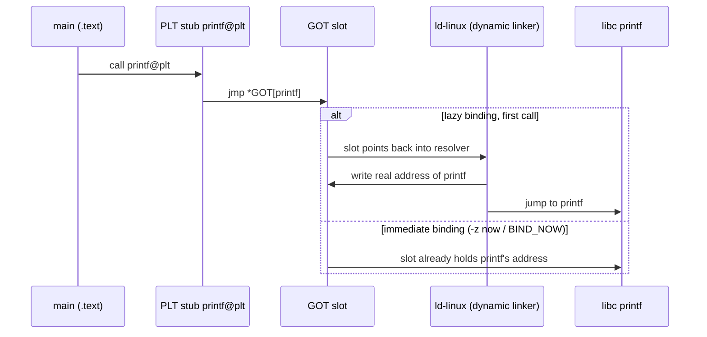

# 03 · Linking and loading: symbols, relocations, PIC/GOT/PLT, LTO

> Level: advanced · Time: ~3 h · Prereqs: 01-beginner/01 (compiler stages), 03-advanced/01 (code generation); C `extern`/`static`

## 1. Why this exists

A compiler sees one **translation unit** (one `.c` file after preprocessing) at a time. When `main.c` calls `bump()` defined in `util.c`, the compiler cannot know where `bump` will end up in memory — so it emits a *hole* plus a note: "put the address of `bump` here". The **linker** combines object files and libraries, decides the final layout, matches every use of a name to exactly one definition, and fills every hole. The **loader** (the kernel plus, for dynamic executables, the **dynamic linker** `ld-linux`) then maps the result into memory and finishes the job for shared libraries at run time. Linking errors ("undefined reference", "multiple definition") are some of the most common build failures, and link-time optimization (LTO) is how compilers finally see across file boundaries.

## 2. Intuition: a book written by many authors

Each author (translation unit) writes a chapter and says "see the table on page ??" (a relocation) for things in other chapters. The editor (linker) collects the chapters, numbers the pages (layout), builds an index of every named thing (symbol table), and replaces every "??" with the real page number (relocation). Some references point into a reference book that stays on the library shelf (a shared library); for those, the book only says "look it up in the shelf directory" (GOT/PLT), and the librarian (dynamic linker) fills them in when the book is opened.

## 3. Precise definitions

* **Object file** (`.o`, ELF *relocatable*): machine code and data in **sections** (`.text` code, `.data` initialised globals, `.bss` zero-initialised globals, `.rodata` read-only data), plus a **symbol table** and **relocation entries**.
* **Symbol**: "A symbol is basically a name and a value" (Ian Lance Taylor). *Defined* symbols mark things in this file; *undefined* symbols are references to things defined elsewhere. *Global* symbols are visible to other files; `static` functions/variables in C produce *local* symbols the linker won't use for cross-file resolution.
* **Symbol resolution**: the linker must "resolve each undefined symbol by finding a defined symbol with the same name". Rules: exactly one **strong** definition per global name; a **weak** definition may be overridden by a strong one; an undefined weak reference with no definition resolves to 0.
* **Relocation**: "A relocation is a computation to perform on the contents" — typically "address of symbol S + addend A, minus the address P of the place being patched" for PC-relative forms. Examples on x86-64: `R_X86_64_PC32` (32-bit PC-relative), `R_X86_64_PLT32` (call through the PLT if needed), `R_X86_64_GLOB_DAT` and `R_X86_64_JUMP_SLOT` (dynamic relocations that fill GOT entries).
* **Static library** (`.a`): an archive of `.o` files. GNU `ld` "will search an archive only once, at the location where it is specified on the command line", pulling only members that define symbols still undefined at that point.
* **Shared library** (`.so`): code loaded at run time and shared between processes; "invented as an optimization for virtual memory systems running many processes simultaneously".
* **Position-independent code (PIC)** and **PIE** (position-independent executable): code that works at any load address, using PC-relative addressing for its own data and indirection tables for external symbols.
* **GOT** (global offset table): a table of addresses filled in by the dynamic linker. **PLT** (procedure linkage table): small stubs; "Position independent code will call non-static functions via the Procedure Linkage Table or PLT."
* **Lazy binding**: "PLT entries are normally relocated lazily by the dynamic linker" — resolved on first call. GNU ld documents `-z lazy` as the default and `-z now` as "resolve all symbols when the program is started"; distributions often override that default for security (see §4.4).
* **LTO** (link-time optimization): "another name for intermodular optimization when performed during the link stage" — object files carry compiler IR, and the optimizer runs again across all of them at link time.

## 4. Step by step

### 4.1 Separate compilation leaves holes

```c
// file: main.c
// Uses a function and a global variable defined in ANOTHER translation unit.
#include <stdio.h>
extern int counter;          // declared here, defined in util.c
int bump(int by);            // prototype; definition in util.c
int main(void) {
    bump(5);
    printf("counter = %d\n", counter);
    return 0;
}
```

```c
// file: util.c
// Definitions that main.c refers to.
int counter = 10;            // initialised global -> .data section
static int calls;            // file-local (static) -> not visible to the linker as global
int bump(int by) { calls++; counter += by; return counter; }
```

```text
$ gcc -O1 -c main.c util.c
$ nm main.o                     $ nm util.o
0000000000000000 r .LC0         0000000000000000 T bump
                 U __printf_chk 0000000000000000 b calls
                 U bump         0000000000000000 D counter
                 U counter
0000000000000000 T main
```

`U` = undefined here; `T` = text (code); `D` = initialised data; lowercase `b` = a *local* bss symbol (`static int calls` — invisible to other files). The holes, shown by `objdump -dr main.o`:

```text
   d:   e8 00 00 00 00          call   12 <main+0x12>
                        e: R_X86_64_PLT32       bump-0x4
                        14: R_X86_64_PC32       counter-0x4
  18:   48 8d 35 00 00 00 00    lea    0x0(%rip),%rsi
                        1b: R_X86_64_PC32       .LC0-0x4
  29:   e8 00 00 00 00          call   2e <main+0x2e>
                        2a: R_X86_64_PLT32      __printf_chk-0x4
```

Every call target is `00 00 00 00` with a relocation saying how to fill it. The `-0x4` addend exists because x86 PC-relative offsets are measured from the *end* of the 4-byte field.

### 4.2 Resolution and its failure modes

```text
$ gcc main.o util.o -o prog && ./prog
counter = 15
$ gcc main.o -o prog2
main.c:(.text+0xe): undefined reference to `bump'
/usr/bin/ld: main.c:(.text+0x14): undefined reference to `counter'
```

The error even names the exact relocation sites (`.text+0xe`, `.text+0x14`) we saw above. After linking, `objdump -d prog` shows `call 1181 <bump>` — a direct call, resolved statically — but `call 1050 <__printf_chk@plt>` — a call through the PLT, because `printf` lives in the shared C library.

**Library order matters.** With `libutil.a` containing `util.o`:

```text
$ ar rcs libutil.a util.o
$ gcc main.o -L. -lutil -o p1        # OK
$ gcc -L. -lutil main.o -o p2        # 2 × "undefined reference"
```

When `ld` reached `-lutil` in the second command, nothing was undefined yet, so it pulled no members; it never looks back.

**Weak vs strong:**

```c
// file: w1.c
// A weak default definition that another file may override.
#include <stdio.h>
__attribute__((weak)) const char *greeting(void) { return "default (weak)"; }
int main(void) { printf("%s\n", greeting()); return 0; }
```

```c
// file: w2.c
// A strong definition: when linked in, it wins over the weak one.
const char *greeting(void) { return "override (strong)"; }
```

```text
$ gcc w1.c -o w_alone && ./w_alone          $ gcc w1.c w2.c -o w_both && ./w_both
default (weak)                              override (strong)
```

**Tentative definitions and `-fno-common`.** Two files each containing `int shared;` (no initialiser) used to be merged silently as "common" symbols. Since GCC 10, "GCC now defaults to `-fno-common`", so GCC 13.3 reports `multiple definition of 'shared'`; `-fcommon` restores the old behaviour. A classic "it built on the old compiler" break.

### 4.3 Static vs dynamic linking

```text
$ ldd prog
	linux-vdso.so.1
	libc.so.6 => /lib/x86_64-linux-gnu/libc.so.6
	/lib64/ld-linux-x86-64.so.2
$ gcc -static -O1 main.c util.c -o prog_static
16096 prog          ELF 64-bit LSB pie executable, dynamically linked, interpreter /lib64/ld-linux-x86-64.so.2
785448 prog_static  ELF 64-bit LSB executable, statically linked
```

The static binary copies the needed parts of libc into itself (49× larger here); the dynamic one names an **interpreter** (`ld-linux`), which the kernel runs first to load `libc.so.6` and apply dynamic relocations.

### 4.4 PIC, GOT, PLT — and lazy vs immediate binding

In a PIE, code must not contain absolute addresses. Its own globals are reached PC-relatively (`lea .LC0(%rip)`). External *data* is reached through a GOT slot holding its address (`R_X86_64_GLOB_DAT`); external *functions* through a PLT stub that jumps via a GOT slot (`R_X86_64_JUMP_SLOT`):

```text
$ readelf -r prog | grep -E "GLOB_DAT|JUMP_SLO"
000000003fd8  000100000006 R_X86_64_GLOB_DAT 0000000000000000 __libc_start_main@GLIBC_2.34 + 0
000000003fd0  000400000007 R_X86_64_JUMP_SLO 0000000000000000 __printf_chk@GLIBC_2.3.4 + 0
```



Taylor describes the classic lazy scheme ("The next time the function is called, the PLT entry will branch directly to the function"). But check what *your* toolchain does:

```text
$ readelf -d prog | grep FLAGS
 0x000000000000001e (FLAGS)              BIND_NOW
 0x000000006ffffffb (FLAGS_1)            Flags: NOW PIE
```

Ubuntu's GCC links with immediate binding by default — `gcc -### main.o util.o -o x` shows the driver passing `-pie -z now -z relro` to the linker —, even though GNU ld's own documentation says "Lazy binding is the default". The reason is security hardening (with **RELRO**, the GOT can then be made read-only after start-up, so an attacker cannot overwrite GOT entries). Once again: *distribution defaults change the toolchain's behaviour*.

### 4.5 LTO: optimizing across files

```c
// file: lto_a.c
// Calls a function from another translation unit.
#include <stdio.h>
int scale(int x);                     // defined in lto_b.c
int main(void) { printf("%d\n", scale(21)); return 0; }
```

```c
// file: lto_b.c
// A tiny function the optimizer could inline -- but only if it can see it.
int scale(int x) { return x * 2; }
```

```text
$ clang -O2 lto_a.c lto_b.c -o nolto && objdump -d nolto      (main only)
    call   1160 <scale>                 # the compiler of lto_a.c could not see scale's body
    mov    %eax,%esi
    call   1030 <printf@plt>
$ clang -O2 -flto -fuse-ld=lld lto_a.c lto_b.c -o withlto && ./withlto
42
    mov    $0x2a,%esi                    # 0x2a = 42: inlined AND constant-folded at link time
    call   1760 <printf@plt>
$ gcc -O2 -flto lto_a.c lto_b.c -o glto                        (GCC's LTO does the same)
    mov    $0x2a,%edx
    call   1050 <__printf_chk@plt>
```

With `-flto`, the `.o` files contain LLVM bitcode (or GCC's GIMPLE bytecode) instead of machine code; at link time "the linker treats LLVM bitcode files like native object files" and hands everything to the optimizer, which can now inline across files and delete unused functions program-wide. **ThinLTO** (LLVM) and **WHOPR** (GCC) partition this work so it scales to huge programs.

## 5. Code

All examples are inline above (`main.c`, `util.c`, `w1.c`, `w2.c`, `lto_a.c`, `lto_b.c`), each fully commented; commands and outputs are from GCC 13.3, Clang/LLD 18.1.3, GNU binutils on Ubuntu 24.04.

## 6. Common mistakes

* **Putting `-lfoo` before the objects that use it** → "undefined reference" with GNU ld. Libraries go *after* their users (or use `--start-group … --end-group` for cycles).
* **Defining (not just declaring) a global in a header** → "multiple definition" once two files include it (since GCC 10's `-fno-common`). Declare with `extern` in the header; define in exactly one `.c`.
* **Forgetting `static` on file-local helpers** → name clashes across files and lost optimization opportunities (a `static` function with all calls inlined can be deleted).
* **Mismatched declarations across files** (`extern long x;` vs `int x;`) — the linker matches *names*, not types; the result is undefined behaviour that C compilers can't diagnose without LTO.
* **Linking non-PIC code into a PIE or shared library** → `relocation R_X86_64_32 … can not be used when making a PIE object; recompile with -fPIE` (02-intermediate/05 hit exactly this with `llc`).
* **Assuming lazy binding** when reasoning about start-up time or exploits — check `readelf -d` for `BIND_NOW`.

## 7. Connections

* **OS track**: ELF loading, `execve`, virtual memory and page sharing of `.so` text, ASLR (why PIE exists), `LD_PRELOAD`, `ld.so` search paths.
* **Security track**: GOT overwrite attacks, RELRO, `-z now`, ASLR, PLT-based return-oriented programming gadgets.
* **C track**: linkage (`extern`, `static`), one-definition rule, tentative definitions.
* **Cloud/DevOps track**: static binaries in minimal containers (e.g. `FROM scratch`) vs dynamic ones needing the right `libc`.
* **Rust track**: Rust links statically by default (except libc) and uses LTO profiles in release builds.

### Where this shows up in my projects

* **compiler-fuzz** compiles and links thousands of generated programs; keeping each generated program a single translation unit avoids linker-order issues and makes the compared behaviour depend only on the compiler — and the cross-compiler comparisons assume both binaries use the *same* libc (dynamic linking against the system's libc ensures that).
* **aws-waste-scanner** runs as AWS Lambda functions; Lambda packages for compiled languages are typically shipped as static or self-contained binaries precisely because the execution environment's shared libraries are not under your control.

## 8. Self-check

1. What do `U`, `T`, `D`, and lowercase `b` mean in `nm` output?
2. Why does `gcc -L. -lutil main.o` fail while `gcc main.o -L. -lutil` works?
3. What problem do the GOT and PLT solve?
4. Why might a program on Ubuntu not use lazy binding even though GNU ld documents it as the default?
5. What can LTO do that per-file `-O2` cannot?

<details><summary>Answers</summary>

1. `U`: undefined (referenced, defined elsewhere); `T`: global symbol in the text section; `D`: global symbol in initialised data; `b`: local (non-global, e.g. `static`) symbol in bss.
2. GNU ld scans an archive only once at its command-line position and only extracts members defining symbols that are undefined *at that moment*; before `main.o` nothing is undefined.
3. Code must not be patched per process (it's shared and position-independent); external addresses go into a per-process data table (GOT) filled by the dynamic linker, and calls go through small stubs (PLT) that jump via the GOT.
4. Ubuntu's toolchain passes `-z now` by default (hardening, enabling a fully read-only GOT with RELRO), recorded as `BIND_NOW` in the dynamic section.
5. See function bodies across translation units: inline across files, propagate constants through calls, and delete unused functions program-wide.

</details>

## 9. Mnemonic (Tamil + English)

**"Peyar, Pothu, Pottu"** — *Name, Place, Patch*: the linker matches **names** (symbol resolution), chooses **places** (layout), and **patches** the holes (relocations). And for library order: **"Kadan vaangiyavan munnadi, kudukkiravan pinnadi"** — *the borrower stands in front, the lender behind*: objects that need symbols come before the libraries that supply them.

## Sources

* Ian Lance Taylor, "Linkers part 2" (symbols, relocations, resolution): https://www.airs.com/blog/archives/39
* Ian Lance Taylor, "Linkers part 4" (shared libraries, PLT, GOT, lazy binding): https://www.airs.com/blog/archives/41
* Ian Lance Taylor, "Linkers part 5" (weak and common symbols): https://www.airs.com/blog/archives/42
* GNU ld manual, "Command-line Options" (`-l` archive search order, `-z now`, `-z lazy`): https://sourceware.org/binutils/docs/ld/Options.html
* GCC 10 release notes ("GCC now defaults to `-fno-common`"): https://gcc.gnu.org/gcc-10/changes.html
* LLVM, "LLVM Link Time Optimization: Design and Implementation": https://llvm.org/docs/LinkTimeOptimization.html
* System V ABI, AMD64 supplement (x86-64 relocation types): https://gitlab.com/x86-psABIs/x86-64-ABI
* J. R. Levine, *Linkers and Loaders* (Morgan Kaufmann, 1999) — the classic book-length treatment: https://www.iecc.com/linker/

## Verify yourself

```bash
# file: verify-03a.sh
# Tested with GCC 13.3, Clang/LLD 18.1.3, binutils 2.42, Ubuntu 24.04, Nov 2026.
gcc -O1 -c main.c util.c && nm main.o && nm util.o
objdump -dr main.o | grep -E "R_X86_64"                        # PLT32 / PC32 holes
gcc main.o util.o -o prog && ./prog                            # counter = 15
gcc main.o -o prog2 2>&1 | grep -c "undefined reference"       # 2
ar rcs libutil.a util.o && gcc main.o -L. -lutil -o p1 && echo ok
gcc -L. -lutil main.o -o p2 2>&1 | grep -c "undefined reference"   # 2: order matters
gcc w1.c -o w_alone && ./w_alone; gcc w1.c w2.c -o w_both && ./w_both
printf 'int shared;\n' > t1.c; printf 'int shared;\nint main(void){return shared;}\n' > t2.c
gcc t1.c t2.c -o tt 2>&1 | grep -c "multiple definition"; gcc -fcommon t1.c t2.c -o tt && echo "-fcommon links"
readelf -r prog | grep -E "GLOB_DAT|JUMP_SLO"; readelf -d prog | grep FLAGS
gcc -### main.o util.o -o x 2>&1 | grep -o -E "\-z (now|relro)|-pie" | sort -u   # Ubuntu driver defaults
clang -O2 lto_a.c lto_b.c -o nolto && objdump -d nolto | sed -n '/<main>:/,/ret/p' | grep call
clang -O2 -flto -fuse-ld=lld lto_a.c lto_b.c -o withlto && objdump -d withlto | sed -n '/<main>:/,/ret/p' | grep -E 'call|0x2a'
```

Check against sources: archive search order against the GNU ld `-l` documentation; the PLT/GOT story against Taylor's part 4; `-fno-common` against the GCC 10 release notes.
