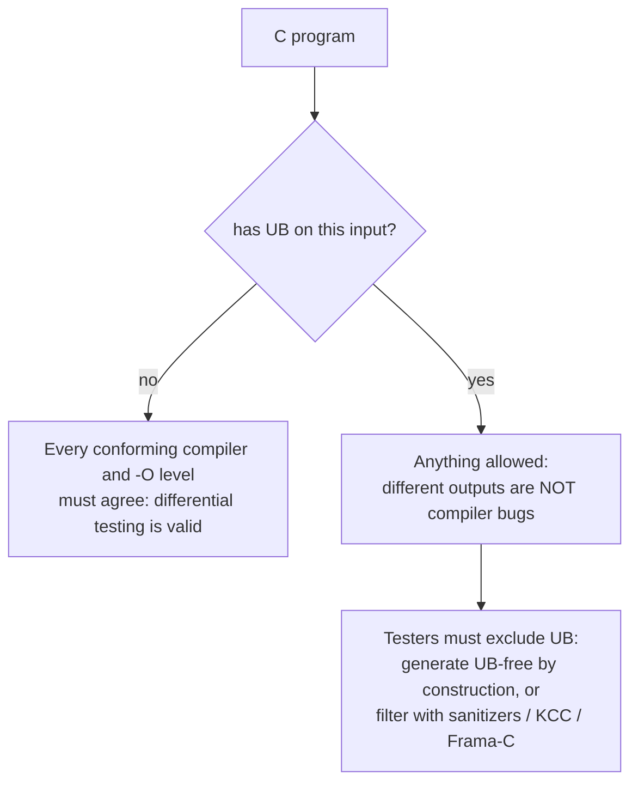

# 04 · Undefined behaviour: what it is, how optimizers exploit it, why testers fear it

> Level: advanced · Time: ~3 h · Prereqs: 02-intermediate/05 (LLVM IR flags), 02-intermediate/07 (optimizations); C

## 1. Why this exists

Every lesson so far assumed "the compiler must preserve the program's meaning". For C and C++ that sentence hides a trap: for many programs **there is no meaning to preserve**. Signed overflow, null dereference, out-of-bounds access, using an uninitialised variable, modifying an object through a pointer of the wrong type — the C standard says these have *undefined behaviour* (UB) and "imposes no requirements". Optimizers are allowed to *assume UB never happens*, and they turn that assumption into real speed: loop trip counts, removed checks, constant-folded comparisons.

For a compiler tester this is the central difficulty. A random C program with UB can legitimately print different results at `-O0` and `-O2`, or under GCC and Clang. If your generator emits UB, every "mismatch" it reports might be *your* bug, not the compiler's. Csmith's whole design (04-pro/02) revolves around this; the C-Reduce paper found that without UB checking, 12 of 41 reduced wrong-code test cases (29%) executed undefined behaviour.

## 2. Intuition: a contract with a fine-print clause

A rental agreement says: "If the tenant stores explosives in the flat, the landlord's obligations under this contract cease." The landlord (compiler) is then free to plan the building assuming *no tenant stores explosives* — e.g. skip expensive blast-proofing. If you do store explosives, you can't complain that the building wasn't designed for it; anything may happen, including things that look like time travel (the optimizer removing a check that runs *before* the UB, because the UB proves the check can't matter on any well-defined execution).

## 3. Precise definitions (C11, N1570 §3.4)

| Term | Standard's definition | Example |
|---|---|---|
| **Implementation-defined** | "unspecified behavior where each implementation documents how the choice is made" | size of `int`; right-shift of a negative value |
| **Unspecified** | "use of an unspecified value, or other behavior where this International Standard provides two or more possibilities and imposes no further requirements on which is chosen in any instance" | order of evaluating function arguments |
| **Undefined** | "behavior, upon use of a nonportable or erroneous program construct or of erroneous data, for which this International Standard imposes no requirements" | "An example of undefined behavior is the behavior on integer overflow." |

The standard's NOTE: possible UB "ranges from ignoring the situation completely with unpredictable results, to behaving during translation or program execution in a documented manner characteristic of the environment … to terminating a translation or execution (with the issuance of a diagnostic message)."

In compiler IR the idea gets finer-grained (LLVM LangRef):

* **undef**: "indicates that the user of the value may receive an unspecified bit-pattern" — each use may see a different value.
* **poison**: "A poison value is a result of an erroneous operation." It propagates ("Most instructions return 'poison' when one of their arguments is 'poison'"), and "Poison values are stronger than undef, and enable more optimizations." Example: `add nsw` produces poison on signed overflow.
* **immediate UB**: e.g. "immediate undefined behavior occurs if a poison value is used as an instruction operand" in certain positions (such as a branch condition or a dereferenced pointer).
* **freeze**: "used to stop propagation of undef and poison values" — it picks an arbitrary but *fixed* value.

The distinction matters: computing an overflowing `add nsw` is not yet UB in LLVM — it yields poison, which is harmless if never used in a way that triggers UB. This lets LLVM *speculate* (hoist) such adds safely.

## 4. Step by step: watch compilers exploit UB

All outputs below: GCC 13.3 and Clang 18.1.3, x86-64 Ubuntu 24.04, run in this sandbox.

### 4.1 Signed overflow: `x + 1 > x`

```c
// file: ub_overflow.c
// Signed overflow is UB, so the optimizer may assume x + 1 > x is ALWAYS true.
#include <stdio.h>
#include <limits.h>

__attribute__((noinline)) int bigger(int x) {
    return x + 1 > x;            // overflows (UB) when x == INT_MAX
}

int main(void) {
    printf("bigger(INT_MAX) = %d\n", bigger(INT_MAX));
    return 0;
}
```

```text
gcc   -O0: bigger(INT_MAX) = 1
gcc   -O2: bigger(INT_MAX) = 1
clang -O0: bigger(INT_MAX) = 0
clang -O2: bigger(INT_MAX) = 1
gcc -O2 -fwrapv: bigger(INT_MAX) = 0
```

Three lessons in five lines:

1. **Optimization level changes the output** (Clang −O0 says 0, −O2 says 1). Neither is wrong: the program has UB.
2. **GCC folds it even at `-O0`.** `gcc -O0 -fdump-tree-original` shows GCC's front end already turned the body into `return 1;`. "`-O0` = no optimization" is a myth; front ends fold.
3. **`-fwrapv`** defines signed overflow as wrapping; the UB disappears and so does the optimization. Lattner's classic explanation: because overflow is undefined, a compiler can fold "X*2/2" to "X", and for `for (i = 0; i <= N; ++i)` it "can assume that the loop will iterate exactly N+1 times" — without that assumption the loop could be infinite when `N == INT_MAX`, blocking loop optimizations.

The same reasoning in LLVM IR (`opt -passes=instcombine`):

```llvm
; file: poison.ll
; With nsw, overflow yields poison, so "x + 1 > x" may be folded to true.
; Without nsw, the add wraps, and the compiler must keep a real check.
define i1 @with_nsw(i32 %x) {
  %a = add nsw i32 %x, 1
  %c = icmp sgt i32 %a, %x
  ret i1 %c
}
define i1 @without_nsw(i32 %x) {
  %a = add i32 %x, 1
  %c = icmp sgt i32 %a, %x
  ret i1 %c
}
```

```text
define i1 @with_nsw(i32 %x) {
  ret i1 true
}
define i1 @without_nsw(i32 %x) {
  %c = icmp ne i32 %x, 2147483647
  ret i1 %c
}
```

The `nsw` flag (which Clang adds to signed C arithmetic, 02-intermediate/05) is literally the UB contract written into the IR.

### 4.2 Dereference-then-check: the deleted null check

```c
// file: ub_null.c
// Dereference BEFORE the null check (the Linux tun bug pattern from the STACK paper).
#include <stdio.h>
struct dev { int flags; };

__attribute__((noinline)) int get_flags(struct dev *d) {
    int f = d->flags;            // if d were NULL this is UB, so the compiler infers d != NULL ...
    if (d == NULL)               // ... and may delete this "impossible" check
        return -1;
    return f;
}

int main(void) {
    struct dev x = { 7 };
    printf("%d\n", get_flags(&x));
    return 0;
}
```

```text
== gcc -O2                 == clang -O2
get_flags:                 get_flags:
	endbr64                    movl	(%rdi), %eax
	movl	(%rdi), %eax         retq
	ret
```

The `if (d == NULL) return -1;` is gone in both. This is exactly the Linux kernel bug in Wang et al.'s STACK paper (SOSP 2013): code dereferenced `tun->sk` before checking `!tun`; GCC removed the check; the paper notes this could enable a privilege-escalation exploit. STACK defines **unstable code** as "code that is unexpectedly discarded by compiler optimizations due to undefined behavior in the program" and "has uncovered 160 new bugs that have been confirmed and fixed by developers". (The kernel now builds with `-fno-delete-null-pointer-checks`.)

### 4.3 The overflow check that checks something else

```c
// file: ub_ptr.c
// A "wraparound" check that relies on pointer overflow, which is UB in C.
#include <stdio.h>
#include <stdint.h>

__attribute__((noinline)) int too_long(char *buf, size_t len) {
    return buf + len < buf;      // intended: detect wraparound; UB if it actually wraps
}

int main(void) {
    char b[4];
    printf("%d\n", too_long(b, SIZE_MAX));   // the arithmetic would wrap around
    return 0;
}
```

```text
== gcc -O2 too_long          == clang -O2 too_long
	shrq	$63, %rsi             movq	%rsi, %rax
	movq	%rsi, %rax            shrq	$63, %rax
	ret                          retq
```

Both compilers rewrote "does `buf + len` wrap?" into "is the top bit of `len` set?" (i.e. `len > PTRDIFF_MAX`) — `buf` disappeared from the function. Since a pointer may not legally move outside its object, the only well-defined way for `buf + len < buf` to hold is a "negative" `len`. For `len = SIZE_MAX` the answer happens to match (all four builds print `1`), but for a moderately large `len` with `buf` near the top of the address space, the intended wraparound check silently tests something else. STACK's Figure 1 shows GCC removing this pattern entirely. The portable fix: compare lengths, not pointers — `if (len > (size_t)(end - buf))`.

### 4.4 Strict aliasing

```c
// file: alias.c
// Strict aliasing: an int object must not be modified through a float* (UB).
#include <stdio.h>
__attribute__((noinline)) int update(int *i, float *f) {
    *i = 1;
    *f = 0.0f;                   // compiler may assume this cannot change *i (different types)
    return *i;                   // ... so it may return the constant 1
}
int main(void) {
    int x;
    printf("%d\n", update(&x, (float *)&x));   // UB: same object through both pointers
    return 0;
}
```

```text
gcc   -O0                       : 0
gcc   -O2                       : 1
gcc   -O2 -fno-strict-aliasing  : 0
clang -O0                       : 0
clang -O2                       : 1
clang -O2 -fno-strict-aliasing  : 0
```

Type-based alias analysis (TBAA) assumes an `int` and a `float` never occupy the same memory. Lattner lists "violating type rules" among the classic UB sources that enable optimizations such as turning a float-writing loop into `memset`.

### 4.5 Unspecified ≠ undefined, but just as dangerous for testers

```c
// file: order.c
// Unspecified (not undefined) behaviour: the order in which function ARGUMENTS are evaluated.
#include <stdio.h>
static int trace = 0;
__attribute__((noinline)) int f(void) { trace = trace * 10 + 1; return 1; }
__attribute__((noinline)) int g(void) { trace = trace * 10 + 2; return 2; }
__attribute__((noinline)) int pair(int a, int b) { return a * 10 + b; }
int main(void) {
    int p = pair(f(), g());      // C does not say whether f() or g() runs first
    printf("pair=%d order=%d\n", p, trace);
    return 0;
}
```

```text
gcc   -O0: pair=12 order=21
gcc   -O2: pair=12 order=21
clang -O0: pair=12 order=12
clang -O2: pair=12 order=12
```

GCC evaluated `g()` first, Clang `f()` first. Both are correct. A naive GCC-vs-Clang differential tester that prints `trace` would report a "bug". Csmith's "effect safety" analysis exists to rule out exactly this: it "ensures no location is both read and written, or written twice, between sequence points" and also covers unspecified argument-evaluation order.

### 4.6 Detecting UB: sanitizers and their limits

```text
$ clang -O1 -fsanitize=undefined ub_overflow.c -o t && ./t
ub_overflow.c:7:14: runtime error: signed integer overflow: 2147483647 + 1 cannot be represented in type 'int'
SUMMARY: UndefinedBehaviorSanitizer: undefined-behavior ub_overflow.c:7:14
bigger(INT_MAX) = 0               # the program continues unless -fno-sanitize-recover
```

UBSan is "a fast undefined behavior detector" that instruments the program at compile time (checks include `signed-integer-overflow`, `shift`, `null`, `alignment`, `bounds`; `-fno-sanitize-recover` aborts on the first error; `-fsanitize-trap` uses a trap instruction instead of a runtime library). Two caveats observed in this sandbox:

* Clang's UBSan needs the compiler-rt runtime (`libclang-rt-18-dev` on Ubuntu); without it, linking fails with "cannot find …libclang_rt.ubsan_standalone-x86_64.a".
* **GCC 13.3's `-fsanitize=undefined` reported nothing for this file, even at `-O0`** — because GCC's front end had already folded `x + 1 > x` to `1`, there was no addition left to instrument. A sanitizer only checks the operations that survive to instrumentation. Use *several* tools (UBSan from both compilers, ASan, MSan, Valgrind, static analysers like Frama-C, or an executable semantics such as the KCC interpreter used in the C-Reduce paper).



## 5. Code

All programs are inline above (`ub_overflow.c`, `poison.ll`, `ub_null.c`, `ub_ptr.c`, `alias.c`, `order.c`), every one compiled and run with both compilers at both optimization levels; the outputs shown are the real ones.

## 6. Common mistakes

* **"It works at `-O0`, so the optimizer is buggy."** First rule out UB (`-fsanitize=undefined,address`, `-fwrapv`, `-fno-strict-aliasing` as diagnostics).
* **Writing overflow checks that overflow** (`if (a + b < a)` on signed ints). Use `__builtin_add_overflow` or check against limits *before* computing.
* **Checking a pointer after dereferencing it.** Check first.
* **Type-punning through pointer casts.** Use `memcpy` (which compilers optimize to a register move) or a union (allowed in C, not in C++).
* **Trusting one sanitizer run.** Sanitizers check only executed paths and only the operations still present after front-end folding.
* **Confusing unspecified with undefined.** Unspecified behaviour has a bounded set of outcomes; UB has none — but both break naive differential testing.
* **In LLVM, treating `undef` like poison or like "0".** Each use of `undef` may observe a different value; use `freeze` when a fixed arbitrary value is needed.

## 7. Connections

* **C track**: integer promotions, sequence points/sequencing, effective types and strict aliasing, `restrict`.
* **Security track**: removed checks become vulnerabilities (STACK); sanitizers and fuzzing (AFL/libFuzzer with ASan/UBSan) are the standard pairing.
* **Rust track**: safe Rust has no UB by design; `unsafe` blocks re-admit it; overflow is defined (panic or wrap).
* **Testing/Verification track**: UB is why compiler test oracles need *UB-free* inputs; Alive2 (04-pro/06) models undef/poison precisely to verify LLVM optimizations.
* **Lesson 02-intermediate/05**: `nsw`, `nuw`, `noundef`, `inbounds` are UB contracts encoded as IR flags.

### Where this shows up in my projects

**compiler-fuzz**'s generator is described as *UB-free*: every arithmetic operation goes through overflow-safe paths, every variable is initialised, array indices are kept in bounds — the same family of guarantees as Csmith's safe-math wrappers. Its test suite runs with UBSan to catch generator mistakes. This lesson's §4.5 is the reason it also has to care about *unspecified* evaluation order when comparing GCC with Clang, and §4.6 is the reason a single sanitizer is not proof of UB-freedom.

## 8. Self-check

1. Define undefined, unspecified and implementation-defined behaviour with one example each.
2. Why can Clang print 0 at `-O0` and 1 at `-O2` for `bigger(INT_MAX)` without being buggy?
3. What is the difference between poison and immediate UB in LLVM?
4. How did both compilers rewrite `buf + len < buf`, and why is that allowed?
5. Why did GCC's UBSan miss the overflow in `ub_overflow.c`?

<details><summary>Answers</summary>

1. Undefined: no requirements (signed overflow). Unspecified: one of several allowed outcomes, not documented (argument evaluation order). Implementation-defined: unspecified but documented by the implementation (`sizeof(int)`, right shift of negative values).
2. The program executes signed overflow, which is UB; the standard imposes no requirements, so any output (or none) conforms.
3. Poison is a value marking an erroneous result; it propagates through most instructions and is harmless unless used in certain ways (branch condition, dereferenced address, etc.), at which point it becomes immediate UB.
4. Into a test of whether `len`'s sign bit is set. Pointer arithmetic outside an object is UB, so on every well-defined execution `buf + len < buf` can only be true if `len` is "negative" when viewed as `ptrdiff_t`.
5. GCC's front end folded `x + 1 > x` to the constant `1` before sanitizer instrumentation, so no addition remained to check (visible in `-fdump-tree-original` as `return 1;`).

</details>

## 9. Mnemonic (Tamil + English)

**"Theriyadha, Sollaadha, Solli-vecha"** — *Undefined (nobody knows), Unspecified (allowed choices, not told), Implementation-defined (choice told in the manual)*. And the optimizer's motto: **"UB nadakkaadhu-nu nambi, check-a thookidu"** — *trusting UB never happens, it throws away the check*.

## Sources

* ISO/IEC 9899:201x (C11) committee draft N1570, §3.4.1, §3.4.3, §3.4.4: https://www.open-std.org/jtc1/sc22/wg14/www/docs/n1570.pdf
* C. Lattner, "What Every C Programmer Should Know About Undefined Behavior #1/3", LLVM Project Blog, May 2011: https://blog.llvm.org/2011/05/what-every-c-programmer-should-know.html
* X. Wang, N. Zeldovich, M. F. Kaashoek, A. Solar-Lezama, "Towards Optimization-Safe Systems: Analyzing the Impact of Undefined Behavior", SOSP 2013: https://pdos.csail.mit.edu/papers/stack:sosp13.pdf
* LLVM Language Reference (undef, poison, freeze, `nsw`): https://llvm.org/docs/LangRef.html
* Clang, "UndefinedBehaviorSanitizer": https://clang.llvm.org/docs/UndefinedBehaviorSanitizer.html
* X. Yang, Y. Chen, E. Eide, J. Regehr, "Finding and Understanding Bugs in C Compilers", PLDI 2011 (Csmith's UB-avoidance mechanisms): https://www-old.cs.utah.edu/~regehr/papers/pldi11-preprint.pdf
* J. Regehr et al., "Test-Case Reduction for C Compiler Bugs", PLDI 2012 (29% of unchecked reduced wrong-code cases had UB): https://www-old.cs.utah.edu/~regehr/papers/pldi12-preprint.pdf
* GCC Developer Options (`-fdump-tree-…`): https://gcc.gnu.org/onlinedocs/gcc/Developer-Options.html
* Linux kernel top-level Makefile (`KBUILD_CFLAGS += -fno-delete-null-pointer-checks`): https://github.com/torvalds/linux/blob/master/Makefile

## Verify yourself

```bash
# file: verify-04a.sh
# Tested with GCC 13.3, Clang 18.1.3 (+ libclang-rt-18-dev for UBSan), Ubuntu 24.04, Nov 2026.
for c in gcc clang; do for o in -O0 -O2; do $c $o ub_overflow.c -o t && echo "$c $o: $(./t)"; done; done
gcc -O2 -fwrapv ub_overflow.c -o t && ./t                       # 0
gcc -O0 -c -fdump-tree-original ub_overflow.c && grep -A2 "^{" ub_overflow.c.*original | head -3   # return 1;
opt -S -passes=instcombine poison.ll | grep -E "ret|icmp"
for c in gcc clang; do $c -O2 -S ub_null.c -o - | sed -n '/^get_flags:/,/ret/p' | grep -c cmp; done   # 0 and 0: check removed
for c in gcc clang; do $c -O2 -S ub_ptr.c -o - | grep -c "shrq.*63"; done                          # 1 and 1
for o in -O0 -O2 "-O2 -fno-strict-aliasing"; do gcc $o alias.c -o t && echo "gcc $o: $(./t)"; done
for c in gcc clang; do $c -O2 order.c -o t && echo "$c: $(./t)"; done                            # order differs
clang -O1 -fsanitize=undefined ub_overflow.c -o t && ./t 2>&1 | head -1                           # runtime error
gcc -O0 -fsanitize=undefined ub_overflow.c -o t && ./t 2>&1 | head -1                             # no report
```

Check against sources: the three definitions against N1570 §3.4; the null-check and pointer-overflow patterns against STACK's Figures 1–2; poison semantics against LangRef's "Poison Values" section.
