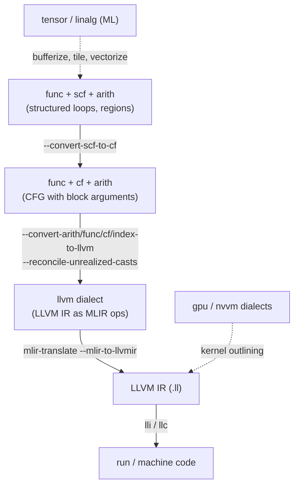

# 05 · MLIR: multi-level IR, dialects and progressive lowering

> Level: advanced · Time: ~3 h · Prereqs: 02-intermediate/04 (SSA), 02-intermediate/05 (LLVM IR), 02-intermediate/07 (passes)

## 1. Why this exists

LLVM IR is one fixed level of abstraction: scalars, pointers, branches. That is perfect for C, but wrong for a TensorFlow graph, a matrix multiplication you want to tile for a GPU's shared memory, a quantum circuit, or a hardware description. Before MLIR, every such domain built its own IR, its own pass manager, its own printer/parser, its own testing tools — and then lowered to LLVM IR too early, throwing away the high-level structure (loops, tensors, parallelism) that the best optimizations need. **MLIR** ("Multi-Level Intermediate Representation"; Lattner et al., "MLIR: Scaling Compiler Infrastructure for Domain Specific Computation", CGO 2021) is a framework for building *many* IRs that share one infrastructure and can be **mixed** in one program and **lowered progressively**, one level at a time. It is now used by many ML compilers (e.g. IREE, Triton's GPU compiler, TPU stacks), Flang (Fortran), CIRCT (hardware), and GPU code generators.

## 2. Intuition: one building, many floors

LLVM IR is a single floor where everyone must speak the same low-level language. MLIR is a building with many floors (dialects): the top floor speaks "tensors and neural-network operators", a middle floor speaks "loops over arrays", a lower floor speaks "branches and integers", the ground floor speaks LLVM IR. A program can have residents from several floors in the same room at the same time, and passes move them down one floor at a time, each floor's optimizations running while their knowledge is still available.

## 3. Precise definitions (MLIR Language Reference)

* "MLIR is fundamentally based on a graph-like data structure of nodes, called **Operations**, and edges, called **Values**." An operation has a name (`dialect.opname`), operands, results, **attributes** (compile-time constants like `value = 42`), successors, and **regions**.
* **Value**: "Each Value is the result of exactly one Operation or Block Argument." Values are SSA and typed.
* **Block**: a list of operations; in control-flow regions, a basic block ending in a terminator.
* **Region**: "A region is an ordered list of MLIR blocks"; regions are *nested inside operations*, so a `scf.for` op literally contains its loop body. This nesting is what keeps structure (loops, functions, modules, GPU kernels) explicit.
* **Dialect**: "Dialects are the mechanism by which to engage with and extend the MLIR ecosystem." Each dialect is a namespace of operations, types and attributes. Built-in dialects include `func`, `arith`, `scf` (structured control flow), `cf` (unstructured control flow), `memref`, `tensor`, `affine`, `linalg`, `vector`, `gpu`, `nvvm`, `llvm`.
* **Block arguments instead of φ**: MLIR is SSA, but blocks take **arguments** and branches pass values, which "eliminates a number of special cases from the IR" compared with "the complex nuances of PHI nodes in traditional SSA representations".
* **Generic form**: every operation can be printed generically as `"dialect.op"(operands) <{properties}> ({regions}) : (types) -> types`; dialects may also define pretty "custom" syntax.
* **Progressive lowering / dialect conversion**: passes rewrite operations of one dialect into another (`scf` → `cf`, `arith` → `llvm`), possibly leaving a mix in between.
* **Interfaces and traits** let generic passes (canonicalisation, CSE, inlining) work on operations they have never heard of, by asking "are you side-effect free?", "can you be folded?".

## 4. Step by step

### 4.1 Write a program in high-level dialects

```text
// file: sum.mlir
// Sum of squares 0..n-1 written with structured control flow (scf.for),
// arithmetic (arith) and functions (func) dialects.
func.func @sum_squares(%n: index) -> i64 {
  %c0 = arith.constant 0 : index
  %c1 = arith.constant 1 : index
  %zero = arith.constant 0 : i64
  // scf.for carries %acc as a loop-carried value ("iter_args") instead of a phi
  %res = scf.for %i = %c0 to %n step %c1 iter_args(%acc = %zero) -> (i64) {
    %iv = arith.index_cast %i : index to i64
    %sq = arith.muli %iv, %iv : i64
    %next = arith.addi %acc, %sq : i64
    scf.yield %next : i64
  }
  return %res : i64
}

// A function the canonicalizer can fold completely.
func.func @folds() -> i64 {
  %a = arith.constant 6 : i64
  %b = arith.constant 7 : i64
  %p = arith.muli %a, %b : i64
  %z = arith.constant 0 : i64
  %r = arith.addi %p, %z : i64
  return %r : i64
}

func.func @main() -> i64 {
  %n = arith.constant 10 : index
  %s = func.call @sum_squares(%n) : (index) -> i64
  return %s : i64
}
```

Reading it: the loop is **one operation** (`scf.for`) with a **region** (its body). There is no back edge and no φ: the loop-carried value is declared with `iter_args` and updated by `scf.yield`. A loop optimizer can see "this is a counted loop from 0 to n step 1" directly — no need to rediscover it from a CFG with dominators (02-intermediate/04). `index` is MLIR's target-width integer type for sizes and indices.

### 4.2 Generic passes work on every dialect: canonicalisation

```text
$ mlir-opt sum.mlir --canonicalize          (only @folds shown)
  func.func @folds() -> i64 {
    %c42_i64 = arith.constant 42 : i64
    return %c42_i64 : i64
  }
```

`--canonicalize` applies each operation's own folding hooks and rewrite patterns plus generic dead-code removal — the MLIR analogue of `instcombine` + `dce`, but defined *per dialect* so it works on tensor or GPU ops too.

The generic form shows what an operation really is (`mlir-opt --mlir-print-op-generic`):

```text
  "func.func"() <{function_type = () -> i64, sym_name = "folds"}> ({
    %0 = "arith.constant"() <{value = 6 : i64}> : () -> i64
    %1 = "arith.constant"() <{value = 7 : i64}> : () -> i64
    %2 = "arith.muli"(%0, %1) <{overflowFlags = #arith.overflow<none>}> : (i64, i64) -> i64
    %3 = "arith.constant"() <{value = 0 : i64}> : () -> i64
    %4 = "arith.addi"(%2, %3) <{overflowFlags = #arith.overflow<none>}> : (i64, i64) -> i64
    "func.return"(%4) : (i64) -> ()
```

Note `overflowFlags = #arith.overflow<none>`: the same `nsw`/`nuw` idea as LLVM IR (03-advanced/04) is carried as an attribute — UB contracts exist at every level.

### 4.3 Lower one level: structured → unstructured control flow

```text
$ mlir-opt sum.mlir --convert-scf-to-cf     (only @sum_squares)
  func.func @sum_squares(%arg0: index) -> i64 {
    %c0 = arith.constant 0 : index
    %c1 = arith.constant 1 : index
    %c0_i64 = arith.constant 0 : i64
    cf.br ^bb1(%c0, %c0_i64 : index, i64)
  ^bb1(%0: index, %1: i64):  // 2 preds: ^bb0, ^bb2
    %2 = arith.cmpi slt, %0, %arg0 : index
    cf.cond_br %2, ^bb2, ^bb3
  ^bb2:  // pred: ^bb1
    %3 = arith.index_cast %0 : index to i64
    %4 = arith.muli %3, %3 : i64
    %5 = arith.addi %1, %4 : i64
    %6 = arith.addi %0, %c1 : index
    cf.br ^bb1(%6, %5 : index, i64)
  ^bb3:  // pred: ^bb1
    return %1 : i64
  }
```

Now there is a CFG: `^bb1` is the loop header and takes **block arguments** `(%0, %1)` = (induction variable, accumulator); each `cf.br` passes values for them. Compare with LLVM's φs below — same information, different encoding. Notice that `func` and `arith` ops are untouched: one program now mixes `func`, `arith` and `cf`.

### 4.4 Lower to the LLVM dialect, translate, run

```text
$ mlir-opt sum.mlir --convert-scf-to-cf --convert-arith-to-llvm --convert-index-to-llvm \
      --convert-func-to-llvm --convert-cf-to-llvm --reconcile-unrealized-casts -o lowered.mlir
```

`lowered.mlir` is entirely in the `llvm` dialect — LLVM IR expressed as MLIR operations:

```text
  llvm.func @sum_squares(%arg0: i64) -> i64 {
    %0 = llvm.mlir.constant(0 : index) : i64
    %1 = llvm.mlir.constant(1 : index) : i64
    %2 = llvm.mlir.constant(0 : i64) : i64
    llvm.br ^bb1(%0, %2 : i64, i64)
  ^bb1(%3: i64, %4: i64):  // 2 preds: ^bb0, ^bb2
    %5 = llvm.icmp "slt" %3, %arg0 : i64
    llvm.cond_br %5, ^bb2, ^bb3
  ^bb2:  // pred: ^bb1
    %6 = llvm.mul %3, %3  : i64
    %7 = llvm.add %4, %6  : i64
    %8 = llvm.add %3, %1  : i64
    llvm.br ^bb1(%8, %7 : i64, i64)
```

`--reconcile-unrealized-casts` removes the temporary `builtin.unrealized_conversion_cast` ops that conversions insert while two type systems (`index` vs `i64`) coexist mid-lowering. Then leave MLIR:

```text
$ mlir-translate --mlir-to-llvmir lowered.mlir -o sum.ll
define i64 @sum_squares(i64 %0) {
  br label %2

2:                                                ; preds = %6, %1
  %3 = phi i64 [ %9, %6 ], [ 0, %1 ]
  %4 = phi i64 [ %8, %6 ], [ 0, %1 ]
  %5 = icmp slt i64 %3, %0
  br i1 %5, label %6, label %10
(loop body and exit block follow, as in the llvm-dialect listing above)
$ lli sum.ll; echo "exit=$?"
exit=29
```

Block arguments became φs. `main` returns Σ i² for i < 10 = 285; the exit status is 285 mod 256 = **29**, exactly what the process reported.



### 4.5 The verifier, at every level

```text
$ cat bad.mlir
func.func @bad(%a: i32, %b: i64) -> i32 {
  %r = arith.addi %a, %b : i32
  return %r : i32
}
$ mlir-opt bad.mlir
bad.mlir:2:23: error: use of value '%b' expects different type than prior uses: 'i32' vs 'i64'
```

Each dialect defines verifiers for its ops; MLIR runs them after parsing and after passes. For compiler testing this gives a cheap oracle at every lowering stage: "a pass produced IR that fails verification" is a crash bug, just as in LLVM.

### 4.6 Why progressive lowering matters

At the `scf`/`affine`/`linalg` level, transformations like loop tiling, fusion and parallelisation are local rewrites on nested regions with known bounds. After lowering to `cf`/`llvm`, the same transformations require rediscovering loops and proving properties from a flat CFG — often impossible. MLIR's thesis is: **optimize at the highest level where the information exists, then lower.** For GPUs, the `gpu` dialect represents host/kernel structure explicitly, and NVIDIA-specific ops live in the `nvvm` dialect before translation to LLVM IR and PTX (04-pro/05).

## 5. Code

All inputs (`sum.mlir`, `bad.mlir`) and every command are shown inline above; MLIR uses `//` comments. Commands use the `mlir-18-tools` Ubuntu package (`mlir-opt`, `mlir-translate` from LLVM 18.1.3), found under `/usr/lib/llvm-18/bin`.

## 6. Common mistakes

* **Forgetting conversion passes** → leftover non-LLVM ops make translation fail. In this sandbox, running `mlir-translate --mlir-to-llvmir` on the output of `--convert-scf-to-cf` alone failed with "Dialect `arith' not found for custom op 'arith.constant'". Lower *every* dialect present and reconcile casts. (Conversely, MLIR 18's `--convert-func-to-llvm` alone already pulled in enough patterns to lower this small file — pass behaviour also varies by version, so test your pipeline rather than trusting a tutorial.)
* **Pass names drift between versions.** MLIR evolves quickly; pass names in tutorials for other LLVM versions (e.g. older `-convert-std-to-llvm`, removed when the `std` dialect was split up) may not exist in yours. Check `mlir-opt --help` for your version.
* **Lowering too early** → losing loop/tensor structure and the optimizations that need it.
* **Confusing MLIR's `index` type with `i64`.** Its width is target-defined; conversions to LLVM map it per data layout.
* **Assuming MLIR replaces LLVM.** For CPU/GPU code it usually *ends* in LLVM IR; it replaces the ad-hoc IRs *above* LLVM.

## 7. Connections

* **ML/LLM agents track** and **AI dev tools track**: ML compilers (XLA/OpenXLA, IREE, Triton) are built on MLIR; `linalg`/`tensor` dialects model neural-network ops.
* **Parallel/CUDA track**: the `gpu` and `nvvm` dialects; kernels outlined into separate modules; lowering to PTX via LLVM's NVPTX back end.
* **Quantum track**: quantum IRs (e.g. QIR builds on LLVM IR; several quantum compilers define MLIR dialects) — the multi-level idea applies to circuits too.
* **Testing/Verification track**: dialect verifiers and `mlir-reduce` (MLIR's test-case reducer) support compiler testing; fuzzing MLIR-based ML compilers is an active research area (04-pro/06).

### Where this shows up in my projects

* **QiskitSage** reviews Qiskit pull requests; Qiskit itself is a *circuit* compiler (its transpiler lowers abstract circuits to a device's native gates in stages) — the same progressive-lowering idea MLIR generalises.
* For **compiler-fuzz**-style testing of an MLIR-based compiler, each lowering stage is a natural differential-testing point: run the program at the `scf` level (via the lowering pipeline with and without optimization passes) and compare results, just as compiler-fuzz compares `-O0` with `-O2`.

## 8. Self-check

1. What three structural features let MLIR represent a loop as a single operation?
2. How does MLIR represent values flowing into a loop header, and what do they become in LLVM IR?
3. What does `--canonicalize` do and why can it work on dialects it doesn't know?
4. Why did `lli sum.ll` exit with status 29?
5. Why is optimizing at the `scf`/`linalg` level easier than at the LLVM IR level?

<details><summary>Answers</summary>

1. Operations can contain regions; regions contain blocks; loop-carried values are explicit (`iter_args` / `scf.yield`).
2. As block arguments passed by branch terminators (`cf.br ^bb1(%x, %y …)`); `mlir-translate` turns them into φ nodes.
3. It applies operation-specific folders and rewrite patterns and removes dead ops; it works generically through interfaces/traits each operation declares (foldable, side-effect free, etc.).
4. `main` returns 285 (sum of squares 0..9); a process exit status keeps only the low 8 bits: 285 mod 256 = 29.
5. Loop bounds, iteration spaces and tensor semantics are explicit; at LLVM IR level they must be reconstructed from a CFG and memory accesses, often impossibly.

</details>

## 9. Mnemonic (Tamil + English)

**"Maadi maadiya irangu"** — *come down floor by floor*: progressive lowering. And for block arguments: **"Phi illa, parcel anuppu"** — *no phi, send a parcel*: each branch carries its values to the next block like a courier parcel.

## Sources

* MLIR Language Reference (operations, values, blocks, regions, dialects, block arguments, generic form): https://mlir.llvm.org/docs/LangRef/
* C. Lattner et al., "MLIR: Scaling Compiler Infrastructure for Domain Specific Computation", CGO 2021: https://research.google/pubs/mlir-scaling-compiler-infrastructure-for-domain-specific-computation/
* C. Lattner et al., "MLIR: A Compiler Infrastructure for the End of Moore's Law", arXiv:2002.11054 (preprint version): https://arxiv.org/abs/2002.11054
* MLIR dialect documentation index (`scf`, `cf`, `arith`, `llvm`, `gpu`, `nvvm`, …): https://mlir.llvm.org/docs/Dialects/
* MLIR passes reference (`-canonicalize`, `-convert-scf-to-cf`, `-reconcile-unrealized-casts`): https://mlir.llvm.org/docs/Passes/
* MLIR Toy tutorial (building a dialect and lowering it): https://mlir.llvm.org/docs/Tutorials/Toy/

## Verify yourself

```bash
# file: verify-05a.sh
# Needs Ubuntu package mlir-18-tools. Tested with MLIR/LLVM 18.1.3, Nov 2026.
export PATH=/usr/lib/llvm-18/bin:$PATH
mlir-opt sum.mlir --canonicalize | grep -A2 "@folds"                     # constant 42
mlir-opt sum.mlir --mlir-print-op-generic | grep -m1 '"arith.muli"'
mlir-opt sum.mlir --convert-scf-to-cf | grep -E "cf\.(br|cond_br)"       # block arguments
mlir-opt sum.mlir --convert-scf-to-cf --convert-arith-to-llvm --convert-index-to-llvm \
  --convert-func-to-llvm --convert-cf-to-llvm --reconcile-unrealized-casts -o lowered.mlir
mlir-translate --mlir-to-llvmir lowered.mlir -o sum.ll && grep -c "phi i64" sum.ll   # 2
lli sum.ll; echo "exit=$?"                                                 # exit=29
printf 'func.func @bad(%%a: i32, %%b: i64) -> i32 {\n  %%r = arith.addi %%a, %%b : i32\n  return %%r : i32\n}\n' > bad.mlir
mlir-opt bad.mlir 2>&1 | head -1                                           # type error
```

Check against sources: definitions against the MLIR Language Reference; pass names against `mlir-opt --help` for your installed version.
