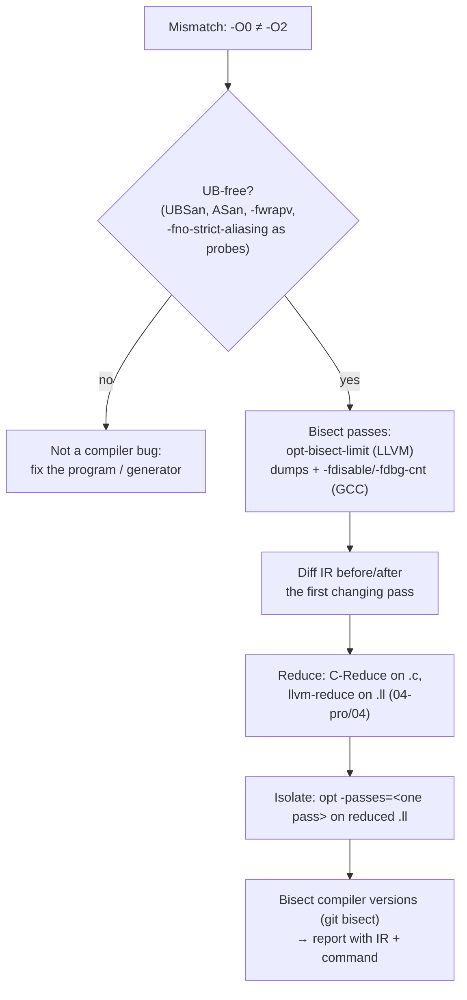

# 06 · Inside an industrial optimizer: pipelines, dumps and pass bisection

> Level: advanced · Time: ~2.5 h · Prereqs: 02-intermediate/07 (passes, pass manager), 03-advanced/04 (UB); basic Python

## 1. Why this exists

When a program behaves differently at `-O0` and `-O2`, there are hundreds of candidate passes. LLVM 18's `-O2` pipeline ran 256 bisectable pass executions on the tiny file used below; GCC 13.3 produced 121 separate dump files for it. You cannot read them all. Compiler engineers have built tools to answer one question fast: **which pass changed the behaviour?** Knowing these tools is what separates "I think the optimizer is broken" from a bug report that names the pass, the function, and the before/after IR — the report that actually gets fixed. It is also the first step of every compiler-testing workflow after a mismatch is found (04-pro/01).

## 2. Intuition: a relay race with a dropped baton

Two hundred runners pass the baton (the program); at the finish it's the wrong baton. You can stop the race after runner *k* and inspect the baton. Binary search: stop after runner 100 — fine? Then the problem is after 100; stop after 150… In about 8 checks you find the runner who swapped it. That runner is the *first pass whose execution changes the outcome* — not necessarily the "guilty" one (it may have legitimately exploited UB or an earlier pass's mistake), but it's where to look.

## 3. Precise definitions and tools

**LLVM**

* `-mllvm -opt-bisect-limit=N` (via `clang`) or `-opt-bisect-limit=N` (via `opt`/`llc`): run only the first *N* "bisectable" pass executions; skip the rest. `-1` means no limit and prints a `BISECT: running pass (k) <Pass> on <unit>` line for every pass execution, which numbers them.
* `-print-after-all`, `-print-before=<pass>`, `-print-after=<pass>`: dump IR around passes. `-print-changed` (variants `diff`, `diff-quiet`, …) prints only when a pass changed the IR. `-filter-print-funcs=<f>` limits output to one function.
* `-debug-pass-manager` (new PM) / `-debug-pass=Structure` (legacy codegen PM): show which passes run.
* `-Rpass=<regex>`, `-Rpass-missed`, `-Rpass-analysis`: optimization remarks (02-intermediate/07).
* For a reduced IR file: `opt -passes='<single pass>'` reproduces a transformation in isolation.

**GCC**

* `-fdump-tree-all`, `-fdump-rtl-all`, `-fdump-ipa-all`: one dump file per pass (`file.c.NNNt.passname`); `-fdump-tree-<pass>` for one.
* `-fdisable-tree-<pass>` / `-fdisable-rtl-<pass>`: skip a specific pass instance; `-fno-<optimization>` flags (e.g. `-fno-tree-fre`, `-fno-tree-pre`) disable optimizations by name.
* `-fdbg-cnt=<counter>:<range>`: GCC's debug counters, which limit how many times specific transformations fire (`-fdbg-cnt-list` lists them) — GCC's closest analogue to opt-bisect.
* `-fopt-info`: "Controls optimization dumps from various optimization passes."

**Both**: bisect across *compiler versions* with `git bisect` on the compiler's repository when a regression appeared between releases.

## 4. Step by step: find the pass that changes `alias.c`

We reuse `alias.c` from lesson 04 (strict-aliasing UB): `-O0` prints 0, `-O2` prints 1 on both compilers. The program is UB, so this is *not* a compiler bug — which makes it a safe, reproducible target for practising the technique. The workflow is identical for a real miscompilation.

```c
// file: alias.c
// Strict aliasing: an int object must not be modified through a float* (UB).
#include <stdio.h>
__attribute__((noinline)) int update(int *i, float *f) {
    *i = 1;
    *f = 0.0f;                   // compiler may assume this cannot change *i (different types)
    return *i;                   // ... so it may return the constant 1
}
int main(void) {
    int x;
    printf("%d\n", update(&x, (float *)&x));   // UB: same object through both pointers
    return 0;
}
```

### 4.1 Dumbest approach: read every dump

`clang -O2 -mllvm -print-after-all` prints the whole module after each of ~256 pass runs; GCC's `-fdump-tree-all` wrote 121 files. Possible for a toy, hopeless for a 5,000-line Csmith program.

### 4.2 Better: bisect the pass sequence

Count the passes (`-opt-bisect-limit=-1` prints 256 `BISECT:` lines here), confirm `limit=0` behaves like `-O0` and `limit=-1` like `-O2`, then binary-search. `log₂ 256 = 8` compile-and-run cycles.

```python
# file: bisect.py
# Find the FIRST optimization pass whose execution changes a program's output,
# by binary search over LLVM's -opt-bisect-limit (passes after the limit are skipped).
# Usage: python3 bisect.py prog.c
import subprocess, sys, re

SRC = sys.argv[1]

def output_with_limit(limit):
    """Compile with clang -O2 running only passes 1..limit, run it, return stdout."""
    subprocess.run(["clang", "-O2", "-mllvm", f"-opt-bisect-limit={limit}", SRC, "-o", "bis.out"],
                   check=True, capture_output=True)
    return subprocess.run(["./bis.out"], capture_output=True, text=True).stdout

def pass_name(n):
    """Ask clang which pass has bisect number n (it prints 'BISECT: running pass (n) ...')."""
    log = subprocess.run(["clang", "-O2", "-mllvm", "-opt-bisect-limit=-1", SRC, "-o", "bis.out"],
                         capture_output=True, text=True).stderr
    m = re.search(rf"BISECT: running pass \({n}\) (.*)", log)
    return m.group(1) if m else "?"

if __name__ == "__main__":
    good = output_with_limit(0)            # no optimization passes at all
    bad = output_with_limit(-1)            # -1 = no limit: the full -O2 pipeline
    print(f"limit=0 prints {good!r}, full -O2 prints {bad!r}")
    if good == bad:
        sys.exit("outputs agree: nothing to bisect")
    lo, hi = 0, 100000                     # invariant: limit lo behaves 'good', hi behaves 'bad'
    while hi - lo > 1:
        mid = (lo + hi) // 2               # // is integer division
        if output_with_limit(mid) == good:
            lo = mid
        else:
            hi = mid
    print(f"first pass that changes the output: #{hi}: {pass_name(hi)}")
```

Python syntax notes:

* `subprocess.run([...], check=True, capture_output=True)` runs a command (list = program + arguments); `check=True` raises an exception if it fails.
* `rf"BISECT: running pass \({n}\) (.*)"` — an *r*aw *f*-string: backslashes are kept for the regex (`\(` = a literal parenthesis), `{n}` is substituted.
* `re.search(pattern, text)` returns a match object or `None`; `m.group(1)` is the text captured by the first `( … )`.
* `sys.exit("message")` prints the message and exits with status 1.

Logic: the loop maintains the invariant "limit `lo` gives the good output, limit `hi` gives the bad one"; any limit ≥ the total number of passes behaves like the full pipeline, so starting `hi` at 100000 is safe.

```text
$ python3 bisect.py alias.c
limit=0 prints '0\n', full -O2 prints '1\n'
first pass that changes the output: #18: InstCombinePass on update
```

### 4.3 Look at exactly what that pass did

```text
$ clang -O2 -mllvm -opt-bisect-limit=17 -S -emit-llvm alias.c -o lim17.ll
$ clang -O2 -mllvm -opt-bisect-limit=18 -S -emit-llvm alias.c -o lim18.ll
$ diff <(sed -n '/define.*@update/,/^}/p' lim17.ll) <(sed -n '/define.*@update/,/^}/p' lim18.ll)
4,5c4
<   %3 = load i32, ptr %0, align 4, !tbaa !5
<   ret i32 %3
---
>   ret i32 1
```

InstCombine forwarded the stored `1` to the load, skipping the intervening `float` store because the `!tbaa` metadata says an `i32` access and a `float` access cannot alias. `-print-changed` shows the same story pass by pass:

```text
$ clang -O2 -mllvm -print-changed=diff-quiet -mllvm -filter-print-funcs=update -c alias.c -o /dev/null
*** IR Dump After SROAPass on update ***
-  %3 = alloca ptr, align 8
-  %4 = alloca ptr, align 8
-  store ptr %0, ptr %3, align 8, !tbaa !5
-  store ptr %1, ptr %4, align 8, !tbaa !5
-  %5 = load ptr, ptr %3, align 8, !tbaa !5
-  store i32 1, ptr %5, align 4, !tbaa !9
-  %6 = load ptr, ptr %4, align 8, !tbaa !5
-  store float 0.000000e+00, ptr %6, align 4, !tbaa !11
-  %7 = load ptr, ptr %3, align 8, !tbaa !5
-  %8 = load i32, ptr %7, align 4, !tbaa !9
-  ret i32 %8
+  store i32 1, ptr %0, align 4, !tbaa !5
+  store float 0.000000e+00, ptr %1, align 4, !tbaa !9
+  %3 = load i32, ptr %0, align 4, !tbaa !5
+  ret i32 %3
*** IR Dump After InstCombinePass on update ***
```

### 4.4 The same hunt in GCC

```text
$ gcc -O2 -fdump-tree-all -c alias.c -o /dev/null && ls alias.c.* | wc -l
121
```

Scanning the dumps in pass order for the body of `update`: in `alias.c.038t.ealias` it still ends `_6 = *i_2(D); return _6;`; in `alias.c.039t.fre1` it is `return 1;`. The culprit-pass is **FRE** (full redundancy elimination), GCC's value-numbering pass, using type-based alias analysis.

Now a trap: try to *confirm* by disabling it.

```text
$ gcc -O2 -fno-tree-fre alias.c -o g1 && ./g1                    → 1
$ gcc -O2 -fno-tree-fre -fno-tree-pre alias.c -o g2 && ./g2      → 1
$ gcc -O2 -fdisable-tree-fre1 alias.c -o g3 && ./g3              → 1
$ gcc -O2 -fno-strict-aliasing alias.c -o g4 && ./g4             → 0
```

Disabling FRE didn't restore `0` — other passes perform the same TBAA-based forwarding later in the pipeline. Only removing the *underlying assumption* (`-fno-strict-aliasing`) does. Lesson: **the first pass that changes behaviour is a lead, not a verdict.** Redundant passes, and the root cause (here, the UB) can be elsewhere.



## 5. Code

`alias.c` and `bisect.py` are above; all outputs are from Clang 18.1.3 and GCC 13.3 in this sandbox.

## 6. Common mistakes

* **Bisecting a program with UB** and filing the result as a compiler bug. Probe first: if `-fwrapv`, `-fno-strict-aliasing` or `-fno-delete-null-pointer-checks` make the difference disappear, suspect UB.
* **Assuming the first changing pass is the buggy pass.** It may have correctly exploited UB, or exposed an earlier pass's wrong IR. Check the IR after the earlier passes with `opt -passes=verify` and by reasoning about each transformation.
* **Forgetting that `-opt-bisect-limit` doesn't cover everything.** Per LLVM's OptBisect page, passes that "must be run or do not modify the IR" never check the limit — in general analysis passes, passes run at `CodeGenOptLevel::None`, and passes required for register allocation — so a bug in them won't bisect cleanly. With LTO, `-mllvm` options given to the driver don't affect the link-time passes.
* **Using `-O0` IR + `opt` to reproduce** → `optnone` blocks passes; use `-O1 -Xclang -disable-llvm-passes`.
* **Comparing dumps from different compiler builds** — pass numbers in GCC dump names change between versions.
* **Non-deterministic outputs** (uninitialised memory, address-dependent hashing) make bisection flip-flop; make the program deterministic first.

## 7. Connections

* **Git track**: `git bisect` is the same binary search over commits instead of passes.
* **DSA track**: binary search with an invariant — `lo` good, `hi` bad.
* **Testing/Verification track**: triage, root-causing, minimal reproducers; pass bisection + test-case reduction (04-pro/04) is the standard pipeline.
* **Linux track**: shell process substitution `<(...)` used in the `diff` command.

### Where this shows up in my projects

When **compiler-fuzz** flags a GCC-vs-Clang or `-O0`-vs-`-O2` mismatch on a UB-free program, this lesson is the triage procedure: `opt-bisect-limit` (Clang side) or dumps plus `-fdisable-tree-…` (GCC side) to localise the pass, then the ddmin reducer to shrink the program, then a single-pass `opt` reproducer for the bug report.

## 8. Self-check

1. What does `-opt-bisect-limit=0` do, and why compare it with `-1`?
2. Why does binary search need at most about 8 compilations for 256 passes?
3. In the GCC experiment, why did `-fno-tree-fre` not restore the `-O0` output?
4. What evidence would convince you a mismatch is a real compiler bug rather than UB?
5. Why is the IR diff around the first changing pass more useful in a bug report than the final assembly?

<details><summary>Answers</summary>

1. It skips all bisectable passes (behaves like an unoptimized pipeline); `-1` removes the limit (full pipeline). They are the "good" and "bad" endpoints of the search.
2. Each test halves the interval; ⌈log₂ 256⌉ = 8.
3. Later passes perform the same TBAA-based load forwarding; the root cause is the strict-aliasing assumption, removed only by `-fno-strict-aliasing`.
4. The program runs clean under UBSan/ASan (and ideally a stricter checker like KCC/Frama-C), its result is the same with `-fwrapv`/`-fno-strict-aliasing`, at least one compiler/level gives the standard-mandated result, and the reduced program still shows the difference.
5. It shows the precise transformation and lets developers reproduce it with a single `opt -passes=…` command, independent of the rest of the pipeline and the back end.

</details>

## 9. Mnemonic (Tamil + English)

**"Paadhi paadhi-ya pirichu paaru"** — *split it half and half and look*: binary search over passes. And the triage order: **"UB-ya? Pass-a? Chinnadha? Report-u!"** — *Is it UB? Which pass? Make it small. Report it.*

## Sources

* LLVM, "Using -opt-bisect-limit to debug optimization errors": https://llvm.org/docs/OptBisect.html
* LLVM, "Using the New Pass Manager" (pipelines, `-print-*` instrumentation): https://llvm.org/docs/NewPassManager.html
* Clang User's Manual (`-Rpass` remarks, `-mllvm`): https://clang.llvm.org/docs/UsersManual.html
* GCC Developer Options (`-fdump-tree-all`, `-fdisable-…`, `-fdbg-cnt`, `-fopt-info`): https://gcc.gnu.org/onlinedocs/gcc/Developer-Options.html
* GCC Optimize Options (`-fno-tree-fre`, `-fstrict-aliasing`): https://gcc.gnu.org/onlinedocs/gcc/Optimize-Options.html
* Git documentation, `git bisect`: https://git-scm.com/docs/git-bisect
* C. Lattner, "What Every C Programmer Should Know About Undefined Behavior #1/3" (TBAA): https://blog.llvm.org/2011/05/what-every-c-programmer-should-know.html

## Verify yourself

```bash
# file: verify-06a.sh
# Tested with Clang 18.1.3, GCC 13.3, Python 3.13, Nov 2026.
clang -O2 -mllvm -opt-bisect-limit=-1 alias.c -o t 2>&1 | grep -c BISECT        # number of pass runs (256 here)
python3 bisect.py alias.c                                                         # #18 InstCombinePass on update
for n in 17 18; do clang -O2 -mllvm -opt-bisect-limit=$n -S -emit-llvm alias.c -o lim$n.ll 2>/dev/null; done
diff <(sed -n '/define.*@update/,/^}/p' lim17.ll) <(sed -n '/define.*@update/,/^}/p' lim18.ll)
gcc -O2 -fdump-tree-all -c alias.c -o /dev/null && ls alias.c.* | wc -l
awk '/;; Function update/{p=1} /;; Function main/{p=0} p' alias.c.*t.fre1 | grep return    # return 1;
for f in "-fno-tree-fre" "-fno-strict-aliasing"; do gcc -O2 $f alias.c -o g && echo "$f: $(./g)"; done
```

Check against sources: opt-bisect semantics against LLVM's OptBisect page; the `-fdisable-…`/`-fdbg-cnt` options against GCC's Developer Options.
