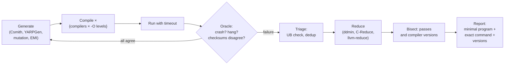

# 01 · The compiler-testing landscape: oracles, bug types and the triage pipeline

> Level: pro · Time: ~3 h · Prereqs: 01-beginner/05 (differential testing), 03-advanced/04 (UB), 03-advanced/06 (pass bisection)

## 1. Why this exists

Compilers are among the most-used and most-trusted programs in existence: a miscompilation silently corrupts *every* program built with the faulty path, and nobody suspects the compiler. Yet compilers are also among the hardest programs to test. The Csmith authors' first sentence is "Compilers should be correct", and their finding after three years of random testing was that "Every compiler we tested was found to crash and also to silently generate wrong code when presented with valid input" — more than 325 previously unknown bugs, 79 in GCC and 202 in LLVM, across 11 compiler teams. This lesson is the map of the field: what counts as a compiler bug, how we decide a test failed (the **oracle**), where test programs come from, and what happens after a failure is found.

## 2. Intuition: grading an exam without an answer key

Testing an ordinary function, you know the right answer (`sort([3,1,2]) == [1,2,3]`). For a compiler and a random 5,000-line program you don't: what *should* it print? Compiler testers grade without an answer key by (1) asking several students and taking the majority (differential testing), (2) asking the same student the same question rephrased and checking consistency (metamorphic testing), or (3) only checking things that are wrong regardless of the answer — the student fainted (crash) or never finished (hang).

## 3. Precise definitions

**Bug classes** (EMI's study classified its 147 GCC/LLVM bugs as 95 wrong-code, 33 crash, 19 performance):

| Class | Symptom | Severity |
|---|---|---|
| **Crash / ICE** | compiler aborts, assertion fails, "internal compiler error", "PLEASE submit a bug report" | annoying but loud |
| **Wrong code (miscompilation)** | compiler succeeds; the binary's observable behaviour differs from the language semantics | worst: silent |
| **Hang / compile-time blow-up** | compiler doesn't finish or takes super-linear time | DoS for builds |
| **Performance bug** | correct but much slower code than expected (cf. 03-advanced/02's allocator measurement) | silent, costly |
| **Rejects-valid / accepts-invalid** | front end rejects a legal program or accepts an illegal one | portability |

**The challenges** (Chen et al., "A Survey of Compiler Testing", *ACM Computing Surveys* 53(1), 2020): "the lack of a formal specification of what exactly a compiler is supposed to do", "the semantic richness of the input and output languages", and the fact that "compilers have various options and features".

**Test oracles**

* **Crash oracle**: any compiler crash on any input is a bug. Free, but finds only crashes.
* **Differential testing** (McKeeman, *Digital Technical Journal* 10(1), 1998): compare implementations that should agree. Three strategies in the survey's terms: *cross-compiler* (GCC vs Clang), *cross-optimization* (`-O0` vs `-O2` — "the most widely used strategy in the existing compiler-testing research"), *cross-version* (GCC 12 vs GCC 13). With three or more implementations, "a tester can use voting to heuristically determine which implementations are wrong." Limitation: if all compilers make the same mistake, it goes unnoticed.
* **Metamorphic testing**: transform the program in a way whose effect on the output is known (often "no effect") and check. EMI is the flagship (04-pro/03).
* **Reference semantics**: an interpreter or executable formal semantics (e.g. KCC for C, CompCert's interpreter) serves as the answer key.
* **Translation validation / verification**: prove each compilation correct (Alive2) or the compiler itself correct (CompCert) — 04-pro/06.

**Test-program sources** (survey taxonomy): hand-written suites (GCC's testsuite, LLVM's `test/` and `llvm-test-suite`); **grammar-directed** generation ("take a language grammar as their input"); **grammar-aided** generation with semantic constraints (Csmith); **mutation** of existing programs, semantics-preserving or not ("the main idea of program mutation is to modify parts of an existing test program"); and newer learning-based/LLM-based generators.

**The validity requirement**: a test program must have *defined* behaviour (03-advanced/04) and *deterministic* output, or the oracle produces false alarms.

## 4. Step by step: from a random program to a fixed bug



### 4.1 Dumbest approach: hand-write tests

Every compiler has thousands of hand-written regression tests. They catch regressions of known bugs, but humans write "normal" code; bugs hide in strange combinations of features no human writes. **Wall → automation.**

### 4.2 Random programs + a crash oracle

Feed random inputs and wait for crashes (classic fuzzing). Random *bytes* are rejected by the lexer immediately; random *grammar-valid* programs get further but are mostly ill-typed or full of UB, so they only test the front end's error paths. **Wall → generators that produce valid, UB-free, deterministic programs**, and an oracle that catches wrong code, not just crashes.

### 4.3 Csmith-style randomized differential testing

Csmith-generated programs compute over global variables and, at the end, print "a checksum of its non-pointer global variables". Compile each program with several compilers at several levels (the paper used `-O0, -O1, -O2, -Os, -O3`); any checksum disagreement on a UB-free program is a bug somewhere.

### 4.4 Then the expensive part: triage

A raw failure is a 2,500-line program with an unreadable checksum difference. Before anyone will fix it you must: confirm it's UB-free (sanitizers, multiple tools); **deduplicate** (100 failures are often 3 bugs — dedup heuristics compare reduced programs, crash stack traces, or the first pass that changes behaviour); **reduce** (04-pro/04) to a few lines; **bisect** the pass (03-advanced/06) and the compiler version (git bisect); and report with versions, flags, the minimal program and expected vs actual output.

### 4.5 Saturation: why yesterday's fuzzer finds nothing today

YARPGen's authors observe that "any given random test-case generator, testing a particular compiler, will eventually reach a saturation point" where "it finds very few new bugs", and that Csmith "had reached apparent saturation on the then-current versions of GCC and LLVM" — "not because the compiler is bug-free" but because "the generator contains biases that make it incapable of exercising specific parts of the compiler implementation." The research frontier is therefore about *new kinds* of programs and oracles, not more CPU hours on the same generator. The experiment below shows saturation directly.

## 5. Code: a Csmith-driven differential harness (`csmith_diff.py`)

Requires `csmith` and its runtime header package (`libcsmith-dev` on Ubuntu — `csmith.h` lives in `/usr/include/csmith`).

```python
# file: csmith_diff.py
# Randomized differential testing in the style of Csmith (PLDI 2011):
# generate a program, compile it with several compilers x optimization levels,
# run each binary, and compare the printed checksums. Majority vote names the odd one out.
# Usage: python3 csmith_diff.py FIRST_SEED COUNT
import subprocess, sys, os, collections, concurrent.futures

COMPILERS = ["gcc", "clang"]
LEVELS = ["-O0", "-O1", "-O2", "-O3"]
INC = "-I/usr/include/csmith"              # csmith.h from Ubuntu's libcsmith-dev package
os.makedirs("work", exist_ok=True)

def run(cmd, timeout):
    """Run a command; return (status, stdout+stderr). status 'timeout' if it took too long."""
    try:
        p = subprocess.run(cmd, capture_output=True, text=True, timeout=timeout)
        return p.returncode, p.stdout + p.stderr
    except subprocess.TimeoutExpired:
        return "timeout", ""

def test_seed(seed):
    src = f"work/s{seed}.c"
    status, _ = run(["csmith", "--seed", str(seed), "-o", src], 30)
    if status != 0:
        return seed, "generator-failed", {}
    results = {}                            # "gcc -O2" -> checksum line / failure kind
    for cc in COMPILERS:
        for lvl in LEVELS:
            exe = f"work/s{seed}_{cc}{lvl}"
            st, out = run([cc, lvl, "-w", INC, src, "-o", exe], 120)
            if st == "timeout":
                results[f"{cc} {lvl}"] = "COMPILER-HANG"; continue
            if st != 0:                     # compiler rejected or crashed on valid code
                crash = "internal compiler error" in out or "PLEASE submit a bug report" in out
                results[f"{cc} {lvl}"] = "COMPILER-CRASH" if crash else "COMPILE-ERROR"; continue
            st, out = run([exe], 10)
            results[f"{cc} {lvl}"] = "RUN-TIMEOUT" if st == "timeout" else out.strip()
    checksums = {k: v for k, v in results.items() if v.startswith("checksum")}
    if any(v.startswith("COMPILER") for v in results.values()):
        verdict = "CRASH/HANG"
    elif len(checksums) < len(results):
        verdict = "inconclusive (some binary timed out)"   # Csmith programs may loop for a long time
    elif len(set(checksums.values())) == 1:
        verdict = "agree"
    else:
        verdict = "WRONG-CODE?"
    return seed, verdict, results

if __name__ == "__main__":
    first, count = int(sys.argv[1]), int(sys.argv[2])
    tally = collections.Counter()
    with concurrent.futures.ThreadPoolExecutor(max_workers=2) as pool:   # 2 seeds in parallel
        for seed, verdict, results in pool.map(test_seed, range(first, first + count)):
            tally[verdict] += 1
            if verdict not in ("agree",):
                votes = collections.Counter(results.values())
                print(f"seed {seed}: {verdict}  votes={dict(votes)}")
    print("summary:", dict(tally))
```

Python syntax notes:

* `try: … except subprocess.TimeoutExpired:` — exception handling (like checking an error code, but the error jumps to the `except` block).
* `{k: v for k, v in results.items() if v.startswith("checksum")}` — dict comprehension with a filter.
* `set(checksums.values())` — the distinct checksums; one element means everyone agrees.
* `collections.Counter(...)` — counts occurrences: `Counter(["a","b","a"]) == {"a": 2, "b": 1}`; `tally[verdict] += 1` works even for new keys.
* `concurrent.futures.ThreadPoolExecutor(max_workers=2)` and `pool.map(f, seeds)` — run `f` on several seeds concurrently (threads are fine here because the real work happens in child processes).
* `results[...] = "COMPILER-HANG"; continue` — two statements on one line separated by `;`.

Logic: each seed yields 8 binaries (2 compilers × 4 levels). The verdict separates **crash/hang** (compiler failure), **inconclusive** (the *generated program* didn't finish in 10 s — Csmith programs can legitimately run very long loops; that's not a compiler bug), **agree**, and **WRONG-CODE?** (checksum disagreement — then the `votes` counter shows which configurations are in the minority).

```text
$ time python3 csmith_diff.py 1 20          # Csmith 2.3.0, GCC 13.3, Clang 18.1.3
seed 20: inconclusive (some binary timed out)  votes={'RUN-TIMEOUT': 8}
summary: {'agree': 19, 'inconclusive (some binary timed out)': 1}
real	1m42.870s
```

160 compilations, zero disagreements, zero crashes: saturation in miniature. Stock Csmith has been run against GCC and LLVM for well over a decade, so finding a new bug this way now needs many CPU-days or a better generator. That is the motivation for YARPGen's generation policies, EMI-style mutation (04-pro/03), and new targets such as GPU and ML compilers (04-pro/05–06).

## 6. Common mistakes

* **Reporting a "miscompilation" in a program with UB or unspecified behaviour** (03-advanced/04 §4.5: GCC and Clang legitimately evaluate arguments in different orders).
* **Treating a run timeout as a compiler bug.** It usually means the generated program loops for a long time; mark it inconclusive (or detect it at `-O0` first and skip the seed).
* **No timeouts at all** → one hanging compile stalls the whole campaign.
* **Not recording exact versions, flags and seeds** → irreproducible reports. Csmith seeds make programs reproducible: `csmith --seed 42` regenerates the same file *for the same Csmith version*.
* **Filing 50 reports for one bug.** Reduce and deduplicate first.
* **Measuring success by CPU hours.** Measure new, *distinct*, confirmed bugs — and expect saturation.

## 7. Connections

* **Testing/Verification track**: test oracles, fuzzing, metamorphic testing, property-based testing — compiler testing is their hardest application.
* **Security track**: compiler bugs can silently remove security checks (STACK); fuzzing infrastructure (OSS-Fuzz runs fuzzers for LLVM components).
* **Research skills track**: how to evaluate a testing tool (bugs found, confirmed, fixed; comparisons; saturation curves).
* **Cloud/DevOps track**: running fuzzing campaigns at scale (parallel workers, deduplicated bug databases, CI integration).

### Where this shows up in my projects

This lesson *is* **compiler-fuzz**'s design space: a UB-free random C generator (generation), GCC 15.2 vs Clang 21.1 at `-O0/-O2/-O3` (cross-compiler + cross-optimization oracles), a ddmin reducer (triage), and planted-bug validation (proving the oracle can fail). The saturation argument above is also the strongest motivation for its next research step — extending it towards GPU compiler testing, where generators are far less mature.

## 8. Self-check

1. Name the four main compiler bug classes and which is most dangerous.
2. What are the three differential-testing strategies, and which is most used in research?
3. Why must generated programs be UB-free *and* deterministic?
4. What does "saturation" mean, and what causes it according to the YARPGen paper?
5. List the triage steps between "checksums differ" and "bug report filed".

<details><summary>Answers</summary>

1. Crashes (ICEs), wrong code, hangs/compile-time blow-ups, performance bugs (plus rejects-valid/accepts-invalid). Wrong code is most dangerous because it is silent.
2. Cross-compiler, cross-optimization, cross-version; cross-optimization is the most widely used.
3. Otherwise compilers may legitimately produce different outputs, and the oracle reports false positives.
4. A generator finds fewer and fewer new bugs in a given compiler over time; caused by the generator's biases preventing it from exercising parts of the compiler, not by the compiler being bug-free.
5. Confirm UB-freedom, deduplicate, reduce, bisect passes and compiler versions, then report with minimal program, exact commands, versions, expected vs actual output.

</details>

## 9. Mnemonic (Tamil + English)

**"Moonu per, oru answer"** — *three people, one answer*: voting in differential testing. And the pipeline: **"Generate, Compare, Chinnadhaakku, Kandupidi, Sollu"** — *Generate, Compare, Make-it-small, Find (the pass/version), Tell (report)*.

## Sources

* X. Yang, Y. Chen, E. Eide, J. Regehr, "Finding and Understanding Bugs in C Compilers", PLDI 2011: https://www-old.cs.utah.edu/~regehr/papers/pldi11-preprint.pdf
* J. Chen, J. Patra, M. Pradel, Y. Xiong, H. Zhang, D. Hao, L. Zhang, "A Survey of Compiler Testing", *ACM Computing Surveys* 53(1), 2020: https://tjusail.github.io/people/chenjunjie/files/CSUR20.pdf
* W. M. McKeeman, "Differential Testing for Software", *Digital Technical Journal* 10(1):100–107, 1998 (citation via): https://en.wikipedia.org/wiki/Differential_testing
* V. Le, M. Afshari, Z. Su, "Compiler Validation via Equivalence Modulo Inputs", PLDI 2014 (bug-type breakdown): https://www.cs.ucdavis.edu/~su/publications/emi.pdf
* V. Livinskii, D. Babokin, J. Regehr, "Random Testing for C and C++ Compilers with YARPGen", OOPSLA 2020 (saturation): https://users.cs.utah.edu/~regehr/yarpgen-oopsla20.pdf
* Csmith source and documentation: https://github.com/csmith-project/csmith

## Verify yourself

```bash
# file: verify-01p.sh
# Needs: csmith, libcsmith-dev (Ubuntu), gcc, clang. Tested Csmith 2.3.0, GCC 13.3, Clang 18.1.3, Nov 2026.
csmith --version | head -1
csmith --seed 42 -o s42.c && gcc -O2 -w -I/usr/include/csmith s42.c -o s42 && ./s42      # checksum = CE48DB53 (Csmith 2.3.0)
clang -O2 -w -I/usr/include/csmith s42.c -o s42c && ./s42c                               # same checksum
python3 csmith_diff.py 1 20             # ~2 minutes on 2 cores; expect mostly "agree"
```

Check against sources: bug counts against the PLDI 2011 abstract and EMI's Table; oracle taxonomy against the survey's Section 4.
