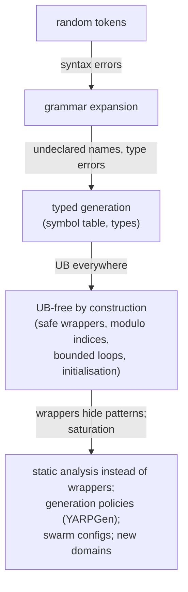

# 02 · Random program generation: Csmith, YARPGen and building a UB-free generator

> Level: pro · Time: ~3.5 h · Prereqs: 04-pro/01 (oracles, saturation), 03-advanced/04 (UB), 02-intermediate/02 (type checking)

## 1. Why this exists

Differential testing is only as good as its inputs. The inputs must be **(1) valid** (accepted by the compiler), **(2) free of undefined and unspecified behaviour** (so all compilers *must* agree), **(3) terminating and deterministic**, and **(4) expressive** — rich enough to drive the optimizer into rare corners. Satisfying (1)–(3) is easy for boring programs and very hard for interesting ones. Csmith (PLDI 2011) showed that a generator meeting all four can find hundreds of bugs; YARPGen (OOPSLA 2020) showed how to keep finding them after the first generator saturates. This lesson takes those designs apart and then builds a small generator with the same guarantees — and *measures* what happens when you drop them.

## 2. Intuition: writing random sentences that a strict teacher must accept

Random letters fail the spelling check. Random grammatical sentences fail the meaning check ("The colourless idea ate Tuesday"). To test a strict teacher (the compiler), you need random sentences that are grammatical, meaningful, *and* unambiguous — so that every competent teacher must mark them the same way. A generator is a sentence-writer that keeps a rulebook in its head (types, scopes, value ranges) and only writes sentences the rulebook permits.

## 3. Precise definitions

* **Generative (grammar-directed) fuzzing**: produce programs by expanding a grammar; guarantees syntactic validity only.
* **Grammar-aided / semantics-aware generation**: expansion guided by type, scope and value constraints (Csmith is the survey's main example).
* **Validity by construction** vs **filtering**: either never generate invalid/UB programs, or generate freely and discard with a checker (UBSan, KCC, Frama-C). Construction is cheaper per program; filtering is simpler to write but wastes most outputs.
* **Csmith's UB-avoidance mechanisms** (PLDI 2011, Table 1):
  * *Integer safety*: "a family of wrapper functions for arithmetic operators whose operands might overflow", plus cases like `INT_MIN % -1` and signed left shifts;
  * *Type safety*: qualifiers (`const`, `volatile`) never cast away;
  * *Pointer safety*: a whole-program flow-sensitive pointer analysis plus null checks; pointers to out-of-scope locals never dereferenced;
  * *Effect safety*: an interprocedural effect analysis ensuring no location is both read and written, or written twice, between sequence points (which also covers unspecified argument-evaluation order);
  * *Array safety*: indices bounded by loop structure, forced in bounds with modulo, explicit checks where needed;
  * *Initializer safety*: explicit initialisers; no `goto` over initialisation;
  * *Loops*: a fixpoint dataflow analysis when a back edge is added; unsafe statements removed.
* **Csmith's oracle hook**: every program ends by printing a checksum of all non-pointer globals.
* **YARPGen** (Livinskii, Babokin, Regehr, OOPSLA 2020): generates "expressive programs that avoid undefined behavior without using dynamic checks" by running static analysis *during* generation and rewriting would-be-UB operations into safe equivalents ("interleaves analysis and code generation"); **generation policies** skew random choices so specific optimizations fire more — "increase the number of times these optimizations are applied by the compiler by an average of 20% for LLVM and 40% for GCC". Found "more than 220 bugs in GCC, LLVM, and the Intel® C++ Compiler" (83 GCC, 62 LLVM, 76 Intel).
* **Swarm testing / configuration diversity**: randomly *disable* language features per program (Csmith flags such as `--no-pointers`, `--no-structs`, `--no-arrays`) so that some programs stress features others would drown out.

## 4. Step by step: from random text to a useful generator

### 4.1 Dumbest: random tokens

Emit random C tokens. Nearly every output is a syntax error → you test only the parser's error path.

### 4.2 Grammar expansion

Expand `expr → expr + expr | (expr) | number | name`. Syntax is fine, but names are undeclared, types mismatch, and `x / 0` appears constantly. **Wall: semantic validity.** Track a symbol table and generate only declared names of the requested type (the type checker of 02-intermediate/02 run in reverse: "give me an expression *of type int32*").

### 4.3 Typed generation — but UB everywhere

Now programs compile, but `INT_MAX + 1`, `1 << 40`, `a[i]` with a random `i`, uninitialised reads… Every one is UB. **Wall: UB.** We measure the damage in §5.3: with raw operators, *all* of 100 programs executed UB and 44 of them printed different results under different compilers/levels — 44 false "bugs".

### 4.4 UB-free by construction

Csmith's answer: wrap every risky operation. Its `safe_math.h` (shipped with Csmith; Ubuntu package `libcsmith-dev`) defines, for example:

```c
/* excerpt from /usr/include/csmith/safe_math.h (Csmith 2.3.0) */
FUNC_NAME(div_func_int32_t_s_s)(int32_t si1, int32_t si2 LOG_INDEX)
{
  LOG_EXEC
  return
#ifndef UNSAFE
    ((si2 == 0) || ((si1 == INT32_MIN) && (si2 == (-1)))) ?
    (UNDEFINED(si1)) :
#endif
    (si1 / si2);
}
```

with `#define UNDEFINED(__val) (__val)` in `csmith_minimal.h`: when the real operation would be undefined, the wrapper **returns the first operand**. The program stays expressive (division really happens most of the time) and is UB-free on every path. Indices use `% size`; loops have bounded trip counts; everything is initialised.

### 4.5 The cost of safety, and the next wall: expressiveness

Wrappers have a price: the optimizer sees `safe_div(a, b)` with a branch, not a bare `a / b`, so some optimizations fire less often — and patterns that trigger deep optimizer bugs (vectorizable loops, specific idioms) may never be generated. That bias is part of why Csmith saturated. YARPGen's two answers: **avoid wrappers** by proving safety statically during generation (rewrite only when analysis says UB is possible), and **generation policies** (e.g. bias towards patterns that trigger arithmetic simplifications, loop optimizations, common subexpressions).



## 5. Code

### 5.1 `minismith.py`: a miniature Csmith

```python
# file: minismith.py
# A miniature Csmith: generates random C programs that are UB-free BY CONSTRUCTION.
#  - every arithmetic op goes through a "safe" wrapper (Csmith returns the first operand
#    when the real operation would be undefined; we do the same)
#  - array indices are reduced modulo the array size
#  - loops have constant bounds, so every program terminates
#  - all variables are initialised; the output is a checksum of all globals
# Usage: python3 minismith.py SEED [--unsafe]   (--unsafe emits raw operators: UB is possible)
import random, sys

HEADER = r"""#include <stdio.h>
#include <stdint.h>
/* Safe wrappers in the style of Csmith's safe_math.h: on would-be UB, return a. */
static int32_t safe_add(int32_t a, int32_t b) { return ((b > 0 && a > INT32_MAX - b) || (b < 0 && a < INT32_MIN - b)) ? a : a + b; }
static int32_t safe_sub(int32_t a, int32_t b) { return ((b < 0 && a > INT32_MAX + b) || (b > 0 && a < INT32_MIN + b)) ? a : a - b; }
static int32_t safe_mul(int32_t a, int32_t b) { int64_t r = (int64_t)a * b; return (r > INT32_MAX || r < INT32_MIN) ? a : (int32_t)r; }
static int32_t safe_div(int32_t a, int32_t b) { return (b == 0 || (a == INT32_MIN && b == -1)) ? a : a / b; }
static int32_t safe_mod(int32_t a, int32_t b) { return (b == 0 || (a == INT32_MIN && b == -1)) ? a : a % b; }
static int32_t safe_shl(int32_t a, int32_t b) { return (b < 0 || b >= 31 || a < 0 || a > (INT32_MAX >> b)) ? a : a << b; }
static int32_t safe_shr(int32_t a, int32_t b) { return (b < 0 || b >= 32 || a < 0) ? a : a >> b; }
static int32_t safe_neg(int32_t a) { return a == INT32_MIN ? a : -a; }
static uint32_t crc = 0;
static void mix(int32_t v) { crc = crc * 31u + (uint32_t)v; }   /* unsigned: wraps, no UB */
"""

class Gen:
    def __init__(self, seed, unsafe=False, n_globals=6, arr_size=8):
        self.rng = random.Random(seed)
        self.unsafe = unsafe
        self.globals = [f"g{i}" for i in range(n_globals)]
        self.arr_size = arr_size
        self.loop_depth = 0

    def const(self):
        r = self.rng.random()                   # bias towards "interesting" boundary values
        if r < 0.2:
            return self.rng.choice(["INT32_MAX", "INT32_MIN", "0", "1", "(-1)", "31", "32"])
        return str(self.rng.randint(-1000, 1000))

    def expr(self, depth, loop_vars):
        """Random int32_t expression; loop_vars are in-scope loop counters."""
        if depth == 0 or self.rng.random() < 0.25:
            choice = self.rng.random()
            if choice < 0.4:
                return self.const()
            if choice < 0.6 and loop_vars:
                return self.rng.choice(loop_vars)
            if choice < 0.8:
                idx = self.expr(depth - 1, loop_vars) if depth > 0 else self.const()
                return f"arr[(uint32_t)({idx}) % {self.arr_size}u]"   # in-bounds by construction
            return self.rng.choice(self.globals)
        a, b = self.expr(depth - 1, loop_vars), self.expr(depth - 1, loop_vars)
        op = self.rng.choice(["add", "sub", "mul", "div", "mod", "shl", "shr",
                              "&", "|", "^", "<", "==", "!=", "neg"])
        if op in ("&", "|", "^"):               # bitwise ops on int32_t never have UB
            return f"({a} {op} {b})"
        if op in ("<", "==", "!="):             # comparisons yield int 0/1
            return f"({a} {op} {b})"
        if op == "neg":
            return f"(-({a}))" if self.unsafe else f"safe_neg({a})"
        if self.unsafe:                         # raw C operator: may overflow / divide by zero
            sym = {"add": "+", "sub": "-", "mul": "*", "div": "/", "mod": "%", "shl": "<<", "shr": ">>"}[op]
            return f"({a} {sym} {b})"
        return f"safe_{op}({a}, {b})"

    def stmt(self, depth, loop_vars, indent):
        pad = "    " * indent
        r = self.rng.random()
        if r < 0.5 or depth == 0:
            target = self.rng.choice(self.globals + ["arr"])
            if target == "arr":
                idx = self.expr(1, loop_vars)
                target = f"arr[(uint32_t)({idx}) % {self.arr_size}u]"
            return f"{pad}{target} = {self.expr(3, loop_vars)};\n"
        if r < 0.75:
            body = "".join(self.stmt(depth - 1, loop_vars, indent + 1) for _ in range(2))
            other = "".join(self.stmt(depth - 1, loop_vars, indent + 1) for _ in range(1))
            return f"{pad}if ({self.expr(2, loop_vars)}) {{\n{body}{pad}}} else {{\n{other}{pad}}}\n"
        if self.loop_depth >= 2:                # cap loop nesting so runtime stays small
            return self.stmt(0, loop_vars, indent)
        v = f"i{len(loop_vars)}"
        self.loop_depth += 1
        body = "".join(self.stmt(depth - 1, loop_vars + [v], indent + 1) for _ in range(3))
        self.loop_depth -= 1
        bound = self.rng.randint(1, 10)          # constant trip count: always terminates
        return f"{pad}for (int32_t {v} = 0; {v} < {bound}; {v}++) {{\n{body}{pad}}}\n"

    def program(self):
        out = [HEADER]
        for g in self.globals:
            out.append(f"static int32_t {g} = {self.const()};\n")
        init = ", ".join(self.const() for _ in range(self.arr_size))
        out.append(f"static int32_t arr[{self.arr_size}] = {{{init}}};\n\n")
        out.append("static void func_1(void) {\n")
        out += [self.stmt(3, [], 1) for _ in range(self.rng.randint(5, 12))]
        out.append("}\n\nint main(void) {\n    func_1();\n")
        for g in self.globals:
            out.append(f"    mix({g});\n")
        out.append(f"    for (int k = 0; k < {self.arr_size}; k++) mix(arr[k]);\n")
        out.append('    printf("checksum = %08X\\n", (unsigned)crc);\n    return 0;\n}\n')
        return "".join(out)

if __name__ == "__main__":
    seed = int(sys.argv[1]) if len(sys.argv) > 1 else 1
    sys.stdout.write(Gen(seed, unsafe="--unsafe" in sys.argv).program())
```

Python syntax notes:

* `HEADER = r"""…"""` — a raw (`r`) triple-quoted string: spans lines and keeps backslashes literally, convenient for embedding C code.
* `class Gen:` with `def __init__(self, seed, unsafe=False, …)` — a class with default arguments; `self.rng = random.Random(seed)` gives each generator its own reproducible random stream.
* `self.rng.choice([...])`, `self.rng.randint(a, b)` (inclusive), `self.rng.random()` (float in [0,1)).
* `{"add": "+", …}[op]` — inline dict lookup as a switch.
* `"".join(self.stmt(...) for _ in range(2))` — a *generator expression* inside `join`: build two statements and concatenate them.
* `f"{pad}if (…) {{\n{body}{pad}}} else {{…"` — inside f-strings, `{{` and `}}` produce literal C braces.
* `out += [ … for _ in range(…)]` — extend a list with a list comprehension.
* `sys.stdout.write(...)` — print without adding a newline.

Logic:

* `expr(depth, loop_vars)` returns a random `int32_t` expression; leaves are constants (biased 20% towards boundary values like `INT32_MAX`, `INT32_MIN`, `-1`, `31`, `32` — the values that trigger edge cases), loop counters, in-bounds array reads, or globals.
* Bitwise ops and comparisons are emitted raw (no UB on `int32_t`); every other operator goes through a `safe_*` wrapper that returns the first operand on would-be UB — Csmith's rule. Right shift of negative values (implementation-defined) and left shift of negatives (UB) are excluded inside `safe_shr`/`safe_shl`.
* `stmt` emits assignments, `if/else`, and `for` loops with constant bounds (≤ 10) nested at most two deep — every program terminates quickly.
* Every global is initialised; `main` mixes all globals and the array into an **unsigned** checksum (`crc * 31u + v`: unsigned overflow is defined).
* `--unsafe` swaps wrappers for raw operators so we can measure the effect.

A sample of generated code (`python3 minismith.py 7`):

```c
static void func_1(void) {
    if (g2) {
        g3 = 671;
        if (-948) {
            g4 = (safe_div(safe_shl(INT32_MIN, arr[(uint32_t)(591) % 8u]), (g2 != 431)) == -297);
            g4 = safe_mod(arr[(uint32_t)((-920 != g0)) % 8u], ((g2 != arr[(uint32_t)(187) % 8u]) == (g2 == arr[(uint32_t)(-876) % 8u])));
        } else {
            /* (the rest of func_1 continues in the same style) */
```

GCC 13.3 and Clang 18.1.3 at `-O2` both print `checksum = 14D983A4` for this program.

### 5.2 `run_minismith.py`: UB check + differential test

```python
# file: run_minismith.py
# Campaign driver: for each seed, generate a program, check it with UBSan, then
# compare GCC/Clang at -O0/-O2. Reports how many programs had UB and how many disagreed.
# Usage: python3 run_minismith.py COUNT [--unsafe]
import subprocess, sys, os

def sh(cmd, timeout=20):
    """Run a command; a run that exceeds the timeout is reported as output 'TIMEOUT'."""
    try:
        p = subprocess.run(cmd, capture_output=True, text=True, timeout=timeout)
        return p.returncode, p.stdout, p.stderr
    except subprocess.TimeoutExpired:
        return "timeout", "TIMEOUT", ""

def main():
    count = int(sys.argv[1])
    unsafe = ["--unsafe"] if "--unsafe" in sys.argv else []
    os.makedirs("w", exist_ok=True)
    ub = mismatch = 0
    for seed in range(1, count + 1):
        src = f"w/m{seed}.c"
        with open(src, "w") as f:
            f.write(sh(["python3", "minismith.py", str(seed)] + unsafe)[1])
        # 1. UB check: UBSan, abort on the first report
        sh(["clang", "-O0", "-w", "-fsanitize=undefined", "-fno-sanitize-recover=all", src, "-o", "w/ub"])
        rc, out, err = sh(["w/ub"])
        if "runtime error" in err:
            ub += 1
            if ub == 1:
                print(f"seed {seed}: UBSan -> {err.splitlines()[0]}")
        # 2. differential test across 4 configurations
        outs = set()
        for cc in ("gcc", "clang"):
            for lvl in ("-O0", "-O2"):
                sh([cc, lvl, "-w", src, "-o", "w/t"])
                outs.add(sh(["w/t"])[1])
        if len(outs) > 1:
            mismatch += 1
            if mismatch == 1:
                print(f"seed {seed}: outputs differ: {sorted(o.strip() for o in outs)}")
    mode = "UNSAFE" if unsafe else "safe"
    print(f"{mode}: {count} programs, {ub} with UB (UBSan), {mismatch} with differing outputs")

if __name__ == "__main__":
    main()
```

Python notes: `sh` wraps `subprocess.run` and converts a timeout into the output `"TIMEOUT"` (the first version of this script crashed with an uncaught `TimeoutExpired` — UB programs can loop forever after optimization, see below); `err.splitlines()[0]` is the first line of stderr; a `set` of outputs with more than one element means disagreement.

Logic: per seed, (1) build with Clang UBSan and `-fno-sanitize-recover=all` (abort at first UB) and look for `runtime error`; (2) build and run GCC/Clang × `-O0/-O2` and compare stdout.

### 5.3 Results (this sandbox: GCC 13.3, Clang 18.1.3 + compiler-rt, Python 3.13)

```text
$ python3 run_minismith.py 100
safe: 100 programs, 0 with UB (UBSan), 0 with differing outputs

$ python3 run_minismith.py 100 --unsafe
seed 1: UBSan -> w/m1.c:24:75: runtime error: shift exponent -791 is negative
seed 1: outputs differ: ['', 'checksum = 06791234']
UNSAFE: 100 programs, 100 with UB (UBSan), 44 with differing outputs
```

| Mode | Programs with UB | Programs whose outputs differ across GCC/Clang × -O0/-O2 |
|---|---|---|
| safe wrappers | 0 / 100 | 0 / 100 |
| raw operators | 100 / 100 | 44 / 100 |

Every one of those 44 "mismatches" is a **false alarm** — the compilers are right to disagree on UB programs. In seed 1 one configuration printed *nothing* (it crashed or was killed), another printed a checksum; some unsafe binaries even ran past the 20-second timeout, because once a loop contains UB the optimizer may legally transform it into something that never terminates. This table is the quantitative argument for UB-freedom by construction, and it echoes the C-Reduce paper's finding that without checks, 29% of reduced wrong-code cases had UB.

Zero mismatches in safe mode is, again, saturation: a generator this simple won't find bugs in modern GCC/Clang quickly. Its value is as a *clean baseline* to extend (structs, pointers with a points-to analysis, function calls with effect analysis, loops that vectorize, floating point with care).

## 6. Common mistakes

* **"Safe" wrappers that are themselves UB** — e.g. checking overflow with `a + b < a` on signed ints. Check *before* computing, or compute in a wider type (as `safe_mul` does with `int64_t`).
* **Forgetting implementation-defined behaviour** — right-shifting negatives, out-of-range conversions to signed types, `char` signedness. Not UB, but GCC and Clang may differ on some targets.
* **Forgetting unspecified evaluation order** — two calls with side effects in one expression (03-advanced/04 §4.5).
* **Non-terminating programs** → timeouts drown the signal. Bound every loop.
* **Assuming UBSan proves UB-freedom** — it only checks executed paths and operations surviving front-end folding (03-advanced/04 §4.6).
* **No seed control** → irreproducible programs. Seed every random source.
* **Only uniform randomness** → boundary values (`INT_MIN`, `-1`, shift by 31/32) are where bugs live; bias towards them.

## 7. Connections

* **DSA track**: random generation with constraints, recursion depth control, reservoir/biased sampling.
* **Testing/Verification track**: property-based testing (QuickCheck/Hypothesis generators with shrinking), grammar-based fuzzing.
* **Security track**: grammar fuzzers for parsers (JavaScript engines, PDF readers) face the same validity problem.
* **ML/LLM agents track**: LLM-based fuzzers (e.g. Fuzz4All, ICSE 2024, which uses "large language models (LLMs) as an input generation and mutation engine" across nine systems and reported 98 bugs, 64 confirmed as previously unknown) trade construction guarantees for diversity — and need UB filters even more.

### Where this shows up in my projects

`minismith.py` is a teaching-sized sibling of **compiler-fuzz**'s generator: same principles (UB-free by construction, initialised globals, checksum of globals, seeded reproducibility), same oracle (GCC vs Clang across optimization levels). The safe-vs-unsafe experiment in §5.3 is a good way to *justify* compiler-fuzz's design in an interview or paper: without the guarantees, roughly half the "findings" in this experiment would be false positives.

## 8. Self-check

1. List four properties a generated test program needs for differential testing.
2. What does Csmith's `safe_div` return when the real division is undefined, and why is that a good choice?
3. Why does bias towards boundary constants help?
4. What two ideas let YARPGen keep finding bugs after Csmith saturated?
5. In the unsafe campaign, why were some outputs empty or timeouts?

<details><summary>Answers</summary>

1. Syntactically and semantically valid; free of undefined (and unspecified/implementation-defined-sensitive) behaviour; terminating and deterministic; expressive enough to exercise optimizations.
2. Its first operand. It keeps the program well-defined on every path while still performing the real operation in the common case, and it is cheap and deterministic.
3. Bugs cluster at boundaries (overflow edges, shift widths, `INT_MIN`, sign changes); uniform random 32-bit values almost never hit them.
4. Avoiding UB via static analysis interleaved with generation (instead of dynamic-check wrappers that hide patterns), and generation policies that bias programs towards patterns that trigger specific optimizations.
5. The programs had UB; optimized builds could crash, be killed, or have loops transformed into non-terminating ones — all legal behaviour for UB.

</details>

## 9. Mnemonic (Tamil + English)

**"Sariya ezhudhu, safe-a kanakku, sikkirama mudi"** — *write it correctly, compute it safely, finish it quickly*: valid, UB-free, terminating. And Csmith's wrapper rule: **"Sandhegam-na mudhal number-e badhil"** — *when in doubt, the first number is the answer*.

## Sources

* X. Yang, Y. Chen, E. Eide, J. Regehr, "Finding and Understanding Bugs in C Compilers", PLDI 2011: https://www-old.cs.utah.edu/~regehr/papers/pldi11-preprint.pdf
* Csmith source, runtime headers (`safe_math.h`, `csmith_minimal.h`): https://github.com/csmith-project/csmith
* V. Livinskii, D. Babokin, J. Regehr, "Random Testing for C and C++ Compilers with YARPGen", OOPSLA 2020: https://users.cs.utah.edu/~regehr/yarpgen-oopsla20.pdf
* YARPGen source: https://github.com/intel/yarpgen
* J. Chen et al., "A Survey of Compiler Testing", *ACM Computing Surveys* 53(1), 2020: https://tjusail.github.io/people/chenjunjie/files/CSUR20.pdf
* C. S. Xia et al., "Fuzz4All: Universal Fuzzing with Large Language Models", ICSE 2024: https://arxiv.org/abs/2308.04748
* J. Regehr et al., "Test-Case Reduction for C Compiler Bugs", PLDI 2012: https://www-old.cs.utah.edu/~regehr/papers/pldi12-preprint.pdf
* Clang UndefinedBehaviorSanitizer: https://clang.llvm.org/docs/UndefinedBehaviorSanitizer.html

## Verify yourself

```bash
# file: verify-02p.sh
# Needs gcc, clang with UBSan runtime (Ubuntu: libclang-rt-18-dev), Python 3. Tested Nov 2026.
python3 minismith.py 7 > m7.c && gcc -O2 -Wall -Wextra m7.c -o m7 && ./m7 && clang -O2 m7.c -o m7c && ./m7c
python3 run_minismith.py 100              # safe: 0 with UB, 0 differing (about 1 minute)
python3 run_minismith.py 100 --unsafe     # unsafe: UB everywhere, many differing (about 2.5 minutes)
grep -n -A9 "div_func_int32_t_s_s" /usr/include/csmith/safe_math.h | head -10   # Csmith's own wrapper
```

Check against sources: Csmith's mechanisms against PLDI 2011 §2.4 / Table 1; YARPGen numbers against its abstract and introduction.
