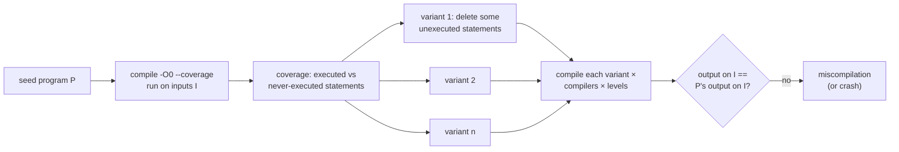

# 03 · Equivalence Modulo Inputs and metamorphic compiler testing

> Level: pro · Time: ~3 h · Prereqs: 04-pro/01 (oracles), 04-pro/02 (generators), 02-intermediate/07 (DCE and other passes)

## 1. Why this exists

Differential testing needs *two different compilers* (or levels) that are supposed to agree — and it misses bugs that every compiler shares. What if you had only *one* compiler, or wanted to test it against itself? **Metamorphic testing** answers: transform the *input* in a way whose effect on the output you know (usually "no effect") and check that the compiler respects it. In 2014, Le, Afshari and Su turned this into a remarkably effective, remarkably simple technique — **Equivalence Modulo Inputs (EMI)** — that found "147 confirmed, unique bug reports for GCC and LLVM alone" in eleven months, "the majority of those bugs are miscompilations, and more than 100 have already been fixed". It also reinvigorated testing of compilers that had saturated under Csmith, and its metamorphic idea later became the backbone of GPU shader-compiler testing.

## 2. Intuition: tearing out pages nobody reads

You give a reader a choose-your-own-adventure book and a fixed set of choices. You record which pages they actually visit. Now tear out some pages they *never* visited and give them the same choices again. Their story *must* be identical — those pages were never part of it. If a "reader" (compiler) now tells a different story, it was influenced by pages it should have ignored: the compiler's optimizer reasoned about the deleted code and the change in context exposed a bug.

The trick is that deleting dead-on-this-input code changes what the *optimizer* sees (control flow, value ranges, aliasing, register pressure) while leaving what the *program* does on that input unchanged.

## 3. Precise definitions

* **Metamorphic relation**: a property relating outputs of a program on related inputs, e.g. `sin(x) = sin(π − x)`. For compilers: relations between *source programs* (P and a transformation T(P)) and their compiled behaviour.
* **EMI** (PLDI 2014 §3.1.1): programs *P* and *Q* are equivalent modulo inputs w.r.t. an input set *I* when ∀ i ∈ I, ⟦P⟧(i) = ⟦Q⟧(i). It is a relaxation of semantic equivalence; for closed programs (no inputs) it coincides with semantic equivalence.
* **Orion** (the paper's tool): profile *P* on *I* (compiled at `-O0` with gcov coverage), find statements not executed on any input in *I*, and "stochastically prune its unexecuted code" to produce variants (the standard setup made about eight variants per program). Compile each variant under each configuration; an output differing from *P*'s output on *I* is a miscompilation (or crash).
* **Athena** (Le, Sun, Su, OOPSLA 2015, "Finding Deep Compiler Bugs via Guided Stochastic Program Mutation"): also *inserts* code into dead regions, guided by MCMC sampling — "In 19 months, Athena has found 72 new bugs", all confirmed, 68 fixed.
* **Hermes** (Sun, Le, Su, OOPSLA 2016, "Finding Compiler Bugs via Live Code Mutation"): mutates *live* code in semantics-preserving ways — "In 13 months, Hermes found 168 confirmed, valid bugs in GCC and LLVM, of which 132 have already been fixed."
* **Semantics-preserving transformation testing** for GPUs: GLFuzz (Donaldson et al., OOPSLA 2017; the project later continued as GraphicsFuzz [unverified]) transforms high-value shaders into equivalent variants; "Rendering mismatches are then indicative of shader compilation bugs" — "more than 60 distinct bugs, covering all tested configurations" across 17 GPU/driver configurations, including security issues. **spirv-fuzz** (Donaldson et al., PLDI 2021) applies sequences of small, independent semantics-preserving transformations to SPIR-V, so that "standard delta debugging can be used to shrink a bug-inducing transformation sequence" — reduction and deduplication "almost for free".
* **CLsmith** (Lidbury, Lascu, Chong, Donaldson, PLDI 2015, "Many-Core Compiler Fuzzing"): Csmith-style generation for OpenCL kernels across "21 OpenCL (device, compiler) configurations", plus an injection mechanism so EMI testing works even on kernels with little or no dynamically dead code.

## 4. Step by step

### 4.1 Dumbest metamorphic idea: compile twice

Compile *P* twice with the same compiler; outputs must match. They always do (compilers are deterministic) — no power.

### 4.2 Equivalent rewrites of live code

Rewrite `x + y` as `y + x`, wrap expressions in `(e) + 0`, etc. Valid, but the compiler's very first canonicalisation passes undo most of these, so the optimizer sees essentially the same program. **Wall: the transformation must survive into the optimizer's view.**

### 4.3 EMI: change dead code

Delete (or insert) code that doesn't execute on the profiled inputs. The compiler can't know it's dead on *those* inputs (it must compile for *all* inputs), so it must still analyse it: removing a dead store changes alias analysis; removing a dead branch changes value ranges and loop shapes; register allocation and scheduling see different code. Yet the program's behaviour on *I* is provably unchanged — a free oracle from a single compiler.



### 4.4 Seeds matter

Orion's seeds were mostly Csmith programs (average 4,590 LOC, about 1,327 lines unexecuted), plus GCC/LLVM test-suite files ("small … bug discovery saturated quickly") and real programs (SPEC CPU2006 integer, etc.). Generated programs work well because they contain lots of statically-reachable-but-dynamically-dead code. EMI is *orthogonal* to generators: any generator's output becomes many more test cases.

### 4.5 Limitation and response

EMI needs dead code. GPU kernels and many real programs have little; CLsmith *injects* dead-by-construction code (guarded by conditions the compiler can't resolve but that are false at run time). Hermes moves the idea to live code with carefully preserving mutations.

## 5. Code: a miniature Orion (`emi.py`)

Uses `minismith.py` from 04-pro/02 to make seeds (its constant-condition `if`s create plenty of never-executed statements).

```python
# file: emi.py
# A miniature Orion (Le, Afshari & Su, PLDI 2014): Equivalence Modulo Inputs.
# 1. profile the seed program with gcov (compiled at -O0 --coverage)
# 2. make variants by randomly DELETING statements that were never executed
#    -> on this input every variant must behave exactly like the seed
# 3. compile every variant with several compilers/levels; any output != seed output is a bug
# Usage: python3 emi.py seed.c NUM_VARIANTS [--delete-executed]
#   --delete-executed deletes EXECUTED statements instead: an invalid transformation, used only
#   to check that the harness can detect a difference at all (like planting a bug).
import subprocess, sys, random, re, os

def sh(cmd, timeout=30):
    try:
        p = subprocess.run(cmd, capture_output=True, text=True, timeout=timeout)
        return p.stdout
    except subprocess.TimeoutExpired:
        return "TIMEOUT"

def unexecuted_lines(src, executed=False):
    """Line numbers (1-based) of simple statements gcov reports as never executed ('#####'),
    or, with executed=True, of simple statements that DID execute."""
    base = os.path.splitext(os.path.basename(src))[0]
    # compile and link separately so the notes file is named <base>.gcno (GCC 13 names it
    # <exe>-<base>.gcno when compiling and linking in one command)
    sh(["gcc", "-O0", "-w", "--coverage", "-c", src, "-o", f"{base}.o"])
    sh(["gcc", "--coverage", f"{base}.o", "-o", f"{base}_cov"])
    sh([f"./{base}_cov"])                          # run once: this IS the input set I
    sh(["gcov", src])                              # writes <src>.gcov next to us
    dead = []
    with open(os.path.basename(src) + ".gcov") as f:
        for line in f:
            parts = line.split(":", 2)             # "  count:  lineno:source"
            if len(parts) < 3:
                continue
            count, lineno, code = parts[0].strip(), parts[1].strip(), parts[2]
            # only whole single-line assignments are safe to delete syntactically
            hit = count == "#####" if not executed else count.isdigit()
            if hit and re.match(r"\s*[\w\[\]\(\)%u ]+ = .*;\s*$", code):
                dead.append(int(lineno))
    return dead

def make_variant(lines, dead, rng, p):
    """Copy of the program with each dead statement deleted with probability p."""
    removed = {n for n in dead if rng.random() < p}
    return ["/* EMI-deleted */\n" if i + 1 in removed else l for i, l in enumerate(lines)], len(removed)

if __name__ == "__main__":
    src, n = sys.argv[1], int(sys.argv[2])
    lines = open(src).readlines()
    dead = unexecuted_lines(src, executed="--delete-executed" in sys.argv)
    sh(["gcc", "-O0", "-w", src, "-o", "seed_bin"])
    expected = sh(["./seed_bin"])                  # the seed's output on input set I
    print(f"seed output: {expected.strip()}; {len(dead)} deletable unexecuted statements")
    rng = random.Random(0)
    configs = [(cc, lvl) for cc in ("gcc", "clang") for lvl in ("-O0", "-O1", "-O2", "-O3")]
    bad = 0
    for v in range(n):
        variant, k = make_variant(lines, dead, rng, 0.5)
        vsrc = f"variant{v}.c"
        open(vsrc, "w").writelines(variant)
        for cc, lvl in configs:
            sh([cc, lvl, "-w", vsrc, "-o", "vbin"])
            out = sh(["./vbin"])
            if out != expected:
                bad += 1
                print(f"variant {v} ({k} deletions) {cc} {lvl}: {out.strip()} != {expected.strip()}  <-- BUG?")
    print(f"{n} variants x {len(configs)} configurations: {bad} EMI violations")
```

Python syntax notes:

* `os.path.splitext(os.path.basename(src))[0]` — file name without directory and extension (`seed11.c` → `seed11`).
* `line.split(":", 2)` — split at most twice, because the source text itself may contain colons. A gcov line looks like `    #####:   28:        g4 = safe_div(...` (count `#####` = never executed, line number, code).
* `re.match(r"\s*[\w\[\]\(\)%u ]+ = .*;\s*$", code)` — a regular expression accepting simple one-line assignments (`target = expression;`) so deletion never breaks syntax.
* `{n for n in dead if rng.random() < p}` — set comprehension: each dead line is chosen independently with probability *p*.
* `["/* EMI-deleted */\n" if i + 1 in removed else l for i, l in enumerate(lines)]` — rebuild the file, replacing chosen lines by a comment (keeps line numbers stable for debugging).
* `open(vsrc, "w").writelines(variant)` — write a list of lines.

Logic: profile once at `-O0` with `--coverage` (compiling and linking as *separate* commands — in GCC 13 a one-step `gcc --coverage file.c -o exe` names the notes file `exe-file.gcno`, and `gcov file.c` then reports "cannot open notes file"; that cost me a debugging round here); collect never-executed simple statements; create variants; compile each with 8 configurations; compare with the seed's `-O0` output.

```text
$ python3 minismith.py 11 > seed11.c
$ python3 emi.py seed11.c 10
seed output: checksum = F3401DB2; 15 deletable unexecuted statements
10 variants x 8 configurations: 0 EMI violations
$ diff seed11.c variant0.c | head -5          # long lines shortened here with "..."
63,64c63,64
<                 g5 = arr[(uint32_t)((g5 ^ safe_shr(968, arr[(uint32_t)(351) % 8u]))) % 8u];
<                 g0 = safe_shr(safe_mod(safe_div(arr[(uint32_t)(177) % 8u], 513), ...
---
> /* EMI-deleted */
> /* EMI-deleted */
```

**Control experiment** — is the harness able to see a difference at all? Delete *executed* statements instead (an invalid transformation):

```text
$ python3 emi.py seed11.c 3 --delete-executed | tail -3
variant 2 (8 deletions) clang -O2: checksum = AE31D1C1 != checksum = F3401DB2  <-- BUG?
variant 2 (8 deletions) clang -O3: checksum = AE31D1C1 != checksum = F3401DB2  <-- BUG?
3 variants x 8 configurations: 24 EMI violations
```

All 24 compilations disagree, as they must: the harness detects changes, so the 0 in the real run is meaningful (for these 80 compilations). This is the same "validate the oracle" discipline as the planted bug in 01-beginner/05.

## 6. Common mistakes

* **Deleting code that *was* executed** → guaranteed false alarms (the control experiment above).
* **Line-granularity coverage traps.** gcov counts lines; a line with two statements, one executed, is reported executed — fine — but a multi-line statement can be partially marked. Orion therefore marks a statement unexecuted "only if its first line is unexecuted and none of its AST children executed", and deletes via the AST (LLVM LibTooling), not by text.
* **Profiling with optimization on.** Coverage must reflect the *source* semantics: profile at `-O0`.
* **Seeds with UB.** EMI inherits the UB problem: if the seed has UB, variants may legitimately differ. Use UB-free seeds.
* **Inputs that differ between profiling and testing** — EMI is "modulo *these* inputs"; run variants on exactly the profiled inputs.
* **Expecting bugs from a toy in minutes.** Orion ran for eleven months on many machines; with modern GCC/Clang expect long campaigns.

## 7. Connections

* **Testing/Verification track**: metamorphic testing in general (ML models, scientific software, search engines) — EMI is its most famous compiler instance.
* **Parallel/CUDA track**: GPU compilers (shader/OpenCL/CUDA) are tested with EMI-style transformations because GPU vendors' compilers are closed and diverse (04-pro/05).
* **Lesson 02-intermediate/07**: dead-code elimination, value ranges and alias analysis are exactly what EMI variants perturb.
* **Linux/DevOps tracks**: coverage tooling (gcov, llvm-cov) used here for oracle construction rather than for measuring test quality.

### Where this shows up in my projects

An EMI mode is a natural extension of **compiler-fuzz**: its UB-free generated programs are ideal EMI seeds, and its existing GCC-vs-Clang × `-O` matrix and ddmin reducer can be reused unchanged — the only new component is the coverage-guided deletion step shown here. For GPU-oriented follow-up research, the CLsmith/GraphicsFuzz/spirv-fuzz line of work is the closest prior art to read first.

## 8. Self-check

1. State the definition of EMI.
2. Why does deleting *unexecuted* code make a good compiler test, if it doesn't change behaviour?
3. Why must profiling happen at `-O0`?
4. What problem did CLsmith's injection mechanism solve for EMI on GPU kernels?
5. What does the `--delete-executed` control experiment demonstrate?

<details><summary>Answers</summary>

1. P and Q are equivalent modulo inputs I if for every input i in I, ⟦P⟧(i) = ⟦Q⟧(i).
2. The compiler must compile for all inputs and cannot know the code is dead on I; deleting it changes the optimizer's analyses and transformations (aliasing, ranges, control flow, register pressure), while the behaviour on I is guaranteed to be unchanged — so any difference is a compiler bug.
3. Coverage must reflect the source program's execution; optimized code can merge, delete or duplicate statements, making line coverage misleading.
4. Kernels often have little or no dynamically dead code, so there is nothing to delete; injecting dead-by-construction code creates EMI opportunities.
5. That the harness *can* detect output differences — validating the oracle, so a zero-violation result is meaningful.

</details>

## 9. Mnemonic (Tamil + English)

**"Padikkaadha pakkatha kizhichaalum kadhai maaradhu"** — *tear out the pages nobody read, the story doesn't change*. If the compiler's story changes, the compiler is wrong.

## Sources

* V. Le, M. Afshari, Z. Su, "Compiler Validation via Equivalence Modulo Inputs", PLDI 2014: https://www.cs.ucdavis.edu/~su/publications/emi.pdf
* V. Le, C. Sun, Z. Su, "Finding Deep Compiler Bugs via Guided Stochastic Program Mutation", OOPSLA 2015: https://web.cs.ucdavis.edu/~su/publications/oopsla15-compiler.pdf
* C. Sun, V. Le, Z. Su, "Finding Compiler Bugs via Live Code Mutation", OOPSLA 2016: https://web.cs.ucdavis.edu/~su/publications/oopsla16.pdf
* C. Lidbury, A. Lascu, N. Chong, A. F. Donaldson, "Many-Core Compiler Fuzzing", PLDI 2015: https://multicore.doc.ic.ac.uk/publications/clsmith-pldi-15.html
* A. F. Donaldson, H. Evrard, A. Lascu, P. Thomson, "Automated Testing of Graphics Shader Compilers", OOPSLA 2017: https://www.doc.ic.ac.uk/~afd/papers/2017/OOPSLA.pdf
* A. F. Donaldson et al., "Test-Case Reduction and Deduplication Almost for Free with Transformation-Based Compiler Testing", PLDI 2021: https://multicore.doc.ic.ac.uk/publications/pldi-21.html
* Cornell CS 6120 blog post on EMI (discussion): https://www.cs.cornell.edu/courses/cs6120/2019fa/blog/equivalence-modulo-inputs
* GCC manual, "gcov — a Test Coverage Program": https://gcc.gnu.org/onlinedocs/gcc/Gcov.html

## Verify yourself

```bash
# file: verify-03p.sh
# Needs minismith.py (04-pro/02), gcc with gcov, clang. Tested GCC 13.3, Clang 18.1.3, Nov 2026.
python3 minismith.py 11 > seed11.c
python3 emi.py seed11.c 10                       # 0 EMI violations expected on current compilers
python3 emi.py seed11.c 3 --delete-executed | tail -1   # control: many violations
grep -c "#####" seed11.c.gcov                     # unexecuted lines found by gcov
```

Check against sources: the EMI definition and Orion pipeline against PLDI 2014 §3; Athena/Hermes numbers against their abstracts.
