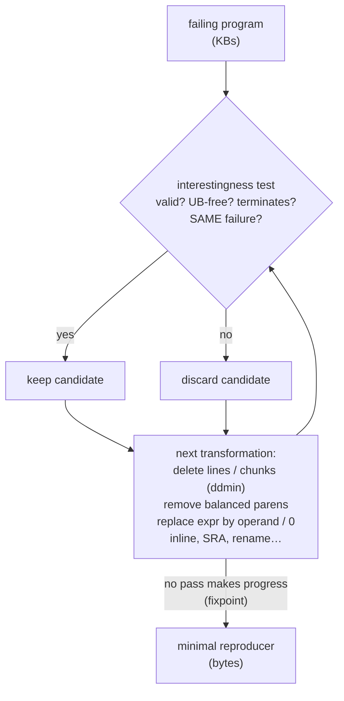

# 04 · Test-case reduction: delta debugging, C-Reduce, Perses and llvm-reduce

> Level: pro · Time: ~3 h · Prereqs: 01-beginner/05 (the planted `<=` bug in `tinyc`), 04-pro/01–02; Python, shell scripts

## 1. Why this exists

A fuzzer's failing program is thousands of lines of noise. Compiler developers will not debug a 2,500-line Csmith program — and they shouldn't have to: the bug is usually triggered by a handful of lines. **Test-case reduction** automatically shrinks a failing input while preserving the failure. The C-Reduce paper puts it bluntly: compiler bug reports need small test cases; Csmith outputs of 37–297 KB were reduced by C-Reduce to "typically less than 0.5 KB". Reduction is also what makes **deduplication** possible (two reduced programs that look alike are probably one bug) and what makes reports *trustworthy* (a 15-byte program is easy to check for undefined behaviour by eye).

## 2. Intuition: finding the one bad ingredient

A dish makes you ill. It has 20 ingredients. Cook it with only the first 10 — still ill? Then the culprit is among those 10. If neither half alone makes you ill, the problem needs ingredients from both halves; try leaving out one quarter at a time instead. Keep splitting more finely until removing any single remaining ingredient makes the dish safe. That's **delta debugging**. Now imagine the "ingredients" are lines or tokens of a program, and some combinations aren't even edible (syntax errors): you need a cook who knows the recipe's grammar — that's C-Reduce and Perses.

## 3. Precise definitions

* **Interestingness test**: a predicate on candidate inputs — "does this candidate still trigger *the* failure (and is it still valid)?" In C-Reduce, a script that exits 0 for interesting candidates; in `llvm-reduce`, `--test` names it (its documentation's example uses a script whose final `grep` exit status "becomes the whole script's status").
* **1-minimal** (Zeller & Hildebrandt, TSE 2002): a failing test case is 1-minimal if "removing any single change would cause the failure to disappear". True global minimality is exponential to check; 1-minimality is the practical target.
* **ddmin** (the same paper): split the current failing input *c* into *n* chunks, then
  1. **reduce to subset**: if some chunk alone fails, recurse on it with *n* = 2;
  2. **reduce to complement**: else if some complement *c* \ chunkᵢ fails, recurse on it with *n* = max(*n*−1, 2);
  3. **increase granularity**: else if *n* < |*c*|, retry with *n* = min(2*n*, |*c*|);
  4. **done**: otherwise *c* is 1-minimal.
  Worst case *n*² + 3*n* tests; best case at most 2·log₂(*n*) when a single element causes the failure. Case studies: Mozilla HTML input reduced from 896 lines to one line in 57 test runs; a GCC crash input from 755 characters to a 77-character 1-minimal program.
* **C-Reduce** (Regehr, Chen, Cuoq, Eide, Ellison, Yang, PLDI 2012): "a generic fixpoint computation invokes modular transformations" — pluggable passes (line removal adapted from Berkeley delta, balanced-delimiter removal, about 30 compiler-like source-to-source transformations such as scalar replacement of aggregates, pretty-printing) run until no pass makes progress. Outputs were "more than 25 times smaller" than Berkeley delta's; median wrong-code case 55,727 bytes → 192 bytes (C-Reduce + Frama-C) vs 6,559 (delta + Frama-C).
* **UB during reduction**: reduction can *introduce* undefined behaviour (delete an initialiser → uninitialised read). Without checking, "12 of 41 reduced wrong-code test cases (29%) executed undefined behavior"; the paper used KCC and Frama-C (and hybrids with Valgrind/Clang's analyzer) inside the interestingness test.
* **Hierarchical / syntax-guided reduction**: **HDD** (hierarchical delta debugging) runs ddmin level-by-level on the parse tree; **Perses** (Sun, Li, Zhang, Gu, Su, ICSE 2018) uses the grammar so "each reduction step considers only smaller, syntactically valid variants" — results "2% and 45% in size of those from DD and HDD", and "only 38-60% reduction time" compared with C-Reduce (C-Reduce's outputs remained smaller thanks to its semantic transformations).
* **llvm-reduce**: reduces LLVM IR "removing redundant or unnecessary code from LLVM test cases"; `--delta-passes` selects which reduction passes run; exit status 2 means the initial input wasn't interesting. `mlir-reduce` does the same for MLIR.
* **Transformation-based reduction** (spirv-fuzz, PLDI 2021): if a test is a seed plus a sequence of small independent semantics-preserving transformations, reduce the *sequence* with ddmin — reduction "almost for free".

## 4. Step by step

### 4.1 Dumbest approach: delete one line at a time

Try removing each line; keep the removal if still interesting; repeat until no single line can go. Correct, and produces a 1-minimal result at line granularity, but needs O(n²) tests in the worst case even when large chunks could go at once.

### 4.2 ddmin: remove big chunks first

Try halves, then quarters… — big deletions when possible, fine ones only when necessary. Our `ddmin.py` on a toy ("fails iff it contains 3 and 7") reduces 20 numbers to `[3, 7]` in 29 tests.

### 4.3 The granularity wall

Line-level ddmin on the 13-line Tiny file (12 statement lines plus a `# file:` comment) that exposes `tinyc`'s planted `<=` bug stopped at **5 lines** — each still a 70-character expression, because no *whole line* can be removed without losing either validity or the bug. Going to **tokens** (209 of them) with plain ddmin then took 4,073 tests and only got to 173 tokens: deleting a single token almost always unbalances parentheses, so nearly every candidate is invalid. **Wall: syntax.** Reducers must make *structure-aware* edits — remove a balanced `( … )`, replace an expression by one of its operands, replace a sub-expression by `0`. That is what C-Reduce's passes and Perses' grammar do.

### 4.4 C-Reduce: a fixpoint of transformations

C-Reduce on the same 825-byte input (in `--not-c` mode, which uses only its language-agnostic passes: lines, balanced delimiters, token-ish edits) finished in 1 min 48 s on 2 cores and produced:

```text
print(0 <= 0);
```

15 bytes, and it explains the bug instantly: `<=` with *equal* operands is compiled as `<`. Compare that with the 13-line random program from 01-beginner/05.

### 4.5 Danger: weak interestingness tests

Two real accidents while preparing this lesson:

1. **Hanging candidates.** My first C-Reduce interestingness script had no timeout on the interpreter. C-Reduce deleted `k = k + 1;` from the `while` loop, the candidate looped forever, and C-Reduce reported "(Interestingness test killed by timeout at 300 seconds.)". Every step of an interestingness test needs a timeout.
2. **Vacuous success.** An `llvm-reduce` test that only checked "instcombine's output contains `shl i32`" was satisfied by a reduced input that *already* contained `shl i32 %x, 1` — llvm-reduce had legitimately mutated the input so the property held without the pass doing anything. Requiring "the input has **no** `shl` but the output does" fixed it and yields the true minimal reproducer (`mul i32 %x, 8` → `shl i32 %x, 3`).

General rule: the interestingness test must pin down *the* bug — same crash message / assertion, same wrong value, same pass — plus validity (compiles, no UB, terminates). Otherwise the reducer happily finds a *different*, smaller "bug" (often UB).



## 5. Code

### 5.1 `ddmin.py`

```python
# file: ddmin.py
# Zeller & Hildebrandt's ddmin (IEEE TSE 2002): minimise a failing input to a
# 1-minimal one -- removing any single remaining element makes the failure disappear.
# Works on any list (characters, lines, tokens, transformations).

def ddmin(items, fails):
    """items: list; fails(list) -> True if the bug still reproduces. Returns a 1-minimal list."""
    assert fails(items), "the starting input must fail"
    n = 2                                            # current granularity: number of chunks
    tests = 0
    while len(items) >= 2:
        size = len(items) // n
        chunks = [items[i * size:(i + 1) * size] for i in range(n - 1)]
        chunks.append(items[(n - 1) * size:])        # last chunk takes the remainder
        reduced = False
        for i, chunk in enumerate(chunks):           # 1. reduce to a single chunk
            tests += 1
            if fails(chunk):
                items, n, reduced = chunk, 2, True
                break
        if not reduced:
            for i in range(len(chunks)):             # 2. reduce to a complement
                complement = [x for j, c in enumerate(chunks) if j != i for x in c]
                tests += 1
                if fails(complement):
                    items, n, reduced = complement, max(n - 1, 2), True
                    break
        if not reduced:
            if n >= len(items):                      # 4. finest granularity reached: done
                break
            n = min(2 * n, len(items))               # 3. increase granularity
    return items, tests

if __name__ == "__main__":
    # toy demo: the "bug" triggers when the input contains both 3 and 7
    data = list(range(1, 21))
    result, tests = ddmin(data, lambda xs: 3 in xs and 7 in xs)
    print(f"toy: {len(data)} -> {result} in {tests} tests")
```

Python syntax notes:

* `def ddmin(items, fails):` — `fails` is a *function* passed as an argument (like a C function pointer); `lambda xs: 3 in xs and 7 in xs` creates one inline.
* `assert cond, "message"` — stops with an error if `cond` is false.
* `items[i * size:(i + 1) * size]` — slice out chunk *i*.
* `[x for j, c in enumerate(chunks) if j != i for x in c]` — a nested comprehension: concatenate all chunks except chunk *i* (read it as two nested `for` loops with a filter).
* `items, n, reduced = chunk, 2, True` — tuple assignment updates three variables at once.

Logic: exactly steps 1–4 of §3: subsets first, then complements, then finer granularity; the loop ends when granularity equals the number of elements and nothing could be removed — the result is 1-minimal.

### 5.2 `reduce_tiny.py`: line-level then token-level ddmin on the planted bug

Needs `tinyc`, `tiny_interp` (built from 01-beginner/04–05) in the same directory.

```python
# file: reduce_tiny.py
# Reduce a Tiny program that exposes the planted '<=' bug in tinyc (lesson 01-beginner/05)
# with ddmin over LINES. The "interestingness test" decides whether a candidate still shows
# the bug: it must be a valid program, and interpreter and buggy compiler must disagree.
import subprocess, os, sys, re
from ddmin import ddmin

ENV = dict(os.environ, TINYC_BUG="1")             # turn the planted bug on

def run(cmd, env=None):
    try:
        p = subprocess.run(cmd, capture_output=True, text=True, timeout=10, env=env)
        return p.returncode, p.stdout
    except subprocess.TimeoutExpired:
        return "timeout", ""

def interesting(lines):
    with open("cand.tiny", "w") as f:
        f.write("".join(lines))
    rc, expected = run(["./tiny_interp", "cand.tiny"])
    if rc != 0:                                   # invalid candidate (e.g. use of a deleted variable)
        return False
    rc, asm = run(["./tinyc", "cand.tiny"], env=ENV)
    if rc != 0:
        return False
    with open("cand.s", "w") as f:
        f.write(asm)
    if run(["gcc", "cand.s", "-o", "cand.bin"])[0] != 0:
        return False
    return run(["./cand.bin"]) != (0, expected)  # the bug: compiled output differs

def tokens_to_lines(toks):
    """Re-join tokens with spaces; '\n' tokens keep the line structure."""
    return [" ".join(toks).replace(" \n ", "\n").replace(" \n", "\n") + "\n"]

if __name__ == "__main__":
    lines = open(sys.argv[1]).readlines()
    # pass 1: ddmin over whole lines (coarse, fast)
    small, tests = ddmin(lines, interesting)
    print(f"pass 1: {len(lines)} lines -> {len(small)} lines after {tests} tests")
    # pass 2: ddmin over tokens of what is left (fine-grained, like hierarchical reduction)
    toks = re.findall(r"<=|>=|==|!=|\w+|\S|\n", "".join(small))
    small_toks, tests2 = ddmin(toks, lambda t: interesting(tokens_to_lines(t)))
    print(f"pass 2: {len(toks)} tokens -> {len(small_toks)} tokens after {tests2} tests:")
    print(tokens_to_lines(small_toks)[0], end="")
```

Python notes: `dict(os.environ, TINYC_BUG="1")` copies the environment and adds the variable that switches the planted bug on; `re.findall(r"<=|>=|==|!=|\w+|\S|\n", text)` splits text into tokens (two-character operators first, then words/numbers, then any other single non-space character, and newlines); `from ddmin import ddmin` imports the function from `ddmin.py` in the same directory.

Logic: the interestingness test requires (1) the interpreter accepts and runs the candidate, (2) the buggy compiler compiles it, (3) the binary's output **differs** from the interpreter's.

```text
# file: failing.tiny
let v0 = (((((19) != (15)) - ((15) != (11)))) == ((((19 + -15)) != (-14))));
let v1 = (((((2) <= (12)) / ((((v0) <= (v0))) * 2 + 1))) >= (((((v0) <= (v0))) != (((18) > (5))))));
let v2 = ((((((-19) >= (-12))) != (((-14) == (7))))) < ((((9 - 14)) >= (v1))));
if (((((v1) > (-20))) >= (18))) print ((((-4) <= (9))) == (((15) >= (-18)))); else print (((v2 - 12)) <= (-9));
if (((((3) < (v2))) >= ((v0 * v1)))) print ((v2 / ((v2) * 2 + 1)) - ((v1) <= (16))); else print (((10 * 18)) >= (((v1) == (-12))));
if (((((13) > (4))) < (v0))) print v1; else print (v2 + ((11) <= (16)));
v0 = 7;
v1 = ((-18 + (v2 + v2)) - (13 + (v0 * v1)));
v0 = (((((v0) > (v1))) < (((-3) == (-7)))) * 9);
v1 = (((((16) <= (-7))) <= (15)) * (((v2) != (v1)) / ((v0) * 2 + 1)));
let k = 0;
while (k < 5) { print ((((-3 - -16) * v2)) <= (v2)); k = k + 1; }
```

(This is the first mismatching program printed by `TINYC_BUG=1 python3 difftest.py 200` in 01-beginner/05.)

```text
$ python3 reduce_tiny.py failing.tiny
pass 1: 13 lines -> 5 lines after 66 tests
pass 2: 209 tokens -> 173 tokens after 4073 tests:
let v0 = ( ( ( ( ( 19 ) != ( 15 ) ) - ( ( 15 ) != ( 11 ) ) ) ) == ( ( ( ( 19 ) ) != ( 14 ) ) ) ) ; let v1 = (output shortened here; 173 tokens in total)
```

### 5.3 C-Reduce with a shell interestingness test

```bash
#!/bin/bash
# file: interesting.sh
# C-Reduce interestingness test: exit 0 iff failing.tiny still shows the planted bug.
# C-Reduce runs this in a temporary directory containing only the current candidate file,
# so the tools are referenced by absolute path (TOOLS is exported by the caller).
# EVERY step has a timeout: deleting "k = k + 1;" makes a candidate loop forever.
timeout 5 "$TOOLS/tiny_interp" failing.tiny > expected.txt 2>/dev/null || exit 1      # must be a valid program
TINYC_BUG=1 "$TOOLS/tinyc" failing.tiny > cand.s 2>/dev/null || exit 1
gcc cand.s -o cand.bin 2>/dev/null || exit 1
timeout 5 ./cand.bin > actual.txt 2>/dev/null
! cmp -s expected.txt actual.txt                                            # interesting = outputs differ
```

Shell notes: `cmd || exit 1` = "if the command fails, report *uninteresting*"; `timeout 5` kills a command after 5 s; `cmp -s` compares files silently (exit 0 if identical) and `!` inverts it — the script's last command's status is the script's exit status.

```text
$ mkdir cr && cp failing.tiny cr/ && cd cr && export TOOLS=$PWD/..
$ creduce --not-c --n 2 ../interesting.sh failing.tiny        # C-Reduce 2.11 (Ubuntu package)
real	1m48.017s
$ cat failing.tiny
print(0 <= 0);
```

For C programs drop `--not-c`; C-Reduce then also uses its Clang-based semantic passes, and the interestingness test should additionally reject UB (compile with `-fsanitize=undefined,address -fno-sanitize-recover=all` and run; ideally also a second checker).

### 5.4 `llvm-reduce` for IR

```bash
#!/bin/bash
# file: ir_interesting.sh
# llvm-reduce interestingness test ($1 = candidate .ll file): exit 0 iff the candidate has
# NO shift but instcombine's output DOES -- i.e. the pass itself must create the shl
# (a stand-in for "this pass still misbehaves on this input").
! grep -q "shl " "$1" && opt -S -passes=instcombine "$1" 2>/dev/null | grep -q "shl i32"
```

```text
$ llvm-reduce --test=./ir_interesting.sh big.ll -o small.ll     # big.ll: base.ll from 02-intermediate/07 (126 lines)
Done reducing! Reduced testcase: small.ll
$ cat small.ll  (body)
define i32 @strength(i32 %x) {
entry:
  %mul = mul i32 %x, 8
  ret i32 %mul
}
```

126 lines → one 2-instruction function: the ideal LLVM bug-report attachment, reproducible with a single `opt -passes=instcombine` command.

## 6. Common mistakes

* **No timeouts in the interestingness test** → the reduction hangs (seen above).
* **Interestingness tests that are too weak** → the reducer finds a different, smaller "bug" (seen above with llvm-reduce; with C programs, typically UB).
* **Not checking for UB introduced by reduction** (29% of unchecked wrong-code reductions in the C-Reduce paper).
* **Matching any crash instead of *the* crash** → reduction drifts to an unrelated assertion. Grep for the specific message or stack frame.
* **Non-deterministic tests** (flaky outputs, timing) → reducers make random progress and produce nonsense; make the test deterministic first.
* **Reducing at the wrong granularity** — use a structure-aware reducer (C-Reduce, Perses, llvm-reduce) rather than raw ddmin on tokens.
* **Running reductions without parallelism** — C-Reduce's `--n` runs several candidates in parallel.

## 7. Connections

* **DSA track**: ddmin is divide-and-conquer with adaptive granularity; compare binary search (bisection finds one culprit; ddmin finds a minimal *set*).
* **Git track**: `git bisect` (commits) and ddmin (inputs) are siblings; Zeller's paper also isolates failure-inducing *differences*.
* **Testing/Verification track**: shrinking in property-based testing (Hypothesis, QuickCheck) is reduction built into the test framework.
* **Lesson 03-advanced/06**: reduction + pass bisection + version bisection = the triage pipeline.

### Where this shows up in my projects

**compiler-fuzz** includes a ddmin reducer of exactly this shape — generic over a list of program elements with a pluggable interestingness test (GCC and Clang outputs still differ, program still UB-free under UBSan). The two pitfalls in §4.5 (missing timeouts, vacuous interestingness) are the ones to guard against in its tests, and the line-vs-token result above is the argument for adding syntax-aware reduction steps (Perses-style) on top of line-level ddmin.

## 8. Self-check

1. Define 1-minimal. Why not aim for a globally minimal test?
2. Walk through ddmin's four cases.
3. Why did token-level ddmin barely shrink the Tiny program while C-Reduce reached 15 bytes?
4. What went wrong with the first `llvm-reduce` interestingness test and how was it fixed?
5. Why must an interestingness test for wrong-code bugs include a UB check?

<details><summary>Answers</summary>

1. Removing any single element makes the failure disappear. Checking global minimality requires testing exponentially many subsets.
2. Subset (a chunk alone fails → recurse on it, n=2); complement (input minus a chunk fails → recurse, n=max(n−1,2)); increase granularity (n=min(2n,|c|)); done when no chunk or complement fails at the finest granularity.
3. Removing single tokens nearly always breaks syntax (unbalanced parentheses), so almost all candidates are invalid; C-Reduce uses structure-aware edits (balanced-delimiter removal, line/chunk deletion, etc.) that keep candidates valid.
4. It only checked that the output contained `shl`, which the reduced *input* could satisfy on its own; the fix required the input to have no `shl` while the output has one, forcing the pass to do the transformation.
5. Reduction can introduce UB (e.g. deleting an initialiser); a reduced program with UB no longer demonstrates a compiler bug, and its "wrong" output may be legitimate.

</details>

## 9. Mnemonic (Tamil + English)

**"Paadhi, kaal, oru-oru"** — *half, quarter, one-by-one*: ddmin's granularity ladder. And the interestingness checklist: **"Sariyaa? Suththamaa? Mudiyumaa? Adhe bug-aa?"** — *Valid? Clean (no UB)? Terminates? The same bug?*

## Sources

* A. Zeller, R. Hildebrandt, "Simplifying and Isolating Failure-Inducing Input", *IEEE TSE* 28(2), 2002: https://www.st.cs.uni-saarland.de/papers/tse2002/tse2002.pdf
* J. Regehr, Y. Chen, P. Cuoq, E. Eide, C. Ellison, X. Yang, "Test-Case Reduction for C Compiler Bugs", PLDI 2012: https://www-old.cs.utah.edu/~regehr/papers/pldi12-preprint.pdf
* J. Regehr, "Design and Evolution of C-Reduce (Part 1)": https://blog.regehr.org/archives/1678
* C. Sun, Y. Li, Q. Zhang, T. Gu, Z. Su, "Perses: Syntax-Guided Program Reduction", ICSE 2018: https://web.cs.ucdavis.edu/~su/publications/perses.pdf
* LLVM, `llvm-reduce` command guide: https://llvm.org/docs/CommandGuide/llvm-reduce.html
* A. F. Donaldson et al., "Test-Case Reduction and Deduplication Almost for Free with Transformation-Based Compiler Testing", PLDI 2021: https://multicore.doc.ic.ac.uk/publications/pldi-21.html
* C-Reduce source and documentation: https://github.com/csmith-project/creduce

## Verify yourself

```bash
# file: verify-04p.sh
# Needs tinyc, tiny_interp (01-beginner/04-05) built here, creduce (Ubuntu package), LLVM 18.
gcc -O2 -w -o tinyc tinyc.c && gcc -O2 -w -o tiny_interp tiny_interp.c
python3 ddmin.py                                  # toy: 20 -> [3, 7] in 29 tests
python3 reduce_tiny.py failing.tiny               # 13 lines -> 5 lines; tokens barely shrink
chmod +x interesting.sh ir_interesting.sh
rm -rf cr && mkdir cr && cp failing.tiny cr/ && (cd cr && TOOLS=$PWD/.. creduce --not-c --n 2 ../interesting.sh failing.tiny > /dev/null 2>&1; cat failing.tiny)   # print(0 <= 0);
llvm-reduce --test=./ir_interesting.sh big.ll -o small.ll && grep -A3 define small.ll   # needs big.ll (base.ll from 02-intermediate/07)
```

Check against sources: ddmin's cases and complexity against Zeller & Hildebrandt §5–6; C-Reduce numbers against the PLDI 2012 tables; Perses numbers against its abstract.
