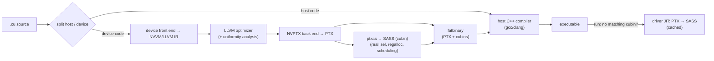

# 05 · GPU compiler basics: SIMT, PTX, divergence, convergence — and testing GPU compilers

> Level: pro · Time: ~3.5 h · Prereqs: 02-intermediate/04 (dominance), 02-intermediate/05 (LLVM IR), 03-advanced/01–02 (isel, register allocation), 04-pro/03 (metamorphic testing); basic CUDA vocabulary helps

## 1. Why this exists

A GPU runs thousands of threads in lockstep groups. Compiling for it adds problems a CPU compiler never faces: code is written for *one* thread but executed by 32 at once; threads in a group may want to take different branches; some operations (barriers, warp votes) are only correct if the *right set of threads* reaches them *together*; memory is split into spaces with very different speeds; and the shipped "binary" is often a virtual ISA that a driver compiles again at run time. Every one of those is a new place for compiler bugs — and GPU compilers are mostly closed-source, vendor-specific, and harder to test than GCC/Clang. This lesson builds the vocabulary and shows, with real compiler output, what a GPU compiler does.

## 2. Intuition: a drill squad

A warp is a drill squad of 32 soldiers who must perform the *same* move at the *same* time. If the sergeant says "odd numbers, step left; even numbers, step right", the squad cannot split: first the odd soldiers step while the even ones stand still (masked off), then vice versa — twice the time (**divergence**). A command like "everybody clap together" (a **barrier** or warp vote) only works if the compiler doesn't rearrange the routine so that some soldiers reach the clap at a different moment (**convergence**). And the drill manual you hand out (PTX) is a generic one; each regiment's officer (the driver/`ptxas`) translates it into their unit's exact moves (SASS).

## 3. Precise definitions

* **SIMT** (single instruction, multiple threads): PTX docs — "A warp executes one common instruction at a time"; "Typically, a warp has 32 threads." When threads of a warp take different branches, "the warp serially executes each branch path taken", disabling threads not on that path.
* **Thread hierarchy (CUDA)**: threads (`threadIdx`) form blocks (`blockIdx`, size `blockDim`), blocks form a grid. A **kernel** (`__global__`) is the entry point launched over the grid.
* **Memory spaces**: global (device DRAM), shared (per-block on-chip scratchpad), local (per-thread spill/stack), constant, param. LLVM's NVPTX back end maps them to IR address spaces: "0: Generic, 1: Global, … 3: Shared, 4: Constant, 5: Local".
* **PTX**: "a low-level parallel thread execution virtual machine and instruction set architecture (ISA)", whose goals include "Provide a stable ISA that spans multiple GPU generations" (current docs describe PTX ISA version 9.5). PTX has unlimited virtual registers; it is **not** what the GPU executes.
* **SASS / cubin**: the real machine code for a specific GPU architecture, produced by `ptxas` ("the PTX optimizing assembler") or by the driver's JIT.
* **Virtual vs real architectures (nvcc)**: `compute_XY` names a virtual architecture (PTX feature level); `sm_XY` a real one. `-arch`/`--gpu-architecture` controls compilation to PTX; `-code`/`--gpu-code` controls which real architectures get SASS; `-gencode` generalises the pair and "may be repeated for different virtual architectures".
* **Fatbinary**: the container embedded in the host object holding PTX and/or cubins; at launch the CUDA runtime picks "an appropriate fatbinary image for the current GPU".
* **JIT**: the driver can postpone "the assembly of PTX code until application runtime"; the cost is "increased application startup delay", mitigated by a persistent compilation cache.
* **Uniform vs divergent value**: uniform = same for all threads of a warp (e.g. a kernel argument); divergent = may differ (e.g. `threadIdx.x`). **Divergence/uniformity analysis** propagates this through data and control dependences; branches on divergent conditions are *divergent branches*.
* **Convergent operation**: LLVM's term for operations where "the set of threads which participate in communication is implicitly affected by control flow" (barriers, ballots, shuffles). Transformations that change which threads reach them together — LLVM's document gives jump threading as an example — are illegal for them. LLVM IR marks such calls and functions with the `convergent` attribute.
* **Reconvergence**: the point after a divergent branch where the warp's threads continue together again — typically the branch's immediate *post-dominator*.

## 4. Step by step

### 4.1 The compilation trajectory



`nvcc` splits device and host code: device code is compiled with "the proprietary NVIDIA compilers and assembler" (their IR, NVVM IR, "is a compiler IR … based on the LLVM IR"), host code by the system C++ compiler, and the device images are embedded as a fatbinary. Clang can do the whole device side itself: it uses "merged parsing" (it parses the input multiple times, since "we have to define different macros during host compilation and during device compilation"), emits PTX via LLVM's NVPTX back end and then runs `ptxas` — Clang "always generates SASS code" when the CUDA toolkit is present. Differences from nvcc exist: in Clang, `__host__` and `__device__` are part of a function's signature, so `__host__ void foo()` and `__device__ void foo()` may coexist, which nvcc rejects.

### 4.2 Watch it: CUDA → PTX with Clang, no GPU or SDK required

```c
// file: saxpy.cu
// Two tiny CUDA kernels compiled to PTX by Clang -- no CUDA SDK or GPU needed.
// Without the SDK headers we declare what we use: __global__/__shared__ come from
// Clang's built-in CUDA attributes; thread/block indices are read via NVPTX builtins.
#define __global__ __attribute__((global))
#define __shared__ __attribute__((shared))
#define tid_x()  __nvvm_read_ptx_sreg_tid_x()      // threadIdx.x
#define ctaid_x() __nvvm_read_ptx_sreg_ctaid_x()   // blockIdx.x
#define ntid_x() __nvvm_read_ptx_sreg_ntid_x()     // blockDim.x

// y[i] = a * x[i] + y[i] for every i < n: one thread per element
__global__ void saxpy(int n, float a, const float *x, float *y) {
    int i = ctaid_x() * ntid_x() + tid_x();
    if (i < n)                                   // threads past the end do nothing
        y[i] = a * x[i] + y[i];
}

// Divergent branch + shared memory + barrier: odd and even threads take different paths.
__global__ void diverge(int *out) {
    __shared__ int buf[64];
    int t = tid_x();
    if (t % 2)                                   // half the warp goes here...
        buf[t] = t * 3;
    else                                         // ...and the other half here
        buf[t] = -t;
    __syncthreads();                             // every thread of the block must arrive here
    out[t] = buf[63 - t];                        // read a value written by ANOTHER thread
}
```

(The file is C-like CUDA; the macros only stand in for what the CUDA SDK headers normally provide. My first attempt used builtin names `__builtin_ptx_read_tid_x`, which Clang 18 rejects as undeclared; the `__nvvm_read_ptx_sreg_*` builtins are the ones it accepts.)

```text
$ clang++ -x cuda --cuda-gpu-arch=sm_70 --cuda-device-only -nocudainc -nocudalib -O2 -S saxpy.cu -o saxpy.ptx
```

`--cuda-device-only` skips the host side; `-nocudainc -nocudalib` avoid needing the SDK. (The current Clang docs spell the architecture flag `--offload-arch`; Clang 18 accepted `--cuda-gpu-arch` as used here.) Result (Clang 18.1.3, comments removed):

```text
.version 6.0
.target sm_70
.address_size 64

.visible .entry _Z5saxpyifPKfPf(
	.param .u32 _Z5saxpyifPKfPf_param_0,
	.param .f32 _Z5saxpyifPKfPf_param_1,
	.param .u64 _Z5saxpyifPKfPf_param_2,
	.param .u64 _Z5saxpyifPKfPf_param_3
)
{
	.reg .pred 	%p<2>;
	.reg .b32 	%r<6>;
	.reg .f32 	%f<5>;
	.reg .b64 	%rd<8>;

	ld.param.u32 	%r2, [_Z5saxpyifPKfPf_param_0];
	mov.u32 	%r3, %ctaid.x;
	mov.u32 	%r4, %ntid.x;
	mov.u32 	%r5, %tid.x;
	mad.lo.s32 	%r1, %r3, %r4, %r5;          // i = blockIdx.x * blockDim.x + threadIdx.x
	setp.ge.s32 	%p1, %r1, %r2;           // predicate p1 = (i >= n)
	@%p1 bra 	$L__BB0_2;                   // predicated branch: threads with p1 skip the body
	ld.param.f32 	%f1, [_Z5saxpyifPKfPf_param_1];
	ld.param.u64 	%rd3, [_Z5saxpyifPKfPf_param_3];
	cvta.to.global.u64 	%rd1, %rd3;          // generic pointer -> global address space
	ld.param.u64 	%rd4, [_Z5saxpyifPKfPf_param_2];
	cvta.to.global.u64 	%rd2, %rd4;
	mul.wide.s32 	%rd5, %r1, 4;
	add.s64 	%rd6, %rd2, %rd5;
	ld.global.f32 	%f2, [%rd6];
	add.s64 	%rd7, %rd1, %rd5;
	ld.global.f32 	%f3, [%rd7];
	fma.rn.f32 	%f4, %f2, %f1, %f3;          // a*x[i] + y[i] fused into one FMA
	st.global.f32 	[%rd7], %f4;
$L__BB0_2:
	ret;
}
```

(I added the `//` annotations.) Points to notice: **special registers** `%tid.x`, `%ctaid.x`, `%ntid.x`; **predicates** (`.pred`, `setp`, `@%p1 bra`); explicit **address spaces** (`cvta.to.global`, `ld.global`, `st.global`); **typed virtual registers** (`%r<6>`, `%f<5>`, `%rd<8>`) — real allocation happens in `ptxas`; the multiply-add became an `fma` (note: fusing changes floating-point rounding — a classic source of "GPU vs CPU results differ" reports that are *not* bugs).

The `diverge` kernel:

```text
	mov.u32 	%r1, %tid.x;
	and.b32  	%r2, %r1, 1;
	setp.eq.b32 	%p1, %r2, 1;                 // p1 = thread is odd
	(address computation for buf[t] omitted in this excerpt)
	neg.s32 	%r3, %r1;                    // even-path value  -t
	mul.lo.s32 	%r4, %r1, 3;                 // odd-path value   t*3
	selp.b32 	%r5, %r4, %r3, %p1;          // select by predicate: NO branch at all
	st.shared.u32 	[%rd5], %r5;             // write to the block's shared memory
	bar.sync 	0;                           // __syncthreads()
	ld.shared.u32 	%r6, [%rd6+252];
	st.global.u32 	[%rd7], %r6;
```

The divergent `if/else` **disappeared**: the compiler computed both sides and used `selp` (select) — *if-conversion*. On a GPU this is a big win: no divergence, both halves of the warp do the same instructions. `__syncthreads()` became `bar.sync 0`, and `buf` lives in `.shared`.

### 4.3 Uniformity analysis in LLVM

Before that decision, the optimizer must know which values differ between threads:

```text
$ clang++ -x cuda --cuda-gpu-arch=sm_70 --cuda-device-only -nocudainc -nocudalib -O1 \
      -Xclang -disable-llvm-passes -S -emit-llvm saxpy.cu -o saxpy.ll
$ opt -S -passes=mem2reg saxpy.ll -o saxpy.m2r.ll
$ opt -passes='print<uniformity>' -disable-output saxpy.m2r.ll     (excerpt, function diverge)
  DIVERGENT:   %2 = call i32 @llvm.nvvm.read.ptx.sreg.tid.x()
  DIVERGENT:   %3 = srem i32 %2, 2
  DIVERGENT:   %4 = icmp ne i32 %3, 0
  DIVERGENT:   br i1 %4, label %5, label %9
```

`tid.x` is a **source of divergence**; everything computed from it is divergent; the branch on it is a divergent branch. Interesting detail: in `saxpy`, LLVM 18 also lists `%ctaid.x` (blockIdx) and `%ntid.x` (blockDim) reads as `DIVERGENT`, although all threads of a warp share the same block and therefore the same values. The analysis is *conservative* — "maybe divergent" — which is always safe but can cost performance (e.g. a scalar/uniform register or branch is not used). Precision of such analyses is a research and engineering topic of its own.

The barrier is a **convergent** intrinsic:

```text
  call void @llvm.nvvm.barrier0()
declare void @llvm.nvvm.barrier0() #3
attributes #3 = { convergent nocallback nounwind }
```

and the kernels themselves carry `convergent` in their attributes. That flag tells every LLVM pass: don't make this call control-dependent on anything new.

### 4.4 Why convergence is a correctness issue (the GPU-specific miscompilation)

```c
/* Correct: all threads of the block reach the barrier together. */
if (t < 32) x = 1;
__syncthreads();

/* A "harmless" CPU optimization (sinking/duplicating code into both branches)
   could produce: */
if (t < 32) { x = 1; __syncthreads(); }
else        {          __syncthreads(); }
```

On a CPU the two forms are equivalent. On a GPU they're not: the barrier calls are now *two different* barriers in different control-flow regions, so threads may wait at different ones — deadlock or undefined behaviour. LLVM's convergent-operations document discusses exactly such transformations (jump threading removing structure "in a way that can make semantics non-obvious"). This is a bug class that *cannot exist* in single-threaded compilers — and a natural target for GPU compiler testing.

### 4.5 Testing GPU compilers: what changes

| Problem | CPU compilers | GPU compilers |
|---|---|---|
| Access | open source (GCC, LLVM) | many proprietary (driver JITs, `ptxas`), many vendors |
| Oracle | cross-compiler is easy | fewer independent implementations per language; outputs can be images (shaders) |
| Determinism | sequential | races, barriers and floating-point reassociation make outputs vary |
| UB | C's list | C's list **plus** data races, barrier divergence, out-of-bounds shared-memory access |
| Dead code for EMI | plentiful | often little (CLsmith injects it) |

Landmarks: **CLsmith** (PLDI 2015) generated Csmith-style OpenCL kernels and tested "21 OpenCL (device, compiler) configurations", finding "a significant number of OpenCL compiler bugs in commercial implementations"; **GLFuzz** (OOPSLA 2017; the project later continued as GraphicsFuzz [unverified]) used semantics-preserving shader transformations and found "more than 60 distinct bugs, covering all tested configurations" (17 GPU/driver configurations), including a WebGL information leak where "a malicious web page can capture the contents of other browser tabs"; **spirv-fuzz** (PLDI 2021) made transformation-based testing for SPIR-V with near-free reduction. For deep-learning compilers (which often target GPUs), **NNSmith** (ASPLOS 2023) generated valid neural-network graphs and "has found 72 new bugs for TVM, TensorRT, ONNXRuntime, and PyTorch".

## 5. Code

`saxpy.cu` is above; every command and every output shown was produced with Clang/LLVM 18.1.3 in a sandbox **without** a GPU or CUDA toolkit — which is also why this lesson stops at PTX: producing SASS (`ptxas`) and *running* kernels need NVIDIA's toolkit and hardware.

## 6. Common mistakes

* **Treating PTX as the final binary.** Performance and register counts are decided by `ptxas`/the driver; inspect SASS (`cuobjdump -sass`) for the truth.
* **Building only for one `sm_XX` without PTX** → the binary won't run on newer GPUs (no JIT fallback). Include PTX for the highest virtual architecture you target.
* **Assuming CPU and GPU float results must match bit-for-bit.** FMA contraction, different math libraries and reduction orders legitimately change results; differential tests must use tolerances or disable contraction (`-ffp-contract=off`).
* **Writing `__syncthreads()` inside divergent control flow** → undefined behaviour / deadlock; a generator for GPU tests must never emit it.
* **Data races in test kernels** → nondeterministic outputs that look like compiler bugs. Race-free by construction is the GPU analogue of UB-free by construction.
* **Ignoring the `convergent` attribute when writing IR passes or IR-level fuzzers** → transformations that are legal on CPUs but break GPU semantics.

## 7. Connections

* **Parallel/CUDA track**: the programming-model side — warps, occupancy, shared-memory bank conflicts, `__launch_bounds__`, profiling.
* **Computer Architecture track**: SIMD vs SIMT, latency hiding through many warps instead of out-of-order execution, register files and occupancy.
* **OS track**: the driver as a JIT compiler and loader; the compute cache.
* **ML/LLM agents and AI dev tools tracks**: ML compilers (Triton, XLA, TVM, TensorRT) generate GPU code; NNSmith-style testing.
* **Lesson 03-advanced/05 (MLIR)**: the `gpu` and `nvvm` dialects model kernels and NVIDIA intrinsics before LLVM IR.

### Where this shows up in my projects

* **compiler-fuzz** is CPU-only today (GCC vs Clang); the stated next step — a research project on **GPU compiler testing** extending it — needs exactly the extra ingredients from §4.5: race-free and barrier-uniform generation, tolerance-aware oracles for floating point, and multiple GPU toolchains (Clang's CUDA path vs `nvcc`, or different `-O`/`-arch` settings) as differential partners. Clang's ability to emit PTX without a GPU (§4.2) lets the generator and the front half of the pipeline be developed and tested on any machine.
* Uniformity analysis and `convergent` (§4.3–4.4) suggest an IR-level oracle: generated kernels can be checked for barriers under divergent control flow *before* running them, the same way compiler-fuzz checks for UB before comparing outputs.

## 8. Self-check

1. What is the difference between PTX and SASS, and who produces each?
2. Why did the divergent `if/else` in `diverge` produce no branch in PTX?
3. What makes a value divergent, and why might an analysis report a uniform value as divergent?
4. Why is moving `__syncthreads()` into both arms of an `if` legal on a CPU but not on a GPU?
5. Name two sources of nondeterminism or false alarms specific to GPU compiler testing.

<details><summary>Answers</summary>

1. PTX is NVIDIA's virtual ISA (stable across generations, unlimited virtual registers), emitted by NVVM/nvcc or Clang's NVPTX back end; SASS is the real machine code for one GPU architecture, produced by `ptxas` ahead of time or by the driver JIT.
2. The compiler if-converted it: computed both values and chose with a predicated `selp`, avoiding divergence.
3. It depends (by data or control dependence) on a thread-varying source like `threadIdx`. Analyses are conservative: if they can't prove uniformity they report divergence (LLVM 18 did so even for `blockIdx`/`blockDim` here).
4. On a CPU a barrier call is just a call; on a GPU, which threads reach a barrier *together* is part of its semantics; splitting it into two calls in different control-flow regions changes which threads synchronise with each other, possibly deadlocking.
5. Data races; floating-point contraction/reassociation and different math libraries; barriers in divergent control flow; closed-source driver JITs whose version changes with the driver.

</details>

## 9. Mnemonic (Tamil + English)

**"Muppathirendu peru, oru kaal"** — *thirty-two people, one leg*: a warp moves as one; if they disagree on a branch, half wait while the other half walks. And for the barrier: **"Ellarum vandha dhaan kai thattu"** — *clap only when everyone has arrived* (and don't let the compiler move the clap).

## Sources

* NVIDIA, "CUDA Compiler Driver NVCC" (compilation trajectory, virtual vs real architectures, `-gencode`, JIT and compute cache; doc version 13.4): https://docs.nvidia.com/cuda/cuda-compiler-driver-nvcc/index.html
* NVIDIA, "Parallel Thread Execution ISA" (PTX ISA 9.5: PTX definition, warps, divergence): https://docs.nvidia.com/cuda/parallel-thread-execution/index.html
* NVIDIA, "NVVM IR Specification": https://docs.nvidia.com/cuda/nvvm-ir-spec/index.html
* LLVM, "User Guide for NVPTX Back-end" (triples, address spaces, `ptx_kernel`, special-register intrinsics): https://llvm.org/docs/NVPTXUsage.html
* LLVM, "Compiling CUDA with clang": https://llvm.org/docs/CompileCudaWithLLVM.html
* LLVM, "Convergent Operation Semantics": https://llvm.org/docs/ConvergentOperations.html
* C. Lidbury, A. Lascu, N. Chong, A. F. Donaldson, "Many-Core Compiler Fuzzing", PLDI 2015: https://multicore.doc.ic.ac.uk/publications/clsmith-pldi-15.html
* A. F. Donaldson, H. Evrard, A. Lascu, P. Thomson, "Automated Testing of Graphics Shader Compilers", OOPSLA 2017: https://www.doc.ic.ac.uk/~afd/papers/2017/OOPSLA.pdf
* A. F. Donaldson et al., "Test-Case Reduction and Deduplication Almost for Free with Transformation-Based Compiler Testing", PLDI 2021: https://multicore.doc.ic.ac.uk/publications/pldi-21.html
* J. Liu et al., "NNSmith: Generating Diverse and Valid Test Cases for Deep Learning Compilers", ASPLOS 2023: https://arxiv.org/abs/2207.13066

## Verify yourself

```bash
# file: verify-05p.sh
# Needs only Clang/LLVM 18 (NVPTX target built in). No GPU, no CUDA toolkit. Tested Nov 2026.
clang++ -x cuda --cuda-gpu-arch=sm_70 --cuda-device-only -nocudainc -nocudalib -O2 -S saxpy.cu -o saxpy.ptx
grep -E "\.target|mad\.lo|@%p1 bra|fma\.rn|selp|bar\.sync|st\.shared" saxpy.ptx
clang++ -x cuda --cuda-gpu-arch=sm_70 --cuda-device-only -nocudainc -nocudalib -O1 \
  -Xclang -disable-llvm-passes -S -emit-llvm saxpy.cu -o saxpy.ll
opt -S -passes=mem2reg saxpy.ll -o saxpy.m2r.ll
opt -passes='print<uniformity>' -disable-output saxpy.m2r.ll 2>&1 | grep -c DIVERGENT
grep -E "barrier0|^attributes #3" saxpy.m2r.ll                     # convergent barrier
llc --version | grep nvptx                                          # NVPTX back end present
```

Check against sources: SIMT/divergence wording against the PTX ISA introduction; address spaces and intrinsics against the NVPTX usage guide; the convergence hazard against "Convergent Operation Semantics".
