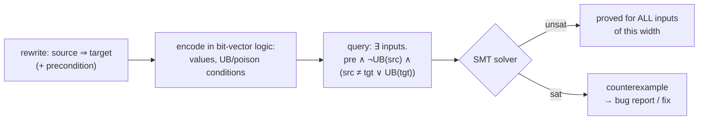

# 06 · Beyond testing: verified compilers, translation validation, and open research problems

> Level: pro · Time: ~3.5 h · Prereqs: 04-pro/01–05; 03-advanced/04 (undef/poison); basic logic (implication, "for all")

## 1. Why this exists

Testing finds bugs; it cannot show their absence. Two research programmes attack correctness head-on: **verified compilation** — prove, once and for all, that a compiler preserves semantics (CompCert) — and **translation validation** — prove, *per compilation or per transformation*, that the output refines the input (Alive, Alive2). Both are now practical enough to matter: Csmith's authors spent about six CPU-years and could not find a wrong-code error in CompCert's verified core, and Alive2 run over LLVM's own unit tests "discovered and reported 47 new bugs, 28 of which have been fixed". This final lesson explains how they work, builds a tiny Alive-style checker with an SMT solver, and then maps the open problems — where a research contribution in compiler correctness could come from.

## 2. Intuition: inspecting the factory vs inspecting each product

Testing is sampling products at random. **Verification** is proving the factory's machines can only make correct products (expensive to build, then free per product). **Translation validation** is attaching an automated inspector to the conveyor belt that mathematically checks *every* product against its order — the machines can stay unverified and complicated, as long as the inspector is trustworthy. Alive is an inspector for one kind of product (LLVM peephole rewrites); Alive2 inspects whole functions.

## 3. Precise definitions

* **Semantic preservation / refinement**: compiled program *T* is correct for source *S* if every behaviour of *T* is a behaviour of *S* — "a target function displays a subset of the behaviors of a source function" (Alive2). If *S* has UB, *S* allows *every* behaviour, so *T* may do anything: that is why UB enables optimization (03-advanced/04).
* **Verified compiler**: a compiler with a machine-checked proof of semantic preservation. **CompCert** (Leroy, "Formal verification of a realistic compiler", *CACM* 2009): "a compiler from Clight (a large subset of the C programming language) to PowerPC assembly code" (more targets since), proved in the Coq proof assistant so that "the generated machine code behaves as prescribed by the semantics of the source program". Performance in that paper: "only 7% slower than gcc -O1 and 12% slower than gcc -O2".
* **Trusted computing base**: the unverified parts. Csmith found CompCert bugs only there: six wrong-code bugs in its then-unverified front end (e.g. a signed/unsigned comparison in integer promotion) — after which the developer extended the verified portion — and a PowerPC stack-displacement issue where the semantics assumed the assembler would catch overflow. The authors state CompCert "is the only compiler we have tested for which Csmith cannot find wrong-code errors."
* **Translation validation** (Pnueli, Siegel, Singerman, TACAS 1998): instead of verifying the compiler, verify each translation's output against its input.
* **Alive** (Lopes, Menendez, Nagarakatte, Regehr, PLDI 2015): a DSL for LLVM peephole optimizations, verified with the Z3 SMT solver over all bit-widths of interest, modelling undef/poison; of 334 InstCombine transformations translated, "Eight (2.4%) of these could not be proved correct" — eight previously unknown bugs. Example (PR21245):

  ```text
  Pre: C2 % (1<<C1) == 0
  %s = shl nsw %X, C1
  %r = sdiv %s, C2
  =>
  %r = sdiv %X, C2/(1<<C1)
  ```

* **Alive2** (Lopes, Lee, Hur, Liu, Regehr, PLDI 2021): "a bounded translation validation tool for the LLVM compiler's intermediate representation" that is "fully automatic through the use of an SMT solver, and requires no changes to LLVM"; it "limits resource consumption by, for example, unrolling loops up to some bound" — hence *bounded*: it can miss bugs beyond the bound but its reports are real.
* **SMT solver**: decides satisfiability of formulas over theories such as fixed-width **bit-vectors** (exact machine arithmetic). Verification query: "is there an input where source is defined but source ≠ target?" — *unsat* means proved for all inputs; *sat* yields a counterexample.

## 4. Step by step

### 4.1 Dumbest verification: exhaustive testing

For an 8-bit rewrite, try all 256 inputs. For two 32-bit operands, 2⁶⁴ cases — impossible. **Wall: input space.** SMT solvers reason symbolically about *all* inputs at once.

### 4.2 Encode the rewrite as a formula

For `x * 8 => x << 3` at width *w*: ask the solver for *x* with `x*8 ≠ x<<3`. Unsat → correct for every *x*.

### 4.3 The UB wall: refinement, not equality

`x + 1 > x => true` is *false* for wrapping arithmetic (x = INT_MAX), but *correct* for `add nsw`, because when `x + 1` overflows the source is poison and any target value refines it. So the query becomes: "is there an input where the **source is well-defined** and (target differs **or target is undefined**)?" Encoding undef/poison/UB faithfully is the hard part of Alive/Alive2 — and the part where they found bugs in LLVM's *semantics*, not only in passes.

### 4.4 Preconditions and edge cases

Peephole rewrites often hold only under preconditions on constants (Alive's `Pre:`). Edge cases at the type boundary (`INT_MIN`, shift by width−1) are where human reasoning slips — exactly what §5 shows.



## 5. Code: a miniature Alive (`mini_alive.py`)

Requires `pip install z3-solver` (z3py; `z3.get_version_string()` reports 5.4.1 in this sandbox).

```python
# file: mini_alive.py
# Alive-style verification of peephole optimizations with the Z3 SMT solver.
# For each rewrite "source => target" we ask Z3: is there an input where the source is
# well-defined but the target differs (or is undefined)?
#   unsat -> no such input: the rewrite is correct for ALL inputs of this bit-width
#   sat   -> Z3 hands us a counterexample
# Bit-vectors model fixed-width machine integers exactly. In z3py, on bit-vectors:
#   + - * wrap around;  /, %, >>, <, > are SIGNED;  LShR / UDiv / ULT are the unsigned ones.
from z3 import (BitVec, BitVecVal, BoolVal, Solver, And, Or, Not, sat,
                SRem, LShR, BVAddNoOverflow)

W = 8                                    # 8-bit integers: small, readable counterexamples

def check(name, src, tgt, xs, pre=None, src_ub=None, tgt_ub=None):
    """Refinement check (as in Alive/Alive2): whenever the source is defined (not UB/poison),
    the target must be defined and produce the same value."""
    s = Solver()
    if pre is not None:
        s.add(pre)                              # only inputs satisfying the precondition
    bad = Or(src != tgt, tgt_ub if tgt_ub is not None else BoolVal(False))
    if src_ub is not None:
        bad = And(Not(src_ub), bad)             # UB in the source => anything goes
    s.add(bad)
    if s.check() == sat:
        m = s.model()
        ce = ", ".join(f"{v}={m.eval(v, model_completion=True).as_signed_long()}" for v in xs)
        print(f"WRONG    {name:44} counterexample: {ce}")
    else:
        print(f"CORRECT  {name}")

x = BitVec("x", W)
C1, C2 = BitVec("C1", W), BitVec("C2", W)
INT_MIN, ONE = BitVecVal(-(1 << (W - 1)), W), BitVecVal(1, W)

# 1. strength reduction
check("x * 8  =>  x << 3", x * 8, x << 3, [x])

# 2. a classic WRONG rewrite: signed division by 2 as an arithmetic shift
check("x /s 2  =>  x >>s 1", x / 2, x >> 1, [x])

# 3. what compilers really emit: add the sign bit first, then shift
check("x /s 2  =>  (x + (x >>u (W-1))) >>s 1", x / 2, (x + LShR(x, W - 1)) >> 1, [x])

# 4. x + 1 > x  =>  true : wrong if the add wraps ...
check("x + 1 >s x  =>  true   (wrapping add)", x + 1 > x, BoolVal(True), [x])
# ... correct for 'add nsw', whose overflow makes the source poison (any target allowed)
check("x +nsw 1 >s x  =>  true", x + 1 > x, BoolVal(True), [x],
      src_ub=Not(BVAddNoOverflow(x, ONE, True)))

# 5. Alive paper, PR21245:  Pre: C2 % (1<<C1) == 0
#    %s = shl nsw %X, C1 ; %r = sdiv %s, C2   =>   %r = sdiv %X, C2/(1<<C1)
shl = x << C1
src_ub = Or(C1 >= W, C1 < 0,                       # shift amount out of range: poison
            (shl >> C1) != x,                      # shl nsw lost bits: poison
            C2 == 0, And(shl == INT_MIN, C2 == -1))  # sdiv UB
d = C2 / (ONE << C1)
tgt_ub = Or(d == 0, And(x == INT_MIN, d == -1))      # target sdiv must not be UB either
check("PR21245 without its precondition", shl / C2, x / d, [x, C1, C2],
      src_ub=src_ub, tgt_ub=tgt_ub)
check("PR21245 with Pre: C2 % (1<<C1) == 0", shl / C2, x / d, [x, C1, C2],
      pre=SRem(C2, ONE << C1) == 0, src_ub=src_ub, tgt_ub=tgt_ub)
# ... my 8-bit encoding still fails at C1 = W-1, where (1<<C1) is the NEGATIVE value INT_MIN.
# Excluding that edge case makes the proof go through:
check("PR21245 with Pre and C1 < W-1", shl / C2, x / d, [x, C1, C2],
      pre=And(SRem(C2, ONE << C1) == 0, C1 < W - 1), src_ub=src_ub, tgt_ub=tgt_ub)
```

Python syntax notes:

* `from z3 import (BitVec, …)` — import several names; parentheses let the list span lines.
* `BitVec("x", W)` creates a symbolic *W*-bit variable; `BitVecVal(v, W)` a constant. Python operators on them build **formulas**, not numbers: `x * 8` is a symbolic term. In z3py, `/`, `%`, `>>`, `<`, `>` on bit-vectors are the **signed** versions; `LShR` is logical (unsigned) shift right; `SRem` is signed remainder.
* `Solver()`, `s.add(f)`, `s.check() == sat`, `s.model()` — assert constraints, ask for satisfiability, read the satisfying assignment; `m.eval(v, model_completion=True).as_signed_long()` turns a model value into a Python int.
* `Or(...)`, `And(...)`, `Not(...)`, `BoolVal(True)` build logical formulas; `BVAddNoOverflow(x, ONE, True)` is the condition "signed `x + 1` does not overflow".
* `def check(name, src, tgt, xs, pre=None, src_ub=None, tgt_ub=None):` — keyword arguments with defaults; callers pass only what they need (`src_ub=…`).

Logic: `check` encodes refinement — failure = precondition ∧ source defined ∧ (values differ ∨ target undefined).

```text
$ python3 mini_alive.py
CORRECT  x * 8  =>  x << 3
WRONG    x /s 2  =>  x >>s 1                          counterexample: x=-49
CORRECT  x /s 2  =>  (x + (x >>u (W-1))) >>s 1
WRONG    x + 1 >s x  =>  true   (wrapping add)        counterexample: x=127
CORRECT  x +nsw 1 >s x  =>  true
WRONG    PR21245 without its precondition             counterexample: x=2, C1=5, C2=79
WRONG    PR21245 with Pre: C2 % (1<<C1) == 0          counterexample: x=-1, C1=7, C2=-128
CORRECT  PR21245 with Pre and C1 < W-1
```

(0.75 s for all eight queries at *W* = 8.) Reading the results:

* `x / 2` vs `x >> 1` at x = −49: C division truncates to −24, the arithmetic shift rounds down to −25 — the strength-reduction trap from 02-intermediate/07, found mechanically; the sign-bit-correction version is proved.
* `x + 1 > x`: wrong with wrapping, correct with `nsw` — 03-advanced/04 made formal.
* PR21245: without its precondition the rewrite fails (x = 2, C1 = 5, C2 = 79: 64 / 79 = 0 but 79 / 32 = 2, 2 / 2 = 1). With the precondition, **my encoding** still finds x = −1, C1 = 7, C2 = −128: at C1 = *W*−1, `1<<C1` is the *negative* value −128, the source computes (−128)/(−128) = 1 while the target computes −1 / (−128 / −128) = −1. Excluding `C1 = W−1` makes the proof go through. Whether Alive's own semantics for its `Pre:` operators and this edge case match my encoding I have not checked [unverified] — but the episode demonstrates the point of the whole approach: the width boundary is where hand reasoning fails and solvers don't.

Trying *W* = 16 with the same file is instructive too: the first seven queries answer quickly (with 16-bit counterexamples such as x = −22529 and x = 32767), but the last *proof* involving division did not finish within five minutes in this sandbox — bit-vector division is expensive for SMT solvers, one reason Alive2 is *bounded* and why scaling verification is itself research.

## 6. Research landscape and open problems

What follows is a map, not a claim of completeness; each item names the evidence it rests on.

1. **Generator saturation** (YARPGen's observation, 04-pro/01): new bug classes need new program shapes — generation policies, swarm configurations, mutation of real code (Hermes), and LLM-based generation (Fuzz4All uses "large language models (LLMs) as an input generation and mutation engine", 98 bugs across nine systems, 64 confirmed new). Open: guaranteeing UB-freedom for LLM-generated programs; measuring and steering *what* parts of a compiler a generator reaches.
2. **GPU and accelerator compilers** (04-pro/05): closed toolchains, nondeterminism, convergence semantics, floating point. Existing work (CLsmith, GLFuzz, spirv-fuzz) targets OpenCL, GLSL and SPIR-V; generators producing race-free, barrier-correct *CUDA*-style kernels, and oracles that tolerate legitimate floating-point differences, are natural next steps.
3. **ML/DL compilers**: NNSmith "has found 72 new bugs for TVM, TensorRT, ONNXRuntime, and PyTorch" (58 confirmed, 51 fixed) by generating valid models, searching for inputs that avoid floating-point exceptional values, and differential testing. MLIR-based stacks add a multi-level IR where each lowering is a test point (03-advanced/05).
4. **Oracles beyond output equality**: performance bugs (EMI counted 19), compile-time blow-ups, debug-information correctness, and *semantic* oracles like Alive2 applied to fuzzer-generated IR.
5. **Triage at scale**: deduplication (spirv-fuzz's "reduction and deduplication almost for free"), automated root-causing (pass bisection, 03-advanced/06), and reducers that keep UB out (C-Reduce's 29% statistic).
6. **Verification reach**: CompCert-style proofs for optimizing compilers with aggressive optimizations, bounded vs unbounded translation validation, solver scalability (the 16-bit division timeout above in miniature).

**Reading a compiler-testing paper** (a checklist built from the papers in this track): What is the generator or mutation, and how does it guarantee validity/UB-freedom? What is the oracle? Which compilers, versions and flags? How many bugs *reported / confirmed / fixed / duplicates* (EMI's table separates these)? Bug classes (wrong-code vs crash vs performance)? Comparison against prior tools under equal time? Saturation curves? Artifact availability?

## 7. Common mistakes

* **"Verified" ≠ "bug-free everywhere".** CompCert's guarantees cover the verified passes; front-end parsing, assembler, linker and the specification itself are trusted.
* **Equality instead of refinement** when the source can be UB/poison → false "bugs" in correct optimizations.
* **Forgetting target UB** — a rewrite that introduces division by zero or `INT_MIN / −1` in the target is wrong even if values match whenever both are defined.
* **Proving at one bit-width only.** Alive checks a range of widths; edge cases differ by width.
* **Trusting bounded validation as a proof.** Alive2's loop unrolling bound means "no bug found within the bound".
* **Treating counts of bugs as the only research contribution.** Reviewers also look for new insights: a new oracle, a new semantic model, a measurable reduction in false positives.

## 8. Connections

* **Math for CS track**: propositional and first-order logic, satisfiability, bit-vector arithmetic, induction (CompCert's simulation proofs).
* **Testing/Verification track**: SMT-based verification, symbolic execution (KLEE uses the same solvers), refinement.
* **Research skills track**: reading and positioning papers; the checklist in §6.
* **Rust track**: Rust's MIR and borrow checker are partly specified with formal models; refinement reasoning appears in unsafe-code verification.
* **AI dev tools / ML tracks**: LLM-based fuzzing and LLM-assisted program reduction are fast-moving areas.

### Where this shows up in my projects

* **compiler-fuzz** currently trusts its oracle (agreement between GCC and Clang across levels). An Alive2-style refinement check on the LLVM IR *before and after* each Clang pass would turn a "checksums differ" signal into "pass P is unsound on function F" automatically — a concrete research-grade extension, and directly relevant to the planned GPU compiler-testing paper, where independent GPU toolchains are scarce and a semantic oracle would compensate.
* **QiskitSage** reviews quantum-circuit code; quantum compilers face the same refinement question (does the transpiled circuit implement the same unitary?), and equivalence checking of circuits is the quantum analogue of translation validation.

## 9. Self-check

1. Define refinement and explain why it, not equality, is the right correctness notion for optimizers.
2. What part of CompCert did Csmith find bugs in, and what does that tell you about verified software?
3. Why can Z3 prove `x * 8 == x << 3` for all 8-bit (or 32-bit) `x` without enumerating them?
4. Why is `x + 1 > x => true` correct for `add nsw` but wrong for plain `add`?
5. What does "bounded" mean in Alive2, and what is its consequence?

<details><summary>Answers</summary>

1. Target T refines source S if every behaviour of T is a behaviour of S. When S is UB/poison it allows every behaviour, so optimizations may choose any; equality would wrongly forbid exploiting UB and would reject correct optimizations.
2. Only the unverified front end (and an assumption at the assembler boundary), never the verified core: verification works for what it covers; the trusted computing base is where bugs remain.
3. It reasons symbolically over bit-vector formulas (bit-blasting to SAT plus theory reasoning), deciding unsatisfiability of `x*8 ≠ x<<3` for all values at once.
4. With `nsw`, overflow makes the source poison, so the single overflowing input (INT_MAX) imposes no constraint; with wrapping `add`, INT_MAX + 1 wraps to INT_MIN and the comparison is false there.
5. It limits resources, e.g. unrolls loops only up to a bound; bugs requiring more iterations can be missed, though reported bugs are genuine.

</details>

## 10. Mnemonic (Tamil + English)

**"Target-u source-oda subset"** — *the target's behaviours are a subset of the source's*: refinement in four words. And the three roads to correctness: **"Sodhi, Nirubi, Saripaaru"** — *Test (sodhi), Prove (nirubi — CompCert), Check each output (saripaaru — translation validation)*.

## Sources

* X. Leroy, "Formal verification of a realistic compiler", *Communications of the ACM* 52(7), 2009: https://xavierleroy.org/publi/compcert-CACM.pdf
* X. Yang, Y. Chen, E. Eide, J. Regehr, "Finding and Understanding Bugs in C Compilers", PLDI 2011 (CompCert results): https://www-old.cs.utah.edu/~regehr/papers/pldi11-preprint.pdf
* A. Pnueli, M. Siegel, E. Singerman, "Translation Validation", TACAS 1998: https://doi.org/10.1007/BFb0054170
* N. P. Lopes, D. Menendez, S. Nagarakatte, J. Regehr, "Provably Correct Peephole Optimizations with Alive", PLDI 2015: https://users.cs.utah.edu/~regehr/papers/pldi15.pdf
* N. P. Lopes, J. Lee, C.-K. Hur, Z. Liu, J. Regehr, "Alive2: Bounded Translation Validation for LLVM", PLDI 2021: https://www-old.cs.utah.edu/~regehr/alive2-pldi21.pdf
* Z3 theorem prover and z3py: https://github.com/Z3Prover/z3
* C. S. Xia et al., "Fuzz4All: Universal Fuzzing with Large Language Models", ICSE 2024: https://arxiv.org/abs/2308.04748
* J. Liu et al., "NNSmith: Generating Diverse and Valid Test Cases for Deep Learning Compilers", ASPLOS 2023: https://arxiv.org/abs/2207.13066
* V. Livinskii, D. Babokin, J. Regehr, "Random Testing for C and C++ Compilers with YARPGen", OOPSLA 2020: https://users.cs.utah.edu/~regehr/yarpgen-oopsla20.pdf
* V. Le, M. Afshari, Z. Su, "Compiler Validation via Equivalence Modulo Inputs", PLDI 2014: https://www.cs.ucdavis.edu/~su/publications/emi.pdf

## Verify yourself

```bash
# file: verify-06p.sh
# Needs: pip install z3-solver. Tested with Z3 5.4.1 (z3py), Python 3.13, Nov 2026.
python3 -c "import z3; print(z3.get_version_string())"
python3 mini_alive.py                         # 4 CORRECT, 4 WRONG with counterexamples (< 1 s)
python3 -c "x=-49; print(int(x/2), x>>1)"     # -24 -25: C-style truncation vs arithmetic shift
```

Check against sources: refinement wording against Alive2's introduction; Alive's numbers and the PR21245 example against PLDI 2015 §6 and Figure 8; CompCert's guarantee and performance against Leroy's CACM paper.
