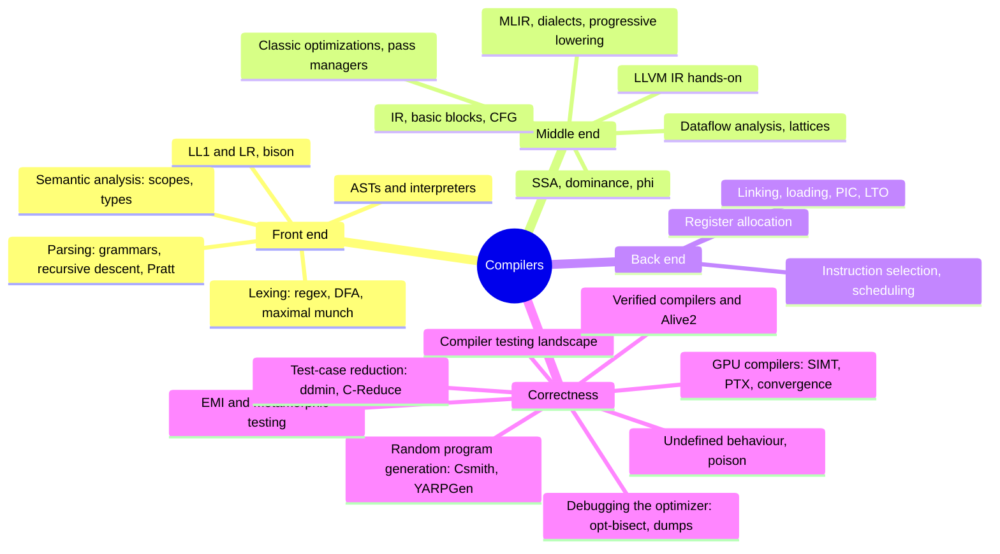

# Compilers, from zero to research level

A complete learning track that starts at "what is a compiler?" and ends at the research frontier of **compiler testing and verification** — random program generation, Equivalence Modulo Inputs, test-case reduction, GPU compilers, translation validation. Every lesson is built around runnable code (C, Python, LLVM IR, MLIR, shell), every number in the text was either measured in a sandbox or taken from a cited primary source, and every file ends with **Sources** and **Verify yourself**.

All code was compiled and run on Ubuntu 24.04 with **GCC 13.3**, **Clang/LLVM 18.1.3** (incl. `opt`, `llc`, `lli`, `llvm-reduce`), **MLIR 18** (`mlir-18-tools`), **Csmith 2.3.0** (+ `libcsmith-dev`), **C-Reduce 2.11**, **flex 2.6.4**, **Bison 3.8.2**, **Python 3.13**, **Z3 5.4.1**, **rustc 1.97** (one check) — Nov 2026. Version-specific behaviour is labelled as such in the lessons.

## Who this is for

A final-year CS student comfortable with **C** (and Java), with basic Python, who wants the *why* before the *how*, and who wants to reach the level where they can read and extend compiler-testing research. No prior compiler course is assumed. Python code is explained syntax-and-logic, line by line; C code is explained logic-first.

**Prerequisites:** C pointers, structs and `malloc`; recursion; basic graphs (DFS/BFS); running commands in a Linux shell. Helpful but not required: x86-64 assembly basics, discrete math (sets, relations, logic).

## How the track is organised

```text
03-compilers/
├── README.md                     ← you are here
├── 01-beginner/                  zero knowledge → a working compiler + first compiler test
├── 02-intermediate/              standard techniques: parsing theory, semantics, IR, SSA, LLVM IR, dataflow, optimizations
├── 03-advanced/                  back end internals, linking, undefined behaviour, MLIR, debugging the optimizer
├── 04-pro/                       research level: compiler testing and verification, GPU compilers
├── glossary.md                   A–Z terms, plain + precise meaning, lesson link
├── appendix.md                   cheat sheets, tools, books, courses, papers, docs
├── exercises.md                  graded exercises with solutions + 3 mini projects
├── interview-questions.md        questions with model answers
├── connections.md                how this track links to the other tracks
└── common-mistakes.md            the mistakes from every lesson, collected
```

Each lesson follows the same shape: why it exists → intuition/analogy → precise definitions → step by step (dumbest approach first, each wall forcing the next idea) → diagrams → commented, tested code → common mistakes → connections → self-check with answers → Tamil + English mnemonic → Sources → Verify yourself.

## Roadmap (mind map)




## Lessons and time estimates

| # | Lesson | Key outcomes | Time |
|---|---|---|---|
| **Beginner** | | | **~12 h** |
| 01 | [What is a compiler? The big picture](01-beginner/01-what-is-a-compiler.md) | phases, driver, preprocess → compile → assemble → link; a 20-line "compiler" | 1.5 h |
| 02 | [Lexing](01-beginner/02-lexing.md) | tokens, regexes, NFA→DFA, maximal munch; hand-written, table-driven and flex lexers | 2 h |
| 03 | [Parsing basics](01-beginner/03-parsing-basics.md) | CFGs, ambiguity, left recursion, recursive descent, precedence climbing, dangling else | 2.5 h |
| 04 | [ASTs and interpreters](01-beginner/04-asts-and-interpreters.md) | AST design, Clang AST dump, a tree-walking interpreter for "Tiny" | 3 h |
| 05 | [Your first compiler — and your first compiler test](01-beginner/05-first-compiler-and-testing-it.md) | Tiny → x86-64, System V ABI, differential testing, a planted bug caught | 3 h |
| **Intermediate** | | | **~21.5 h** |
| 01 | [LL(1), LR and parser generators](02-intermediate/01-ll-and-lr-parsing.md) | FIRST/FOLLOW, LL(1) tables, shift/reduce, LALR, Bison conflicts | 3 h |
| 02 | [Semantic analysis](02-intermediate/02-semantic-analysis.md) | scopes, symbol tables, type checking, implicit conversions | 2.5 h |
| 03 | [IR, basic blocks and CFGs](02-intermediate/03-ir-and-control-flow-graphs.md) | three-address code, leaders, CFGs, GIMPLE dumps | 2.5 h |
| 04 | [SSA form and dominance](02-intermediate/04-ssa-form.md) | dominators (Cooper–Harvey–Kennedy), dominance frontiers, φ placement, renaming, mem2reg | 3.5 h |
| 05 | [LLVM IR hands-on](02-intermediate/05-llvm-ir-hands-on.md) | reading/writing `.ll`, `lli`/`opt`/`llc`, GEP, verifier, `nsw` | 3 h |
| 06 | [Dataflow analysis](02-intermediate/06-dataflow-analysis.md) | lattices, worklist solver, liveness, reaching definitions, available expressions | 3.5 h |
| 07 | [Classic optimizations](02-intermediate/07-classic-optimizations.md) | LVN, SCCP, CSE, DCE, LICM, inlining, strength reduction, pass managers | 3.5 h |
| **Advanced** | | | **~17.5 h** |
| 01 | [Instruction selection and codegen](03-advanced/01-instruction-selection-and-codegen.md) | tree tiling, maximal munch, SelectionDAG/GlobalISel, MIR, scheduling | 3 h |
| 02 | [Register allocation](03-advanced/02-register-allocation.md) | interference graphs, Chaitin–Briggs, linear scan, LLVM greedy, measured spills | 3 h |
| 03 | [Linking and loading](03-advanced/03-linking-and-loading.md) | symbols, relocations, static/dynamic, PIC/GOT/PLT, weak symbols, LTO | 3 h |
| 04 | [Undefined behaviour](03-advanced/04-undefined-behaviour.md) | UB vs unspecified vs implementation-defined, poison/undef/freeze, sanitizers | 3 h |
| 05 | [MLIR introduction](03-advanced/05-mlir-intro.md) | operations/regions/dialects, block arguments, progressive lowering to LLVM | 3 h |
| 06 | [Debugging the optimizer](03-advanced/06-debugging-the-optimizer.md) | `opt-bisect-limit`, `-print-changed`, GCC dumps, triage workflow | 2.5 h |
| **Pro** | | | **~20 h** |
| 01 | [The compiler-testing landscape](04-pro/01-compiler-testing-landscape.md) | bug classes, oracles, Csmith-driven differential harness, saturation | 3 h |
| 02 | [Random program generation](04-pro/02-random-program-generation.md) | Csmith/YARPGen design, a UB-free generator, measured false-alarm rate without it | 3.5 h |
| 03 | [EMI and metamorphic testing](04-pro/03-emi-and-metamorphic-testing.md) | Orion/Athena/Hermes, GPU metamorphic testing, a mini-Orion with gcov | 3 h |
| 04 | [Test-case reduction](04-pro/04-test-case-reduction.md) | ddmin, C-Reduce, Perses, llvm-reduce, interestingness pitfalls | 3 h |
| 05 | [GPU compiler basics](04-pro/05-gpu-compiler-basics.md) | SIMT, PTX vs SASS, nvcc trajectory, uniformity, convergent ops, GPU testing | 3.5 h |
| 06 | [Verified compilers and open problems](04-pro/06-verified-compilers-and-open-problems.md) | refinement, CompCert, Alive/Alive2, a Z3 mini-Alive, research map | 3.5 h |
| | **Track total (lessons only)** | | **~71 h** |
| | exercises + mini projects | | +30–60 h |

## Coverage check

The track is checked against **one standard university course**, **two standard textbooks**, and **the industrial references** (LLVM and GCC documentation). ✔ = covered, ◐ = covered partially, ✘ = excluded (with reason).

### Stanford CS143 "Compilers" lecture list

| CS143 lecture | Where covered |
|---|---|
| Course overview | ✔ 01-beginner/01 |
| Cool: the course project | ✘ (project language specific); replaced by the "Tiny" language built across 01-beginner/02–05 |
| Lexical analysis; implementation of lexical analysis | ✔ 01-beginner/02 |
| Introduction to parsing | ✔ 01-beginner/03 |
| Syntax-directed translation | ✔ 01-beginner/04 (AST construction), 02-intermediate/01 (Bison actions), 02-intermediate/02 (attributes) |
| Top-down parsing | ✔ 01-beginner/03, 02-intermediate/01 |
| Bottom-up parsing | ✔ 02-intermediate/01 |
| Semantic analysis & type checking I–II | ✔ 02-intermediate/02 |
| Run-time environments | ◐ stack frames, calling conventions, prologue/epilogue in 01-beginner/05 and 03-advanced/01; heap layout/objects/vtables not covered (belongs to OOP language implementation) |
| Code generation | ✔ 01-beginner/05, 03-advanced/01 |
| Operational semantics | ◐ informal semantics via interpreters (01-beginner/04) and refinement (04-pro/06); formal operational semantics rules not covered |
| Intermediate code & local optimization | ✔ 02-intermediate/03, 02-intermediate/07 (LVN) |
| Global optimization | ✔ 02-intermediate/06–07 |
| Register allocation | ✔ 03-advanced/02 |
| Automatic memory management (GC) | ✘ excluded: runtime-system topic, not needed for C/LLVM/GPU compiler correctness; see appendix for reading |
| JIT compilers and fast compilation | ◐ JIT concepts in 01-beginner/01, 01-beginner/04, linear scan for JITs in 03-advanced/02, CUDA driver JIT in 04-pro/05 |

### Aho, Lam, Sethi, Ullman — *Compilers: Principles, Techniques, and Tools* (2nd ed.)

| Chapter | Where covered |
|---|---|
| 1 Introduction | ✔ 01-beginner/01 |
| 2 A Simple Syntax-Directed Translator | ✔ 01-beginner/02–05 (the Tiny compiler) |
| 3 Lexical Analysis | ✔ 01-beginner/02 |
| 4 Syntax Analysis | ✔ 01-beginner/03, 02-intermediate/01 |
| 5 Syntax-Directed Translation | ✔ 01-beginner/04, 02-intermediate/01–02 |
| 6 Intermediate-Code Generation | ✔ 02-intermediate/03, 02-intermediate/05 |
| 7 Run-Time Environments | ◐ stack frames and ABI (01-beginner/05, 03-advanced/01, 03-advanced/03); garbage collection excluded |
| 8 Code Generation | ✔ 03-advanced/01–02 |
| 9 Machine-Independent Optimizations | ✔ 02-intermediate/04, 02-intermediate/06–07 |
| 10 Instruction-Level Parallelism | ◐ list scheduling in 03-advanced/01; software pipelining/VLIW excluded (specialised) |
| 11 Optimizing for Parallelism and Locality | ◐ vectorisation remark (02-intermediate/07), GPU parallelism (04-pro/05), MLIR loop-level IR (03-advanced/05); polyhedral/affine theory excluded (research specialty; pointers in appendix) |
| 12 Interprocedural Analysis | ◐ inlining, IPSCCP, LTO (02-intermediate/07, 03-advanced/03); pointer analysis theory excluded |

### Cooper & Torczon — *Engineering a Compiler* (3rd ed., 2022)

| Chapter | Where covered |
|---|---|
| 1 Overview of Compilation | ✔ 01-beginner/01 |
| 2 Scanners | ✔ 01-beginner/02 |
| 3 Parsers | ✔ 01-beginner/03, 02-intermediate/01 |
| 4 Intermediate Representations | ✔ 02-intermediate/03–05, 03-advanced/05 |
| 5 Syntax-Driven Translation | ✔ 01-beginner/04, 02-intermediate/02 |
| 6 Implementing Procedures | ◐ calling conventions, frames (01-beginner/05, 03-advanced/01) |
| 7 Code Shape | ◐ lowering of control flow and expressions (02-intermediate/03, 01-beginner/05) |
| 8 Introduction to Optimization | ✔ 02-intermediate/07 (LVN) |
| 9 Data-Flow Analysis | ✔ 02-intermediate/04 (dominance), 02-intermediate/06 |
| 10 Scalar Optimization | ✔ 02-intermediate/07 |
| 11 Instruction Selection | ✔ 03-advanced/01 |
| 12 Instruction Scheduling | ◐ 03-advanced/01 (list scheduling) |
| 13 Register Allocation | ✔ 03-advanced/02 |
| 14 Runtime Optimization | ◐ JIT notes (01-beginner/04, 04-pro/05) |

### Industrial references (LLVM, GCC)

| Reference | Where covered |
|---|---|
| LLVM Language Reference (SSA, types, instructions, poison/undef/freeze) | 02-intermediate/05, 03-advanced/04 |
| LLVM pass documentation + new pass manager | 02-intermediate/07, 03-advanced/06 |
| LLVM Target-Independent Code Generator, GlobalISel, MIR | 03-advanced/01–02 |
| LLVM LTO, OptBisect, llvm-reduce, NVPTX usage, CUDA with Clang, Convergent Operations | 03-advanced/03, 03-advanced/06, 04-pro/04, 04-pro/05 |
| Kaleidoscope tutorial (front end → IR → JIT) | 01-beginner/02–04, 02-intermediate/04 (mem2reg) |
| MLIR Language Reference, dialects, passes | 03-advanced/05 |
| GCC Internals: GENERIC/GIMPLE/RTL, passes, dump options | 02-intermediate/03, 03-advanced/01, 03-advanced/06 |
| NVIDIA nvcc and PTX ISA documentation | 04-pro/05 |

### Research topics (beyond a standard course)

Compiler testing survey taxonomy (generation, mutation, oracles), Csmith, YARPGen, EMI/Athena/Hermes, CLsmith, GLFuzz, spirv-fuzz, NNSmith, Fuzz4All, ddmin, C-Reduce, Perses, CompCert, translation validation, Alive, Alive2, STACK (unstable code) — 03-advanced/04 and the whole 04-pro level.

## How to study this track

1. Do the levels in order; inside a level, the lessons build on each other (the Tiny language grows from 01-beginner/02 to 01-beginner/05 and is reused in 02-intermediate/03 and 04-pro/04).
2. Run every `Verify yourself` block — the code blocks marked `file: NAME` can be saved under that name and run as-is.
3. After each level, do that level's section in `exercises.md`, then the self-checks in `interview-questions.md`.
4. For the research level, read at least the abstracts and evaluation sections of the papers cited in each 04-pro lesson; the appendix lists them in reading order.

## Sources

* Stanford CS143 course page (lecture list): https://web.stanford.edu/class/cs143/
* Aho, Lam, Sethi, Ullman, *Compilers: Principles, Techniques, and Tools*, 2nd ed. (table of contents): https://www.pearson.com/store/en-us/p/compilers-principles-techniques-and-tools/P200000003472
* Cooper & Torczon, *Engineering a Compiler*, 3rd ed., 2022 (table of contents): https://shop.elsevier.com/books/engineering-a-compiler/cooper/978-0-12-815412-0
* LLVM documentation index: https://llvm.org/docs/
* GCC Internals manual: https://gcc.gnu.org/onlinedocs/gccint/
* MLIR documentation: https://mlir.llvm.org/docs/
* J. Chen et al., "A Survey of Compiler Testing", *ACM Computing Surveys* 53(1), 2020: https://tjusail.github.io/people/chenjunjie/files/CSUR20.pdf
* Cornell CS 6120 Advanced Compilers (self-guided): https://www.cs.cornell.edu/courses/cs6120/2023fa/self-guided/

## Verify yourself

```bash
# file: verify-toolchain.sh
# Check that your machine has the tools this track uses (Ubuntu 24.04 package names in comments).
gcc --version | head -1                     # gcc
clang --version | head -1                   # clang (LLVM 18 used here)
opt --version | sed -n 2p; llc --version | grep -c nvptx   # llvm (NVPTX back end present?)
ls /usr/lib/llvm-18/bin/mlir-opt            # mlir-18-tools
csmith --version | head -1                  # csmith  (+ libcsmith-dev for csmith.h)
creduce --help | head -1                    # creduce
flex --version; bison --version | head -1   # flex, bison
python3 -c "import z3; print('z3', z3.get_version_string())"   # pip install z3-solver
```

Check the coverage tables yourself against the CS143 lecture list and the two textbooks' tables of contents linked above.
