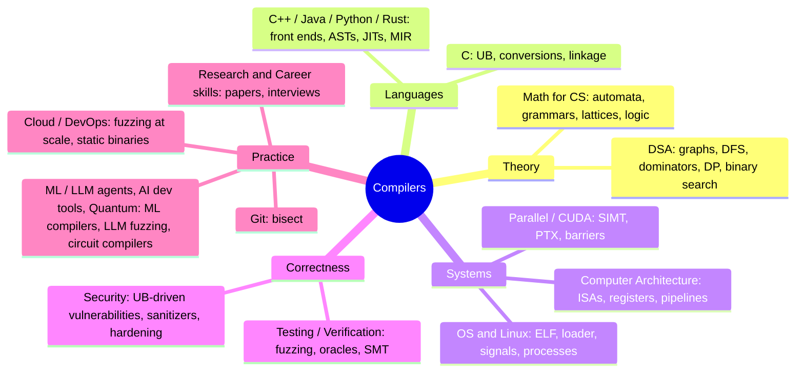

# Connections: how compilers link to the other tracks

Compilers sit at the crossroads of theory (automata, logic, graphs) and systems (architecture, OS, linking, GPUs). This file maps those links so you can study tracks together. Other tracks are referred to by name; each row names the lesson(s) in *this* track where the link appears.

## Track-by-track

| Track | What connects | Where in this track |
|---|---|---|
| **C** | preprocessor; translation units, `extern`/`static`; integer promotions and usual arithmetic conversions; undefined/unspecified/implementation-defined behaviour; strict aliasing; struct layout | 01-beginner/01, 02-intermediate/02, 02-intermediate/05, 03-advanced/03–04 |
| **C++** | Clang is written in C++; Clang's AST class hierarchy and visitors; name mangling (`_Z5saxpyifPKfPf` in PTX); CUDA is C++ | 01-beginner/04, 04-pro/05 |
| **Computer Architecture** | ISAs (x86-64 CISC addressing modes vs RISC-V load/store vs AArch64 shifted operands), registers and register pressure, pipelines and scheduling, flags, SIMD vectorization | 01-beginner/05, 03-advanced/01–02 |
| **OS** | process exit status, signals (SIGFPE from `idiv`, SIGSEGV), ELF loading, dynamic linker, ASLR/PIE, `fork`/`exec` (what `subprocess.run` does) | 01-beginner/05, 03-advanced/03 |
| **Parallel/CUDA** | SIMT and warps, divergence, shared memory, barriers and convergence, PTX vs SASS, nvcc trajectory, occupancy vs registers | 03-advanced/02, 04-pro/05 |
| **DSA** | recursion and stacks (parsers), finite automata, hash tables (symbol tables), DFS/postorder (dominators), worklists (dataflow), graph colouring and interval scheduling (register allocation), dynamic programming (optimal tiling), binary search (pass bisection), divide and conquer (ddmin) | almost every lesson; especially 02-intermediate/04, 02-intermediate/06, 03-advanced/01–02, 03-advanced/06, 04-pro/04 |
| **Math for CS** | regular languages, CFGs and pushdown automata, partial orders and lattices, monotone fixpoints, propositional/first-order logic, bit-vector arithmetic | 01-beginner/02–03, 02-intermediate/01, 02-intermediate/06, 04-pro/06 |
| **Linux** | shell pipelines and process substitution, `nm`/`objdump`/`readelf`/`ldd`, `timeout`, exit codes in interestingness scripts | 03-advanced/03, 03-advanced/06, 04-pro/04 |
| **Git** | `git bisect` across compiler versions mirrors pass bisection; reproducible bug reports | 03-advanced/06, 04-pro/01 |
| **Networks** | (weak link) protocol parsers are lexers/parsers; grammar-based fuzzing of network inputs uses the same generators | 01-beginner/02–03, 04-pro/02 |
| **DBMS** | SQL front ends are compilers (PostgreSQL's grammar is a Bison grammar); query optimizers are rewrite systems with cost models | 02-intermediate/01, 02-intermediate/07 |
| **Cloud/DevOps** | running fuzzing campaigns in parallel, CI integration of compiler tests, static vs dynamic binaries in containers and serverless | 03-advanced/03, 04-pro/01 |
| **System Design** | pass managers and analysis caching as a plugin architecture; MLIR's dialect extensibility; M+N vs M×N component design | 02-intermediate/07, 03-advanced/05 |
| **Python** | CPython's tokenizer and PEG parser, `ast` module; all the research tooling scripts (generators, ddmin, dataflow) | 01-beginner/04, 02-intermediate/01, 04-pro (all) |
| **Java** | Visitor pattern over ASTs; JIT compilation (HotSpot, linear scan in C1); definite assignment as semantic analysis | 01-beginner/04, 02-intermediate/02, 03-advanced/02 |
| **Security** | UB-induced unstable code (STACK), sanitizers, ReDoS from backtracking regexes, GOT/RELRO/`-z now`, shader-compiler bugs leaking browser data (GLFuzz) | 01-beginner/02, 03-advanced/03–04, 04-pro/03, 04-pro/05 |
| **ML/LLM agents** | ML compilers (MLIR, Triton, TVM), NNSmith-style testing, LLM-based fuzzing (Fuzz4All), ML cost models for optimization | 03-advanced/05, 04-pro/02, 04-pro/06 |
| **AI dev tools** | LLM tools generating code need the same oracles (differential testing, sanitizers) to be trusted; MLIR-based AI compilers | 03-advanced/05, 04-pro/06 |
| **Quantum** | quantum circuit transpilers lower circuits progressively (like MLIR); circuit-equivalence checking as translation validation | 03-advanced/05, 04-pro/06 |
| **Testing/Verification** | differential, metamorphic and property-based testing; test oracles; test-case reduction; SMT-based verification; refinement | 01-beginner/05, all of 04-pro |
| **Rust** | rustc → LLVM IR (no `nsw` for plain `+` in release, overflow checks in debug — measured with rustc 1.97); no UB in safe Rust; MIR | 02-intermediate/05, 03-advanced/04 |
| **Research skills** | reading compiler-testing papers (reported/confirmed/fixed/duplicates), saturation, artifact evaluation | 04-pro/01, 04-pro/06 |
| **Career skills** | interview answers grounded in experiments; project framing | interview-questions.md |

## Projects ↔ lessons

| Project | Lessons where it is connected |
|---|---|
| **compiler-fuzz** (UB-free C generator, GCC vs Clang at -O0/-O2/-O3, ddmin reducer, planted-bug validation) | 01-beginner/01, 01-beginner/05, 02-intermediate/02, 02-intermediate/06–07, 03-advanced/04, 03-advanced/06, all 04-pro lessons |
| **QiskitSage** (multi-agent Qiskit PR reviewer, Python `ast`) | 01-beginner/04 (ASTs), 02-intermediate/02 (semantic vs syntactic review), 03-advanced/05 (progressive lowering in circuit compilers), 04-pro/06 (equivalence checking) |
| **aws-waste-scanner** (AWS Lambda + Terraform) | 03-advanced/03 (self-contained binaries for serverless environments) |
| Nidhogg, AURIXA, ARIA | no genuine compiler-specific connection beyond general parsing of inputs; intentionally not linked |

## Sources

* Each lesson's Sources section documents the facts referenced in the table (e.g. STACK SOSP 2013, GLFuzz OOPSLA 2017, NNSmith ASPLOS 2023, Fuzz4All ICSE 2024, PEP 617, GCC/LLVM/NVIDIA docs).
* PostgreSQL parser source (`gram.y`): https://github.com/postgres/postgres/blob/master/src/backend/parser/gram.y

## Verify yourself

* For three rows, open the named lesson and confirm the connection is actually taught there (not just mentioned).
* Check the Rust row: `printf '#[no_mangle]\npub fn add(a: i32, b: i32) -> i32 { a + b }\n' > r.rs && rustc -O --crate-type=lib --emit=llvm-ir r.rs -o r.ll && grep "add " r.ll` (expect `add i32` with no `nsw`).
